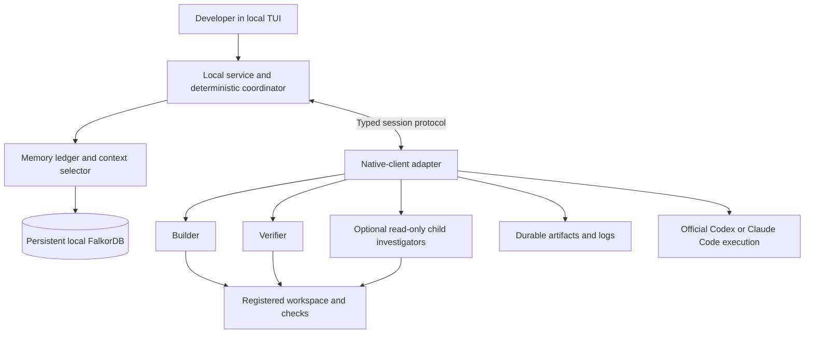

# Threadline: consolidated Track 2 architecture and delivery decision

**Revised recommendation, 13 October 2026.** The user selected Track 2, confirmed four members including two DevOps teammates, and proposed a local TUI using native subscriptions. Current authentication documentation supports investigating that route. Prefer local TUI/native clients over the preceding web-first recommendation. This is research and planning: no application, package, login test, deployment, integration or benchmark exists yet.

## Product and delivery decision

Build **Threadline** (working name): a developer's persistent workspace for finishing agent-driven coding tasks across interruptions, changed requirements and fresh sessions. Use an official native coding client through a tested programmatic adapter for execution. FalkorDB governs task context, memory applicability, ownership, handoffs and evidence; a deterministic coordinator enforces the protocol.

**Primary delivery:** a local npm package with a TUI, coordinator, persistent FalkorDB and one tested native-client adapter. Demonstrate real Builder/Verifier sessions on the authored public inventory-export fixture. Codex is the first adapter candidate; Claude Code follows its own capture/recovery gate. A website or Railway-hosted memory endpoint is optional later. The package name is unreserved; universal harness compatibility is not established.

The complete product must demonstrate working agents shaped by graph context. Live deployment is preferred by the organizers; complete local setup and a working video are accepted alternatives. [Official challenge and delivery guidance](https://www.wemakedevs.org/hackathons/falkordb)

## Architecture at a glance



The TUI is the frontend; native clients retain their model/tool loops and authentication. These are logical modules, not a separate service for every box. Local application state remains distinct from the provider's remote model inference.

### 1. TUI, local service and coordinator

Use a terminal interface backed by a TypeScript local service. The service owns project/principal routing, typed memory operations, task claims, revisions, handoffs, resource budgets, refresh delivery and completion acceptance. Native-client adapters launch and observe supported sessions; closing a TUI view must not delete persisted memory.

One API/coordinator instance is sufficient for the first demonstration. Application state lives in FalkorDB, so a restart can reconcile unfinished work. TUI views display recorded events; they are not the task authority. Only this service has database credentials; agents and local workers never receive them.

### 2. Memory ledger and context selector

These are backend modules. The ledger commits validated state changes and keeps source history. The selector retrieves current mandatory constraints, relevant dependency/evidence paths and applicable earlier experiences within a declared context budget.

Start from task/artifact IDs, use indexed bounded traversals, and explain why each item was included. Optional full-text/semantic recall can supplement this closure. Mandatory authority must not depend on similarity ranking; required-context overflow is explicit. No separate vector store or model-based memory-curator role is needed for the first workflow.

### 3. Native-client adapters and tools

First test a TypeScript adapter to local Codex app-server over stdio. The native client retains its login, model/tool loop and permission handling. The adapter records observable events, supplies graph context, handles approvals and starts fresh sessions. Claude Code uses its documented programmatic CLI/plugin/hook interfaces; it requires its own version/capture probe. Do not add an independent generic SDK/model runtime to the critical path.

Builder plans, investigates and edits one authorized worktree. Verifier checks a separate candidate snapshot using a tested host tool/permission profile that disables editing while allowing declared checks. Independent tests supply observable acceptance evidence; a favorable model verdict alone does not complete a task.

Native repository tools remain under host permissions. Validate any pre-tool guards; isolate writer worktrees and check candidate digests during integration. The older custom SDK edit/run wrapper is a fallback proposal, not a guarantee around native tools. Typed memory operations remain retrieve, checkpoint, propose decision and refresh. Verifier submits evidence; Builder requests completion. The service owns actual claims/handoffs/completion. See [Codex adapter](track2-codex-subscription-local-adapter.md), [Claude adapter](track2-claude-subscription-local-adapter.md) and the [earlier tool vocabulary](track2-agent-tools-and-execution-plan.md).

### 4. FalkorDB and artifacts

Choose **one graph per `(tenant, project)`**. Trusted backend identity and membership resolve an opaque project ID to its graph key. Worktrees are deliberately registered beneath that project. This keeps project revisions, Events and receipts within one atomic mutation domain while separating other tenants/projects. Source/message visibility still needs application authorization; a tenant property alone is not access control. [ACL reference](https://docs.falkordb.com/commands/acl), [core contract](track2-architecture-core-contract.md)

FalkorDB stores goals, constraints, decisions, tasks, attempts, procedures, sessions/messages, findings, artifact versions, receipts and delivery metadata. Actual code and large immutable logs remain on the registered worker's durable filesystem. Their digests, source references and applicability live in the graph. Small message/receipt payloads can be stored directly. A graph hash cannot recreate a missing file.

## Subscription authentication decision

Prefer client-managed authentication in the first adapter. Codex documents local app-server clients; its current OSS/local Sign in with ChatGPT flow additionally supports eligible plan-backed requests. Choose one tested path initially. [Codex research](track2-codex-subscription-local-adapter.md), [official OSS integration](https://developers.openai.com/cookbook/articles/sign-in-with-chatgpt)

Claude users authenticate directly to the official unmodified Claude Code binary. Third-party SDK/app authentication has distinct conditions. Do not implement a generic token-borrowing inference route. [Claude research](track2-claude-subscription-local-adapter.md)

Provider limits apply to every worker sharing an allowance. Run controls must show limit errors, bound concurrency and queue or pause work. Code/memory/session management can remain local while inference still calls the provider. No subscription or login was exercised during this research.

## How the three memory types are created

**Episodic:** the worker automatically captures visible messages, tool calls/results, failures, checkpoints, requirement changes and handoffs. Each observation links to its session, task and relevant artifact version. A successor can retrieve a previously failed approach and its actual result.

**Semantic:** accepted user goals/constraints, scoped facts and decisions. Agent-generated findings start as proposals or observations; acceptance requires the declared evidence/policy. Preserve supersession, contradiction and source provenance. Neither repeated assertions nor majority agreement establish truth.

**Procedural:** one reusable workflow with steps, preconditions, environment/artifact scope and supporting successful receipts. Demonstrate reuse on a held-out compatible task and record its new result. Changed prerequisites require adaptation or revalidation. Broad automatic procedure learning is secondary.

**Conversation history:** ordered Session/Message records and tool-source references survive sessions and service restarts. Summaries supplement source history. Only observable content is recorded; hidden reasoning and events never captured cannot be restored. Missing capture remains visible.

A typical relationship sketch is:

`Session → Message → sourced Decision/Constraint → Task → Attempt → ArtifactVersion → VerificationReceipt`

A Procedure links to supporting attempts and applicability. Worker context records identify which revisions and sources were actually inserted.

## State transitions, sharing and handoff

For critical business changes, one guarded graph mutation commits the state delta, new revision, Event and idempotent request receipt. Validate current owner, expected revision, project scope and evidence. Single-query atomicity is the foundation; a multi-query workflow or external process is a separate boundary. [FalkorDB concurrency](https://docs.falkordb.com/design/concurrency)

Use persisted Events as the delivery outbox. Notifications tell recipients to pull updates. Cursors, replay and context-insertion acknowledgements recover dropped notifications and reconnects; request/event IDs deduplicate retries. Acknowledgement demonstrates insertion, not correct model use. The query command's schema-cache version is not an application task revision.

A changed requirement creates a new source-bound version. Traverse recorded dependencies to affected decisions, tasks, receipts and workers that loaded those items. Refresh them at supported boundaries and reject old completion evidence. Unknown dependency coverage remains explicit; a changed artifact means revalidation, not necessarily broken code.

Fresh continuation stops/reconciles the old worker, flushes captured observations, marks uncertain outcomes and starts a genuinely new native-client session. Its initial packet contains current goals/constraints, unfinished work, applicable decisions, failed attempts and procedures. It inspects actual artifacts before acting and obtains current ownership. Copying the old transcript is not this fresh-session proof.

Database ownership guards do not prevent an already-running external command from changing files. One editable Builder, controlled tools and candidate-version checks keep that boundary narrow. Unknown tool outcomes must be reconciled before repetition. During loss of authoritative service access, stop admitting guarded work and reconnect; do not invent a successful commit.

## Bounded spawning extension

After two-role recovery works, Builder may request narrow read-only investigations. The service validates prerequisites, existing work, source/tool scope, depth and budget; record the child and launch intent before the runtime starts it. Reconcile uncertain launch outcomes using stable identifiers.

Use **four live model workers globally within a run**, across worker hosts and every subtree, including Builder, Verifier and waiting parents. Depth one in core: children cannot spawn. At most two children can be live alongside both core roles. Depth two remains stretch. Model/token/cost reservations and lifetime bounds apply across retries and recovery replacements.

Children publish compact findings with source/artifact versions. Graph relationships identify relevant recipients; independent draft hypotheses retain their own scope. A failed child can be replaced by a fresh session with current requirements and earlier applicable evidence. Spawning remains optional until matched-budget sequential/flat comparisons show a useful benefit. [Bounded-spawning proposal](track2-bounded-swarm-product-extension.md), [sharing reliability](track2-swarm-memory-reliability.md), [RLM analysis](track2-recursive-language-models-and-swarms.md)

## Local TUI interaction and package

The TUI shows current goal/criteria and tasks, captured activity/history, and a source/evidence inspector. User controls are start, pause at a supported boundary, update a requirement, answer an ambiguity, continue fresh and review the final patch. Child task cards can appear in the same workspace when enabled. A small relevant graph path explains restoration or invalidation; a full graph editor is unnecessary for this job.

**Local demonstration:** run readiness/setup, select the authored fixture, use one authenticated supported client, then start Builder/Verifier. Keep persistent graph data and artifacts after exiting. The TUI lets the user inspect a decision, change a requirement and continue fresh without writing a handoff recap.

Illustrative commands only; no package exists:

```text
npx <package> doctor
npx <package> init --workspace <permitted-path>
npx <package> tui
```

Prerequisites are Node/npm, a tested native client with eligible authentication, and either Docker for the pinned FalkorDB service or a configured endpoint. Diagnose them explicitly; npx does not silently supply them. Database persistence needs an effective data directory, AOF/RDB settings and restart tests. Preserve local logs/worktree artifacts separately from graph references.

The critical first gate is one real native turn, captured tool outcome, allowed/denied permission interaction and a fresh successor using current graph memory. Native history/resume and Codex's persisted goal features are baseline capabilities; our additional value must be source-bound applicability, changed-evidence invalidation and shared context.

A Railway website, read-only results viewer or authenticated remote memory service can be added after the local workflow works. The [earlier Railway deployment plan](track2-railway-deployment-plan.md) is a secondary topology, not the current launch prerequisite. Local setup and a working terminal video remain an accepted delivery route. [Official overview](https://www.wemakedevs.org/hackathons/falkordb)

## Track 2 acceptance evidence

- **Episodic, semantic, procedural:** recall a failed attempt, apply a changed constraint, and reuse a tested procedure on a held-out task with checked prerequisites.
- **Persistent history:** restart service/session, recover ordered history and inspect a restored decision's original source.
- **Shared state/handoffs:** Builder-to-fresh-successor continuation plus independent Verifier evidence, selective refresh and obsolete-result rejection.
- **Concurrent reads/writes:** 4/8/16 real or simulated protocol clients against read-heavy, balanced and burst workloads. Label simulations separately from 2–4 actual agents. Report throughput, p50/p95 request/delivery latency, queue pressure, conflicts, retries and invariant failures. Same-graph writes serialize; no latency result is assumed.
- **Tenant separation:** two identities with colliding names/IDs; deny cross-tenant reads/writes and source/artifact access. Within one authorized project, share only applicable permitted memory.

These are proposed demonstration criteria, not organizer-specified numerical thresholds. Compare graph context against equally informative versioned JSON/files under the same model, tools, context/spend budget and interruption schedule. Test duplicate submissions, dropped notifications, late obsolete results, worker/service restarts and uncertain actions. Task correctness and delivery throughput are distinct measurements.

## Integration effort and quality gates

**Planning estimates, not measured development times or runtime latency.** Assume an experienced engineer with AI assistance, an installed authenticated eligible client, available model allowance and the narrow architecture above. Installation, account restrictions, schema drift and incomplete graph APIs can extend the schedule.

- A packaged user's normal connection/setup target is **5–15 minutes**, excluding initial client/database downloads and troubleshooting.
- A first programmatic coding turn with observed tool output is estimated at **1–3 engineer-hours**.
- One dependable narrow native adapter is estimated at **1–2 working days**; this includes capture, permissions, interruption and fresh-session integration, and assumes the memory-service contract is available.
- Both clients plus graph integration and evaluation are estimated at **3–5 elapsed days** with four people working in parallel. This is a risky fit for the four-day event, so one deeply tested adapter is the required path and the second is gated. Full TUI polish or additional scope can take longer.

Use native client-managed authentication initially. Implementing a separate OAuth lifecycle is another work item. Timebox the initial compatibility probe to three hours: require a real turn, recorded tool result and terminal success/failure status. If blocked, assess a simpler supported native surface or the other client against the same gate. Do not count a mock reply as integration.

Quality is three separate questions:

1. **Model/output:** compare our adapter with memory disabled against ordinary native execution, matching model, reasoning settings, tools, permissions and budget. Native history/goal features belong in the baseline. Preserve actual task acceptance results, not claims of completion.
2. **Adapter:** check event/session IDs, completed versus failed/interrupted status, allowed and declined approvals, visible capture gaps, cancellation and reconnect. Pin and test the actual client version. A correctly parsed final message alone is insufficient.
3. **Memory/coordination:** test held-out requirement changes, genuinely fresh successors, applicable earlier failures/procedures, obsolete receipts, lost notifications, duplicate submissions and tenant isolation. Use executable acceptance assertions tied to the tested artifact revision. Independent Verifier findings supplement those assertions.

Keep a small scripted fixture set covering normal work, interruption, changed requirements, stale completion, a contradicted finding, failed procedure prerequisites, denied permissions, restart/replay and cross-tenant access. Repeat critical cases, report counts/failures and compare against equally informed native and versioned-file baselines. No model accuracy or zero-error guarantee follows from a passing small sample. The first build milestone is native-parity capture plus actual fresh-session graph recovery; spawning follows it.

Measure wrapper startup, graph retrieval, time to first model output and complete task time separately. No numerical inference latency or overhead claim exists yet. Detailed estimate: [Codex adapter research](track2-codex-subscription-local-adapter.md).

## Four-person ownership and delivery gates

- **Engineer 1:** typed graph ledger, applicability/context selection and coordination protocol; joint native-adapter integration.
- **Engineer 2:** TUI workflow, agent behavior, fixtures, current acceptance checks and evidence presentation.
- **DevOps 1:** local Docker/database packaging, trusted service access, persistence, clean setup and restore tests.
- **DevOps 2:** native process/worktree lifecycle, npm packaging, cancellation/recovery, release setup and load/fault probes.

These owners share integration tests; DevOps members own backend behavior as well as deployment. Agree protocol types early. During the event, Day 1 proves one real native-client/service/graph round trip and durable observation; Day 2 proves changed-requirement fresh recovery with Builder/Verifier; Day 3 verifies procedure/history/isolation/load and packages the same worker; Day 4 freezes, fixes, documents essential Cypher/setup and records the demo. Add child investigations or a second native adapter only after the first path works.

The main presentation is a real disrupted task completed correctly from current connected memory. Show the original source, obsolete receipt, selective refresh, recovered next action and current tests. The first implementation probe is one actual native-client action through the local adapter/service/FalkorDB path, followed by fresh-session recovery.

## Preparation boundary and companion evidence

The event starts 15 October 2026 at 12:01 AM IST. Main implementation/design is event-time work; notes and graph sketches are permitted preparation. Demonstration data is authored/public/synthetic under the reviewed rules. [Official rules](https://www.wemakedevs.org/hackathons/falkordb/rules)

Current delivery/authentication: [local TUI decision](track2-local-tui-delivery-decision.md), [Codex subscription adapter](track2-codex-subscription-local-adapter.md), [Claude subscription adapter](track2-claude-subscription-local-adapter.md).

Detailed audits: [core contract](track2-architecture-core-contract.md), [Railway plan](track2-railway-deployment-plan.md), [presentation/team decision](track2-presentation-and-team-decision.md), [tools](track2-agent-tools-and-execution-plan.md), [prior delivery feasibility](track2-delivery-feasibility-check.md). Earlier web/SDK-first portability and packaging notes remain research history; this document and the local-TUI decision supply the current ordering. Critical native contracts still need testing.
