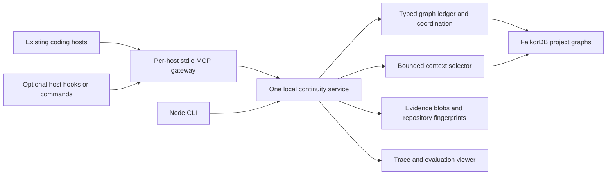

# Track 2 packaging: portable core, thin host adapters, four-person plan

**Research date: 2026-10-11.** Verified protocol/package facts are separated from the proposed design. No product code, installation or runtime spike was performed. Implementation begins only after the permitted event start. This proposal builds on [the continuity architecture](track2-continuity-architecture.md).

## Recommendation

Ship an **attachable Node CLI and MCP memory service backed by FalkorDB**. Keep coding/model execution in Codex, Claude Code, OpenCode or Hermes. Build a small controlled evaluation runner, rather than making a new general-purpose coding-agent harness the product.

The initial product promise is: “Connect a project, record evidence-backed checkpoints, restore a bounded task context, and exchange explicit handoffs.” Automatic capture, automatic restoration and launching other agents are host-adapter capabilities, not universal consequences of installing an MCP server.

| Packaging choice | Work we own | Assessment for four people/four days |
| --- | --- | --- |
| Own coding harness | Model/tool loop, permissions, shell/files, interruption, context management, worker lifecycle and memory | Maximum control, but too much unrelated infrastructure for this MVP. Useful only as a constrained benchmark driver. |
| Portable memory core + adapters | Typed ledger, task closure, sharing, coordination, transport/configuration and host-specific capture hooks | Recommended. Existing hosts retain their coding experience; each adapter has an explicit capability boundary. |
| Pure JavaScript library | Functions a harness developer imports | Useful internal interface, but an existing host does not automatically import it. Pair it with a CLI/MCP surface. |

## Verified interoperability boundaries

MCP separates host orchestration from server capabilities; servers should receive necessary context rather than the entire conversation. Tools expose callable operations, while the host controls incorporating resources. Therefore a memory server alone cannot globally intercept every host's tokens, compaction or session lifecycle, or force a restore packet into its prompt. This is an inference from the protocol's ownership boundaries. [Architecture](https://modelcontextprotocol.io/specification/2026-07-28/architecture), [Tools](https://modelcontextprotocol.io/specification/2026-07-28/server/tools), [Resources](https://modelcontextprotocol.io/specification/2026-07-28/server/resources)

No standard MCP primitive is a Codex/Claude/OpenCode/Hermes worker launcher. A custom tool can launch a worker **if our implementation invokes a supported host API/CLI**; that is additional orchestration. Sampling requests a model generation through a supporting client, not arbitrary host-session control. Sampling is deprecated in the current protocol, so avoid making it a dependency. [Sampling](https://modelcontextprotocol.io/specification/2026-07-28/client/sampling)

Current `/latest` MCP docs resolve to **2026-07-28**, which uses per-request version/capability metadata. Older clients use an initialization handshake. Dual-era servers are allowed, but old/new interoperability is not automatic. TypeScript SDK main is stable v2 (`@modelcontextprotocol/server`, `@modelcontextprotocol/client`); legacy v1.x uses `@modelcontextprotocol/sdk`. Pin a tested SDK/protocol profile for the actual host versions. Do not combine API examples from both generations. [Compatibility](https://modelcontextprotocol.io/specification/2026-07-28/basic/versioning), [Official SDK](https://github.com/modelcontextprotocol/typescript-sdk)

Roots are informational, not filesystem access control, and deprecated in the current revision. Use explicit configured project identity and authorized paths. [Roots](https://modelcontextprotocol.io/specification/2026-07-28/client/roots)

`npx`/`npm exec` runs a package executable and may fetch it into npm's cache. It does not provision a database, register every host or provide credentials merely by invoking the package. Database setup must be our explicit CLI feature or an existing endpoint. [npm exec](https://docs.npmjs.com/cli/v11/commands/npm-exec/), [FalkorDB Docker deployment](https://docs.falkordb.com/operations/docker)

## Proposed architecture

Use one shared local service for concurrent clients. Stdio gateways are thin processes launched by hosts; closing one gateway must not shut down the shared service or delete memory. All gateways and optional hooks use the same domain API. The service owns database credentials, revisions, authorization, idempotency and mutation coordination. It does not issue unrestricted model-generated Cypher.

For the MVP, the gateways can use an authenticated loopback API to the service. This internal API is not itself a claim of remote MCP support. Direct Streamable HTTP and remote multi-user deployment can follow after transport/authentication compatibility is tested. Stdio reserves stdout for MCP messages; logs belong on stderr. [Stdio binding](https://modelcontextprotocol.io/specification/2026-07-28/basic/transports/stdio)

## Planned user setup

These are proposed subcommands, not existing commands or a published package:

1. **`doctor`** checks Node/npm, selected host versions, protocol compatibility, database reachability and configured persistence.
2. **`init`** creates a project UUID, canonical workspace registration and non-secret configuration. It offers an existing FalkorDB endpoint or explicit Docker setup when Docker is available.
3. **`serve`** starts the shared local service; a versioned discovery record and authenticated health check identify it. Two concurrent starts must resolve to one service or fail clearly.
4. **`mcp`** runs a gateway attached to that service/project. Host-specific configuration names this executable and its reviewed arguments/environment.
5. **`status` / `resume`** show recorded task state or return the same restore packet exposed to agents.

Node/npm and a running FalkorDB endpoint remain real prerequisites. Docker is required only for the Docker option. Use a mounted data directory and deliberate persistence configuration. Package/SDK/engine versions should be pinned for judging; a tarball or local package is an acceptable fallback if registry publication is unavailable. No new runtime installation is assumed to be authorized before the event.

## Shared contract: identity, operations and failures

**Proposed identity:** credentials resolve to a tenant and permitted project; a persisted project UUID distinguishes clones from intentionally shared worktrees. Register additional worktrees explicitly. A remote URL, directory basename, MCP connection ID or model-provided actor name is not adequate authorization. The gateway receives a server-issued actor/session identity; the service derives its graph key.

The local service keeps credentials outside repository files and tool results. Authenticate loopback requests too; validate configured paths and reject arbitrary outside-file evidence access. MCP HTTP authorization and stdio credentials have different transport conventions; do not treat a protocol session identifier as a credential. [Authorization](https://modelcontextprotocol.io/specification/2026-07-28/basic/authorization)

**Domain operations:** `restore_task`, `checkpoint_task`, `record_attempt`, `publish_memory`, `claim_task`, `offer_handoff`, `accept_handoff`, `verify_completion`. Read tools return bounded typed context and evidence references; mutation tools enforce permitted transitions. No raw-query or arbitrary command tool is needed.

Each mutation carries an application request ID, expected task revision and—where ownership matters—a fence. Return a durable receipt or a typed error such as `CONFLICT`, `UNAUTHORIZED`, `STALE_ARTIFACT`, `NOT_INITIALIZED`, `DB_UNAVAILABLE` or `BUDGET_OVERFLOW`. A repeated request ID must yield the original outcome. A JSON-RPC request ID is not the application's idempotency key. Concurrent client connections must not share mutable actor/project state.

The service implements guarded atomic ledger transitions and evidence checks described in the architecture report. Database serialization does not serialize outside file edits: use isolated worker workspaces and guarded integration. Closing/restarting a host leaves persisted task state intact; expired claims and unknown tool outcomes require reconciliation.

## Four parallel team contracts

Freeze domain schema, operation inputs/outputs, fixture events and errors together on Day 1. Each owner builds against the same contract and can use fixture responses while dependencies are unfinished. Allocate by module, not one person per host.

| Owner | Exclusive responsibility and interface | Acceptance evidence |
| --- | --- | --- |
| 1 — graph ledger | FalkorDB persistence, identity mapping, event/current-state projection, guards, claims/handoffs and publication. Exposes domain operations; contains every Cypher mutation. | Duplicate retries, stale revisions/fences, competing claims, tenant denial and restart recovery pass. |
| 2 — context selection | Task closure, relevance/validity rules, evidence fingerprints, mandatory/optional budgeting and explanation of included context. Consumes a scoped read interface; returns a versioned `ContextPack`. | Preserves governing constraints, excludes unrelated/private data and rejects stale test evidence under a fixed budget. |
| 3 — distribution/adapters | Node CLI, shared-service bootstrap, MCP gateway, schema transport, host configuration and optional capture/restore hooks. Calls the domain API; contains no graph business rules. | Two real hosts perform tool round trips and fresh-session restore; remaining hosts are claimed supported only after the same checks. Stdio stays clean; multiple gateways share one service. |
| 4 — evaluation/demo | Authored fixture repository, interruption/race cases, JSON/vector baselines, trace viewer, reproducible setup and integration. Consumes receipts/context; does not bypass core guards. | Independent task tests, privacy/conflict cases, matched-input baselines and a repeatable cross-host handoff trace. |

Each adapter declares a capability record: tool connectivity, explicit restore, explicit checkpoint, session-start automation, pre-compaction capture, post-tool observation and worker launch. Mark each **tested**, **manual**, **unsupported** or **unverified**. Codex/Claude/OpenCode/Hermes can share the core without claiming identical automation. Hooks map available host events into typed observations; they do not redefine the ledger.

Day 1 completes contracts/core probes; Day 2 demonstrates recovery in one real host; Day 3 adds a second host, sharing and races; Day 4 verifies remaining claimed adapters, compares baselines and rehearses setup. Drop optional hooks before dropping core correctness or independent verification.

## Limits and decision gate

A server can remember only submitted/observed information. It cannot reliably measure an opaque host's complete context/token use. A resource notification does not force restoration. Registering an MCP server does not stop stale native filesystem writes or create multiagent orchestration. A portable npm executable still needs per-host configuration, a compatible runtime and database access.

Approve the portable direction if two distinct hosts can resume the same recorded task through the shared API with a bounded context pack and verified artifacts. Expand automation only where a tested adapter supports it. The small evaluation runner should establish repeatability; the product should remain the attachable memory/coordination core.

## Coverage of all five Track 2 requirements

**Design coverage: yes, with the additions below. Demonstrated coverage: none yet.** These are explicit MVP requirements, not implementation or performance claims.

| Requirement | Required core behavior and proof |
| --- | --- |
| Episodic, semantic and procedural memory | Episodic `Event`/`Attempt` records link observations, actions, results and their source messages/tool receipts. Semantic goals, constraints, decisions and facts are typed, scoped and source-backed; distinguish assertions, proposals and verified observations. Add one candidate `Procedure` with applicability conditions and provenance; verify it on a later held-out coding task before marking it validated. |
| Persistent conversation history | Add `Session` and `Message` nodes: stable IDs, actor/role, per-session sequence, recorded timestamp, visibility, content/blob digest and source links to the derived events/facts. Preserve authorized message text, not just a lossy summary. The adapter must actually submit or import the messages; MCP alone does not observe the full conversation. Demonstrate reconstruction after host closure and service/database restart. |
| Shared state and handoffs | Persist authoritative task revisions, owner/fence, checkpoint, dependencies, artifact evidence and offer/accept receipts. Two clients must observe an accepted handoff; stale-owner completion and duplicate retries must be rejected or resolve to the original receipt. Private history is shared only through explicit publication. |
| High-concurrency reads/writes | Proposed measurement: **32 simulated clients**, a declared mixed restore/append/claim workload, first against one shared project graph and then separate tenant graphs. Report request mix, dataset size, hardware/configuration, throughput, p50/p95 latency, unexpected errors and correctness failures. Expected stale-version conflicts are reported separately. Same-graph writes serialize; this is not a claim of 32 parallel writers or guaranteed throughput. |
| Per-user/per-tenant separation | Authenticated principals resolve to permitted graph/project scopes; sessions and citations inherit source-access rules. Reuse identical task/message IDs across two tenants and verify that reads, writes, restoration and evidence access cannot cross the boundary. Separate users within one shared organization require application authorization too. |

**Recovery acceptance:** record messages, an attempt, current task state and a handoff; capture their receipts; close the host and restart the service/database under the declared persistence configuration. Verify the restored sequence, current state and evidence digests. Also interrupt a write acknowledgment, retry its application request ID and verify no duplicate event. State what crash-durability settings were tested; a graceful restart alone does not prove power-loss durability.

**Procedure acceptance:** a candidate such as “inspect both API and CLI dependents before changing their shared helper” must affect a later task's selected checks, pass independent tests, and retain its source/evidence. Compare against the same task without that remembered procedure. Do not promote a single successful anecdote into an unconditional rule.

**Architectural conflicts to resolve:** full-history persistence needs an explicit host capture/import path and can conflict with private scratch separation if everything is published by default. Per-user privacy inside a shared graph needs backend checks beyond graph-key ACLs. A local singleton service supports concurrent clients on one machine, but remote team clients need a separately authenticated deployment or tunnel design. In-process mutation coordination does not solve multiple-service deployment; atomic graph guards remain necessary. Protocol disconnects are not task boundaries, and serialized writes cannot be presented as unrestricted write parallelism. These additions fit the portable core; automatic capture across all hosts and remote deployment remain separate adapter/deployment scope.
