# Threadline detailed Mermaid diagram atlas

**Proposed owned-harness architecture, 15 October 2026.** These diagrams accompany [the final architecture](track2-final-architecture.md), [harness scope](track2-harness-scope.md), and [database model](track2-data-model.md). Solid/dotted lines distinguish ordinary and optional/asynchronous paths where indicated by labels; they do not imply a cross-store transaction. Native clients and SIWC are post-hackathon compatibility routes. The MVP has one logical Builder and a protected service checker. Target extension diagrams are references, not an implementation checklist. See the development blueprint.

Schema panels include every declared field. External entities are repeated as minimal anchors where needed; full fields live on their home panel. SQL FK optionality is derived from nullable columns. Graph associations use generic many-to-many marks; exact cardinalities and invariants are defined in the [graph dictionary](schema/graph-field-dictionary.md), not inferred from these association marks.

## Architecture and lifecycle

### Master Architecture

[Standalone source](diagrams/master-architecture.mmd)

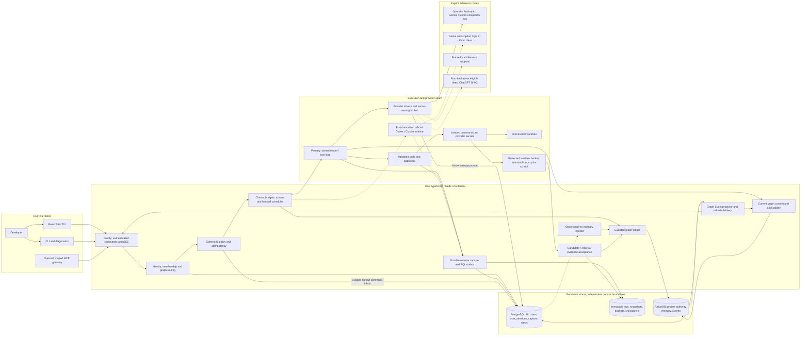

### Backend Modules

[Standalone source](diagrams/backend-modules.mmd)

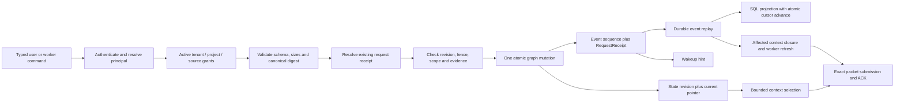

### Owned Runtime Loop

[Standalone source](diagrams/owned-runtime-loop.mmd)

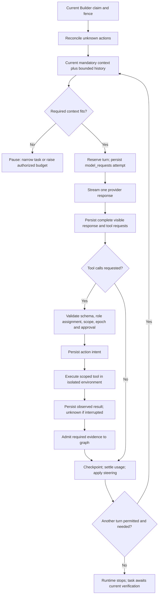

### Identity And Sessions

[Standalone source](diagrams/identity-and-sessions.mmd)

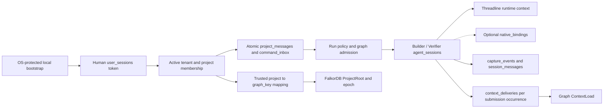

### Sql Graph Reconciliation

[Standalone source](diagrams/sql-graph-reconciliation.mmd)

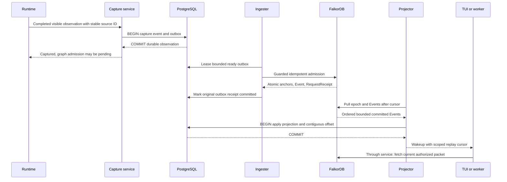

### Fresh Session Recovery

[Standalone source](diagrams/fresh-session-recovery.mmd)

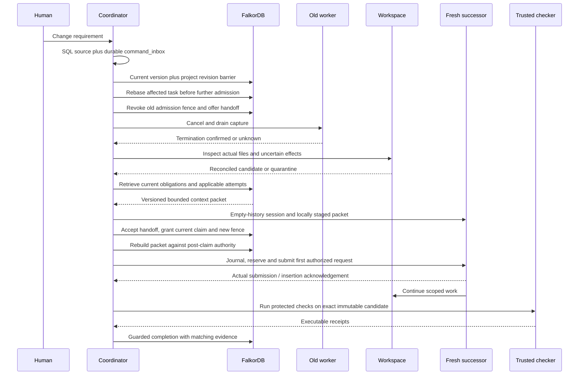

### Requirement Invalidation

[Standalone source](diagrams/requirement-invalidation.mmd)

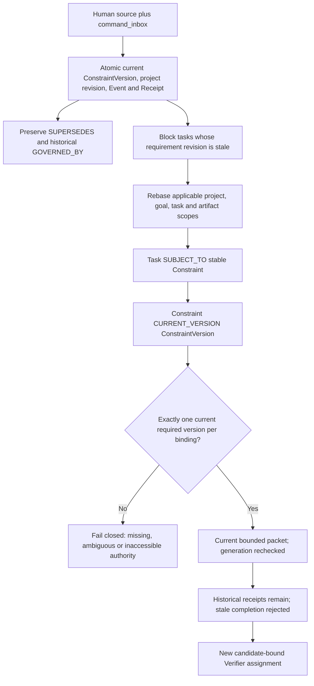

### Bounded Spawning

[Standalone source](diagrams/bounded-spawning.mmd)

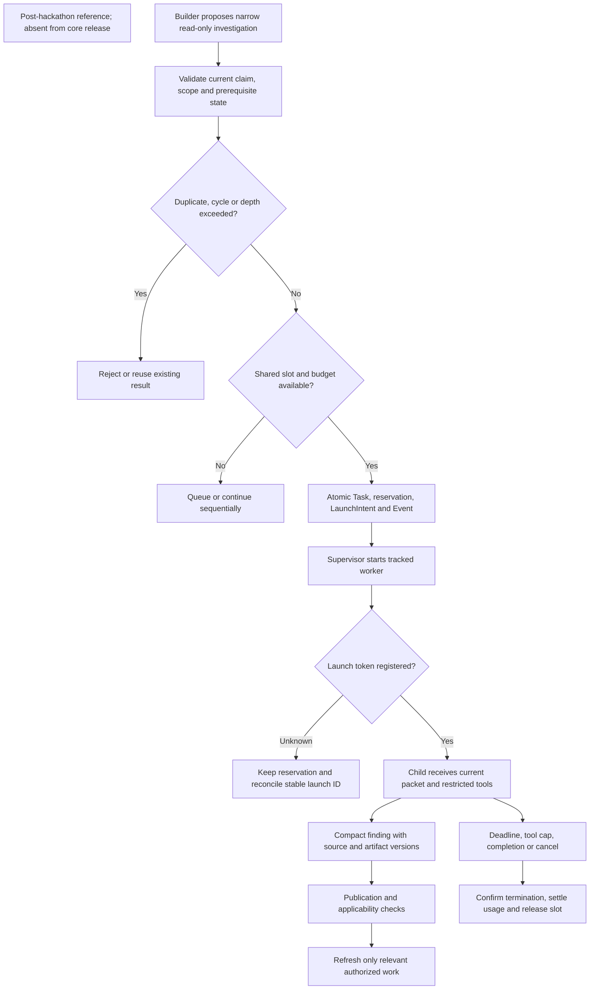

### Provider Routes

[Standalone source](diagrams/provider-routes.mmd)

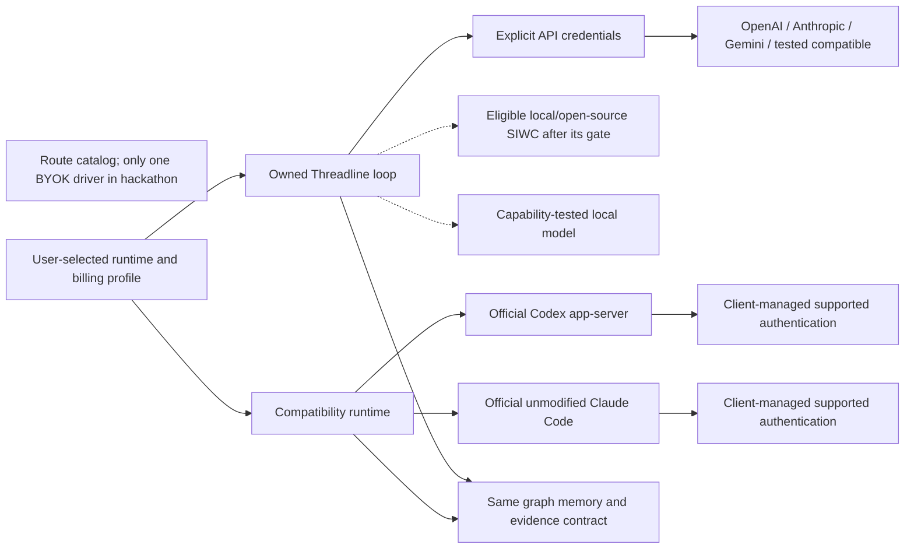

### Completion And Integration

[Standalone source](diagrams/completion-and-integration.mmd)

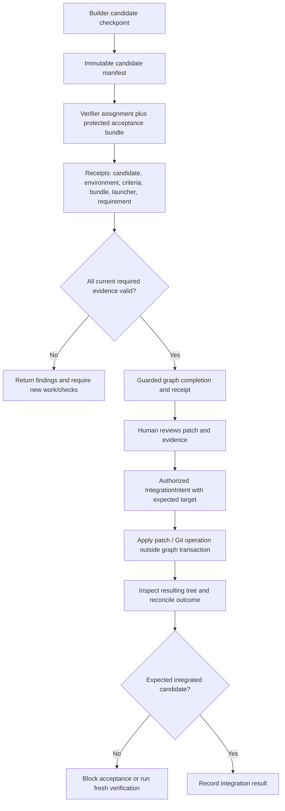

### Deployment

[Standalone source](diagrams/deployment.mmd)

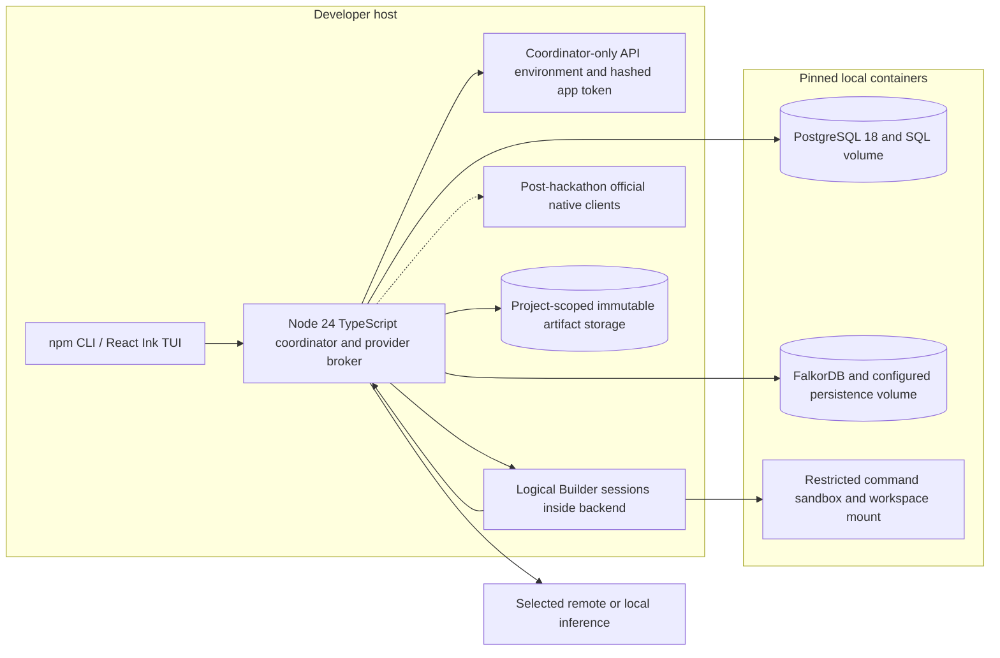

### State Machines

[Standalone source](diagrams/state-machines.mmd)

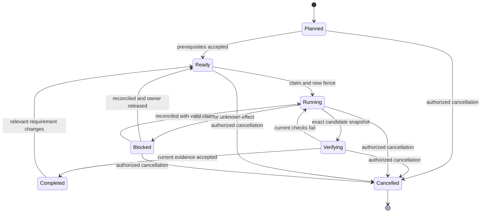

### Chatgpt Oauth

[Standalone source](diagrams/chatgpt-oauth.mmd)

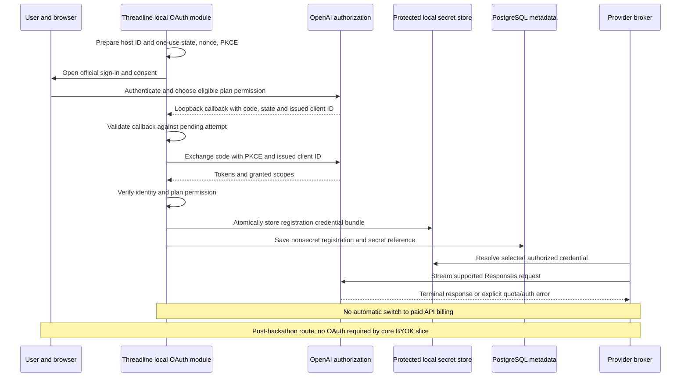

### Command Recovery

[Standalone source](diagrams/command-recovery.mmd)

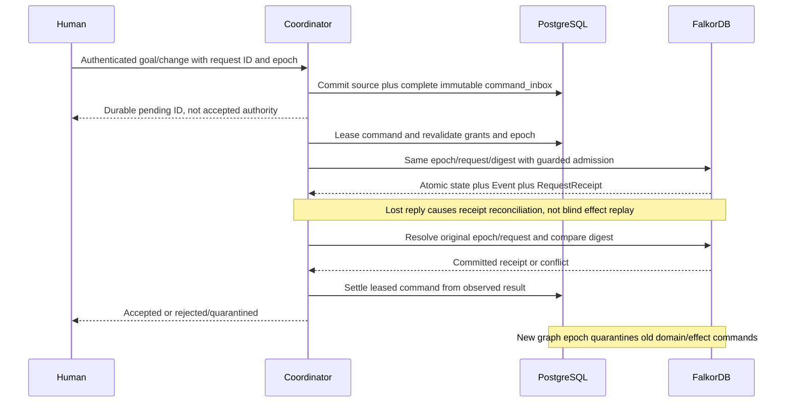

### Privacy Revocation

[Standalone source](diagrams/privacy-revocation.mmd)

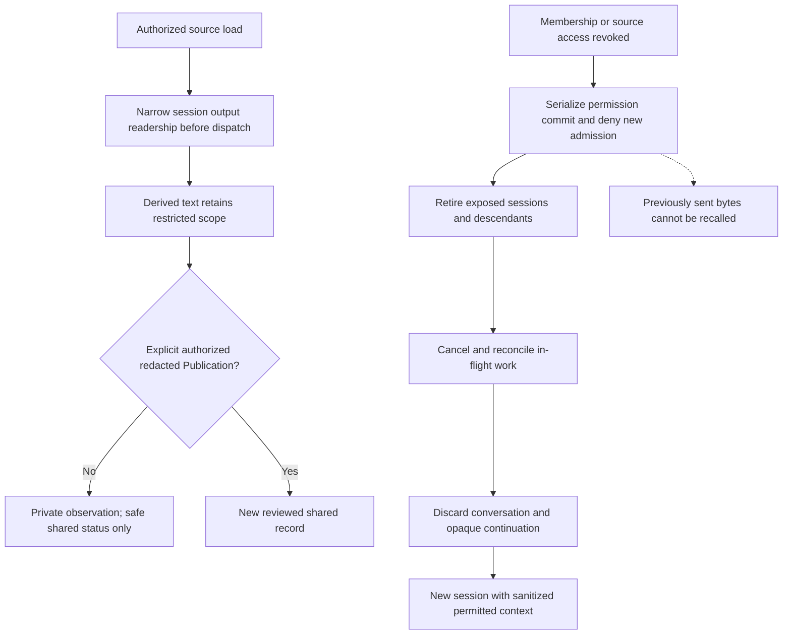

### Harness Tool Surface

[Standalone source](diagrams/harness-tool-surface.mmd)

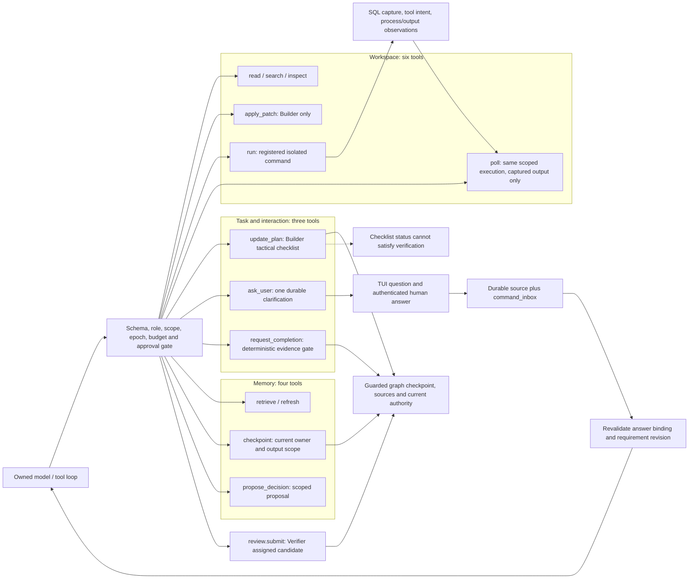

### Development Mvp

[Standalone source](diagrams/development-mvp.mmd)

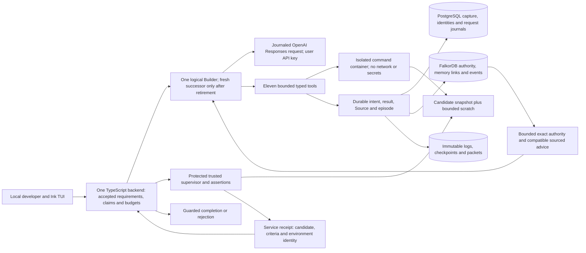

### Checkpoint Recovery

[Standalone source](diagrams/checkpoint-recovery.mmd)

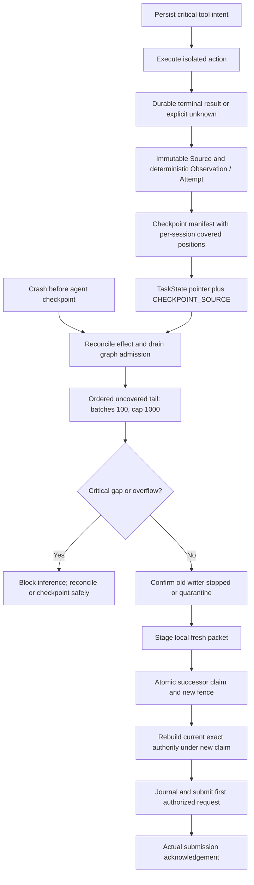

### Tool Surface

[Standalone source](diagrams/tool-surface.mmd)

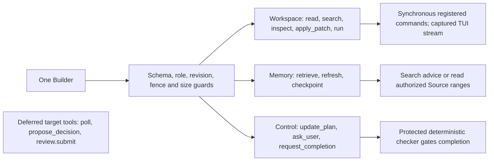

## Relational schema

### Sql Identity

[Standalone source](diagrams/sql-identity.mmd)

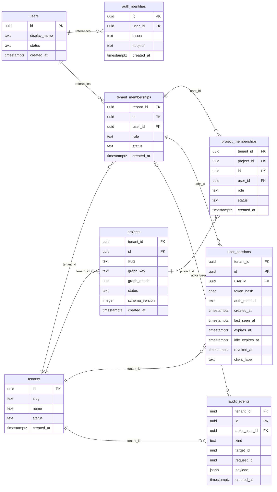

### Sql Execution

[Standalone source](diagrams/sql-execution.mmd)

```mermaid
erDiagram
    direction LR
    worker_hosts {
        uuid tenant_id FK
        uuid id PK
        uuid user_id FK
        text name
        char credential_hash
        timestamptz credential_expires_at
        uuid boot_id
        jsonb allowed_roots
        jsonb capabilities
        timestamptz last_seen_at
        timestamptz revoked_at
        timestamptz created_at
    }
    workspace_registrations {
        uuid tenant_id FK
        uuid project_id FK
        uuid id PK
        uuid host_id FK
        text canonical_path
        char repository_fingerprint
        text kind
        text status
        text base_commit
        timestamptz created_at
    }
    runs {
        uuid tenant_id FK
        uuid project_id FK
        uuid id PK
        uuid initiated_by FK
        uuid initial_profile_id FK
        jsonb policy
        char policy_digest
        text observed_status
        uuid projected_epoch
        bigint projected_seq
        timestamptz created_at
        timestamptz finished_at
    }
    agent_sessions {
        uuid tenant_id FK
        uuid project_id FK
        uuid id PK
        uuid run_id FK
        uuid task_graph_id
        uuid parent_session_id FK
        uuid profile_id FK
        uuid workspace_id FK
        text role
        text authorization_kind
        jsonb authorization_manifest
        char authorization_digest
        text runtime_status
        bigint capture_seq
        timestamptz started_at
        timestamptz ended_at
        timestamptz created_at
    }
    native_bindings {
        uuid tenant_id FK
        uuid project_id FK
        uuid id PK
        uuid agent_session_id FK
        text native_session_id
        text native_runtime
        text native_version
        char protocol_digest
        text mode
        timestamptz created_at
    }
    launch_attempts {
        uuid tenant_id FK
        uuid project_id FK
        uuid id PK
        uuid agent_session_id FK
        uuid launch_graph_id
        uuid host_id FK
        integer attempt_no
        bigint process_id
        text process_start_identity
        text status
        timestamptz created_at
        timestamptz reconciled_at
    }
    tenant_memberships ||--o{ worker_hosts : "user_id"
    tenants ||--o{ worker_hosts : "tenant_id"
    worker_hosts ||--o{ workspace_registrations : "host_id"
    projects ||--o{ workspace_registrations : "project_id"
    provider_profiles ||--o{ runs : "initial_profile_id"
    project_memberships ||--o{ runs : "initiated_by"
    projects ||--o{ runs : "project_id"
    runs ||--o{ agent_sessions : "run_id"
    provider_profiles ||--o{ agent_sessions : "profile_id"
    workspace_registrations ||--o{ agent_sessions : "workspace_id"
    agent_sessions o|--o{ agent_sessions : "parent_session_id"
    projects ||--o{ agent_sessions : "project_id"
    agent_sessions ||--o{ native_bindings : "agent_session_id"
    projects ||--o{ native_bindings : "project_id"
    agent_sessions ||--o{ launch_attempts : "agent_session_id"
    worker_hosts ||--o{ launch_attempts : "host_id"
    projects ||--o{ launch_attempts : "project_id"
```

### Sql Providers

[Standalone source](diagrams/sql-providers.mmd)

```mermaid
erDiagram
    direction LR
    provider_accounts {
        uuid tenant_id FK
        uuid id PK
        uuid user_id FK
        text provider
        text runtime
        text auth_route
        text label
        text secret_ref
        text native_profile_ref
        timestamptz last_probe_at
        text probe_status
        timestamptz created_at
    }
    provider_profiles {
        uuid tenant_id FK
        uuid project_id FK
        uuid id PK
        uuid owner_user_id FK
        uuid provider_account_id FK
        text name
        text model_id
        text adapter_version
        text effort
        jsonb settings
        char config_digest
        timestamptz created_at
    }
    usage_ledger {
        uuid tenant_id FK
        uuid project_id FK
        uuid id PK
        uuid agent_session_id FK
        text source_key
        bigint input_tokens
        bigint output_tokens
        bigint cost_microunits
        char currency
        text precision
        uuid reservation_graph_id
        timestamptz observed_at
    }
    provider_oauth_registrations {
        uuid tenant_id FK
        uuid id PK
        uuid user_id FK
        uuid provider_account_id FK
        uuid host_id FK
        text issuer
        text subject
        text client_id
        text ext_agent_host_id
        text[] scopes
        text status
        bigint credential_version
        timestamptz validated_at
        timestamptz created_at
    }
    tenant_memberships ||--o{ provider_accounts : "user_id"
    tenants ||--o{ provider_accounts : "tenant_id"
    provider_accounts ||--o{ provider_profiles : "provider_account_id"
    projects ||--o{ provider_profiles : "project_id"
    agent_sessions ||--o{ usage_ledger : "agent_session_id"
    projects ||--o{ usage_ledger : "project_id"
    provider_accounts ||--o{ provider_oauth_registrations : "provider_account_id"
    worker_hosts ||--o{ provider_oauth_registrations : "host_id"
    tenants ||--o{ provider_oauth_registrations : "tenant_id"
```

### Sql History

[Standalone source](diagrams/sql-history.mmd)

```mermaid
erDiagram
    direction LR
    capture_events {
        uuid tenant_id FK
        uuid project_id FK
        uuid id PK
        uuid agent_session_id FK
        text source_key
        bigint capture_seq
        text kind
        jsonb payload
        char payload_digest
        uuid raw_artifact_id FK
        timestamptz observed_at
        timestamptz captured_at
    }
    session_messages {
        uuid tenant_id FK
        uuid project_id FK
        uuid id PK
        uuid agent_session_id FK
        uuid capture_event_id FK
        bigint message_seq
        text role
        text body
        uuid body_artifact_id FK
        char body_digest
        text visibility
        uuid owner_user_id FK
        boolean is_partial
        timestamptz created_at
    }
    tool_executions {
        uuid tenant_id FK
        uuid project_id FK
        uuid id PK
        uuid agent_session_id FK
        uuid capture_event_id FK
        text runtime_call_id
        text tool_name
        char input_digest
        uuid input_artifact_id FK
        uuid output_artifact_id FK
        text status
        integer exit_code
        char candidate_digest
        timestamptz started_at
        timestamptz finished_at
    }
    tool_approvals {
        uuid tenant_id FK
        uuid project_id FK
        uuid id PK
        uuid agent_session_id FK
        text runtime_request_id
        uuid tool_execution_id FK
        char request_digest
        jsonb request_payload
        text status
        uuid decided_by FK
        timestamptz expires_at
        timestamptz decided_at
        timestamptz created_at
    }
    capture_gaps {
        uuid tenant_id FK
        uuid project_id FK
        uuid id PK
        uuid agent_session_id FK
        bigint from_seq
        bigint to_seq
        text reason
        text status
        timestamptz created_at
    }
    project_messages {
        uuid tenant_id FK
        uuid project_id FK
        uuid id PK
        uuid author_user_id FK
        uuid user_session_id FK
        uuid run_id FK
        uuid request_id
        text body
        char body_digest
        text visibility
        timestamptz created_at
    }
    model_requests {
        uuid tenant_id FK
        uuid project_id FK
        uuid id PK
        uuid agent_session_id FK
        uuid logical_request_id
        integer attempt_no
        uuid profile_id FK
        uuid context_packet_id FK
        uuid input_artifact_id FK
        char input_digest
        char profile_digest
        uuid graph_epoch
        bigint requirement_revision
        uuid reservation_graph_id
        text provider_request_id
        text status
        uuid response_artifact_id FK
        text usage_source_key FK
        text failure_code
        timestamptz created_at
        timestamptz dispatched_at
        timestamptz finished_at
    }
    agent_sessions ||--o{ capture_events : "agent_session_id"
    artifacts o|--o{ capture_events : "raw_artifact_id"
    projects ||--o{ capture_events : "project_id"
    agent_sessions ||--o{ session_messages : "agent_session_id"
    capture_events ||--o{ session_messages : "capture_event_id"
    artifacts o|--o{ session_messages : "body_artifact_id"
    tenant_memberships o|--o{ session_messages : "owner_user_id"
    projects ||--o{ session_messages : "project_id"
    agent_sessions ||--o{ tool_executions : "agent_session_id"
    capture_events ||--o{ tool_executions : "capture_event_id"
    artifacts o|--o{ tool_executions : "input_artifact_id"
    projects ||--o{ tool_executions : "project_id"
    agent_sessions ||--o{ tool_approvals : "agent_session_id"
    tool_executions o|--o{ tool_approvals : "tool_execution_id"
    project_memberships o|--o{ tool_approvals : "decided_by"
    projects ||--o{ tool_approvals : "project_id"
    agent_sessions ||--o{ capture_gaps : "agent_session_id"
    projects ||--o{ capture_gaps : "project_id"
    project_memberships ||--o{ project_messages : "author_user_id"
    user_sessions ||--o{ project_messages : "user_session_id"
    runs o|--o{ project_messages : "run_id"
    projects ||--o{ project_messages : "project_id"
    agent_sessions ||--o{ model_requests : "agent_session_id"
    provider_profiles ||--o{ model_requests : "profile_id"
    context_packets o|--o{ model_requests : "context_packet_id"
    artifacts ||--o{ model_requests : "input_artifact_id"
    usage_ledger o|--o{ model_requests : "usage_source_key"
    projects ||--o{ model_requests : "project_id"
```

### Sql Synchronization

[Standalone source](diagrams/sql-synchronization.mmd)

```mermaid
erDiagram
    direction LR
    capture_outbox {
        uuid tenant_id FK
        uuid project_id FK
        uuid id PK
        uuid capture_event_id FK
        uuid operation_id
        char request_digest
        text status
        integer attempts
        uuid lease_owner
        timestamptz lease_expires_at
        timestamptz next_attempt_at
        uuid graph_epoch
        bigint graph_event_seq
        text last_error_code
        timestamptz created_at
    }
    graph_event_projection {
        uuid tenant_id FK
        uuid project_id FK
        uuid id PK
        uuid graph_epoch
        bigint event_seq
        uuid event_graph_id
        text kind
        uuid aggregate_graph_id
        jsonb payload
        char payload_digest
        timestamptz committed_at
        timestamptz projected_at
    }
    projection_offsets {
        uuid tenant_id FK
        uuid project_id FK
        uuid id PK
        text consumer_name
        uuid graph_epoch
        bigint last_contiguous_seq
        timestamptz updated_at
    }
    command_inbox {
        uuid tenant_id FK
        uuid project_id FK
        uuid id PK
        uuid initiated_by FK
        uuid user_session_id FK
        uuid source_message_id FK
        uuid request_id
        uuid graph_epoch
        text operation
        jsonb payload
        char request_digest
        text status
        integer attempts
        uuid lease_owner
        timestamptz lease_expires_at
        timestamptz next_attempt_at
        uuid graph_receipt_id
        bigint graph_event_seq
        text last_error_code
        timestamptz created_at
        timestamptz settled_at
    }
    capture_events ||--o{ capture_outbox : "capture_event_id"
    projects ||--o{ capture_outbox : "project_id"
    projects ||--o{ graph_event_projection : "project_id"
    projects ||--o{ projection_offsets : "project_id"
    project_memberships ||--o{ command_inbox : "initiated_by"
    user_sessions ||--o{ command_inbox : "user_session_id"
    project_messages o|--o{ command_inbox : "source_message_id"
    projects ||--o{ command_inbox : "project_id"
```

### Sql Evidence

[Standalone source](diagrams/sql-evidence.mmd)

```mermaid
erDiagram
    direction LR
    artifacts {
        uuid tenant_id FK
        uuid project_id FK
        uuid id PK
        char content_digest
        text storage_key
        text kind
        text media_type
        bigint byte_size
        text visibility
        uuid owner_user_id FK
        uuid owner_session_id FK
        text status
        timestamptz created_at
    }
    context_packets {
        uuid tenant_id FK
        uuid project_id FK
        uuid id PK
        uuid task_graph_id
        uuid graph_epoch
        bigint task_revision
        bigint requirement_revision
        bigint graph_generation
        uuid content_artifact_id FK
        char content_digest
        integer token_count
        text count_precision
        timestamptz created_at
    }
    context_deliveries {
        uuid tenant_id FK
        uuid project_id FK
        uuid id PK
        uuid agent_session_id FK
        uuid context_packet_id FK
        uuid submission_id
        text runtime_turn_id
        text status
        timestamptz submitted_at
        timestamptz acknowledged_at
        uuid graph_ack_id
        timestamptz created_at
    }
    agent_sessions o|--o{ artifacts : "owner_session_id"
    tenant_memberships o|--o{ artifacts : "owner_user_id"
    projects ||--o{ artifacts : "project_id"
    artifacts ||--o{ context_packets : "content_artifact_id"
    projects ||--o{ context_packets : "project_id"
    agent_sessions ||--o{ context_deliveries : "agent_session_id"
    context_packets ||--o{ context_deliveries : "context_packet_id"
    projects ||--o{ context_deliveries : "project_id"
```

### Sql Operations

[Standalone source](diagrams/sql-operations.mmd)

```mermaid
erDiagram
    direction LR
    schema_migrations {
        uuid id PK
        text store
        integer version
        char checksum
        timestamptz applied_at
    }
```

## FalkorDB schema

### Graph Authority

[Standalone source](diagrams/graph-authority.mmd)

```mermaid
erDiagram
    direction LR
    %% Graph edges are associations; exact multiplicities are in the graph dictionary.
    ProjectRoot {
        string id PK
        integer schema_version
        integer created_at_ms
        string producer_id
        string visibility
        string visibility_user_id
        string visibility_session_id
        string tenant_id
        string project_id
        string graph_epoch
        integer generation
        integer next_event_seq
        integer requirement_revision
        string status
    }
    ActorRef {
        string id PK
        integer schema_version
        integer created_at_ms
        string producer_id
        string visibility
        string visibility_user_id
        string visibility_session_id
        string actor_kind
        string sql_id
        string display_label
    }
    Run {
        string id PK
        integer schema_version
        integer created_at_ms
        string producer_id
        string visibility
        string visibility_user_id
        string visibility_session_id
        string policy_digest
        string status
        integer max_live_workers
        integer reserved_slots
        integer child_launch_count
        integer max_child_launches
        integer reserved_tokens
        integer used_tokens
        boolean usage_unknown
        integer max_tokens
        integer deadline_ms
    }
    Goal {
        string id PK
        integer schema_version
        integer created_at_ms
        string producer_id
        string visibility
        string visibility_user_id
        string visibility_session_id
        integer current_revision
        string status
    }
    GoalVersion {
        string id PK
        integer schema_version
        integer created_at_ms
        string producer_id
        string visibility
        string visibility_user_id
        string visibility_session_id
        integer revision
        string text
        string criteria_digest
        string source_id
    }
    Constraint {
        string id PK
        integer schema_version
        integer created_at_ms
        string producer_id
        string visibility
        string visibility_user_id
        string visibility_session_id
        integer current_revision
        string scope_kind
        string scope_id
    }
    ConstraintVersion {
        string id PK
        integer schema_version
        integer created_at_ms
        string producer_id
        string visibility
        string visibility_user_id
        string visibility_session_id
        integer revision
        string text
        string polarity
        string accepted_by
        string source_id
        integer valid_from_revision
    }
    Criterion {
        string id PK
        integer schema_version
        integer created_at_ms
        string producer_id
        string visibility
        string visibility_user_id
        string visibility_session_id
        string kind
        string check_ref
        string acceptance_bundle_digest
        string launcher_digest
        string expected_result
        boolean required
        integer timeout_ms
        string criteria_digest
    }
    Task {
        string id PK
        integer schema_version
        integer created_at_ms
        string producer_id
        string visibility
        string visibility_user_id
        string visibility_session_id
        string run_id
        integer current_revision
        string current_status
        string owner_session_id
        integer fence
        integer requirement_revision
        integer depth
    }
    TaskState {
        string id PK
        integer schema_version
        integer created_at_ms
        string producer_id
        string visibility
        string visibility_user_id
        string visibility_session_id
        string task_id
        integer revision
        string status
        string owner_session_id
        integer fence
        integer lease_expires_ms
        integer requirement_revision
        string checkpoint_text
        string checkpoint_source_id
        string checkpoint_session_id
        integer checkpoint_capture_seq
        string candidate_digest
        boolean unresolved_effects
    }
    ProjectRoot }o..o{ Run : "HAS_RUN"
    ProjectRoot }o..o{ Goal : "HAS_GOAL"
    ProjectRoot }o..o{ Constraint : "HAS_CONSTRAINT"
    ProjectRoot }o..o{ Procedure : "HAS_PROCEDURE"
    Goal }o..o{ GoalVersion : "CURRENT_VERSION"
    Constraint }o..o{ ConstraintVersion : "CURRENT_VERSION"
    GoalVersion }o..o{ Criterion : "REQUIRES"
    GoalVersion }o..o{ Source : "SOURCED_FROM"
    ConstraintVersion }o..o{ Source : "SOURCED_FROM"
    ConstraintVersion }o..o{ ConstraintVersion : "SUPERSEDES"
    GoalVersion }o..o{ GoalVersion : "SUPERSEDES"
    Goal }o..o{ Task : "DECOMPOSES_INTO"
    Task }o..o{ Constraint : "SUBJECT_TO"
    Constraint }o..o{ ConstraintVersion : "HAS_VERSION"
    Goal }o..o{ GoalVersion : "HAS_VERSION"
    Task }o..o{ ConstraintVersion : "GOVERNED_BY"
    Task }o..o{ Criterion : "REQUIRES"
    Run }o..o{ Task : "HAS_TASK"
    Task }o..o{ Task : "SUBTASK_OF"
    Task }o..o{ Task : "DEPENDS_ON"
    Task }o..o{ TaskState : "CURRENT_STATE"
    TaskState }o..o{ TaskState : "PREVIOUS_STATE"
    TaskState }o..o{ AgentSession : "OWNED_BY"
    Task }o..o{ Workspace : "USES_WORKSPACE"
    Run }o..o{ AgentSession : "HAS_SESSION"
    TaskState }o..o{ ArtifactVersion : "HAS_ARTIFACT"
    TaskState }o..o{ Source : "CHECKPOINT_SOURCE"
    Task }o..o{ ArtifactVersion : "TOUCHES"
    TaskState }o..o{ VerificationReceipt : "ACCEPTED_RECEIPT"
    Run }o..o{ BudgetReservation : "RESERVES"
```

### Graph Execution

[Standalone source](diagrams/graph-execution.mmd)

```mermaid
erDiagram
    direction LR
    %% Graph edges are associations; exact multiplicities are in the graph dictionary.
    Workspace {
        string id PK
        integer schema_version
        integer created_at_ms
        string producer_id
        string visibility
        string visibility_user_id
        string visibility_session_id
        string sql_id
        string kind
        string host_id
        string repository_fingerprint
    }
    AgentSession {
        string id PK
        integer schema_version
        integer created_at_ms
        string producer_id
        string visibility
        string visibility_user_id
        string visibility_session_id
        string sql_id
        string run_id
        string role
        string status
        integer last_capture_seq
        integer loaded_requirement_revision
        string authorization_kind
        string authorization_digest
        string authorization_json
        string output_visibility
        string output_owner_user_id
        string output_owner_session_id
    }
    Handoff {
        string id PK
        integer schema_version
        integer created_at_ms
        string producer_id
        string visibility
        string visibility_user_id
        string visibility_session_id
        string task_id
        string from_session_id
        string to_session_id
        string status
        integer old_fence
        integer expected_revision
        string packet_id
        boolean termination_confirmed
    }
    BudgetReservation {
        string id PK
        integer schema_version
        integer created_at_ms
        string producer_id
        string visibility
        string visibility_user_id
        string visibility_session_id
        string run_id
        string launch_id
        integer slots
        integer tokens_reserved
        integer max_cost_microunits
        string status
        integer deadline_ms
        string usage_precision
    }
    LaunchIntent {
        string id PK
        integer schema_version
        integer created_at_ms
        string producer_id
        string visibility
        string visibility_user_id
        string visibility_session_id
        string run_id
        string task_id
        string agent_session_id
        string parent_session_id
        string request_signature
        string status
        string reservation_id
        integer claim_fence
        string authorization_digest
    }
    AgentSession }o..o{ Observation : "PRODUCED"
    AgentSession }o..o{ Message : "HAS_MESSAGE"
    AgentSession }o..o{ ContextPacket : "LOADED"
    Handoff }o..o{ Task : "TRANSFERS"
    Handoff }o..o{ AgentSession : "FROM_SESSION"
    Handoff }o..o{ AgentSession : "TO_SESSION"
    LaunchIntent }o..o{ BudgetReservation : "CONSUMES"
    LaunchIntent }o..o{ AgentSession : "STARTS"
    LaunchIntent }o..o{ Task : "FOR_TASK"
```

### Graph Memory

[Standalone source](diagrams/graph-memory.mmd)

```mermaid
erDiagram
    direction LR
    %% Graph edges are associations; exact multiplicities are in the graph dictionary.
    Source {
        string id PK
        integer schema_version
        integer created_at_ms
        string producer_id
        string visibility
        string visibility_user_id
        string visibility_session_id
        string source_kind
        string source_sql_id
        string content_digest
        string locator_ref
        string availability
    }
    Message {
        string id PK
        integer schema_version
        integer created_at_ms
        string producer_id
        string visibility
        string visibility_user_id
        string visibility_session_id
        string session_id
        integer message_seq
        string role
        string body_digest
        string source_id
        boolean is_partial
    }
    Observation {
        string id PK
        integer schema_version
        integer created_at_ms
        string producer_id
        string visibility
        string visibility_user_id
        string visibility_session_id
        string capture_event_id
        string session_id
        integer capture_seq
        string kind
        string payload_digest
        string outcome
    }
    Attempt {
        string id PK
        integer schema_version
        integer created_at_ms
        string producer_id
        string visibility
        string visibility_user_id
        string visibility_session_id
        string task_id
        string hypothesis
        string outcome
        integer requirement_revision
        string environment_digest
        string summary
    }
    Decision {
        string id PK
        integer schema_version
        integer created_at_ms
        string producer_id
        string visibility
        string visibility_user_id
        string visibility_session_id
        string status
        string choice
        string rationale
        string scope_task_id
        integer requirement_revision
        string accepted_by
        string rejected_alternative
    }
    Finding {
        string id PK
        integer schema_version
        integer created_at_ms
        string producer_id
        string visibility
        string visibility_user_id
        string visibility_session_id
        string status
        string statement
        string scope_task_id
        integer requirement_revision
        string artifact_digest
        string evidence_status
    }
    Procedure {
        string id PK
        integer schema_version
        integer created_at_ms
        string producer_id
        string visibility
        string visibility_user_id
        string visibility_session_id
        string name
        integer version
        string steps_json
        string preconditions_json
        string status
        integer heldout_reuse_count
        string policy_digest
    }
    Publication {
        string id PK
        integer schema_version
        integer created_at_ms
        string producer_id
        string visibility
        string visibility_user_id
        string visibility_session_id
        string source_record_id
        string published_record_id
        string source_policy_digest
        string accepted_by
        string status
    }
    Message }o..o{ Source : "SOURCED_FROM"
    Observation }o..o{ Source : "SOURCED_FROM"
    Attempt }o..o{ Task : "ATTEMPTS"
    Attempt }o..o{ Observation : "EVIDENCED_BY"
    Attempt }o..o{ ArtifactVersion : "PRODUCES"
    Decision }o..o{ Task : "APPLIES_TO"
    Decision }o..o{ Source : "SUPPORTED_BY"
    Finding }o..o{ Task : "APPLIES_TO"
    Finding }o..o{ Source : "SUPPORTED_BY"
    Finding }o..o{ Finding : "CONTRADICTS"
    Decision }o..o{ Decision : "SUPERSEDES"
    Finding }o..o{ Finding : "SUPERSEDES"
    Decision }o..o{ ConstraintVersion : "DEPENDS_ON"
    Finding }o..o{ ArtifactVersion : "DEPENDS_ON"
    Procedure }o..o{ VerificationReceipt : "VALIDATED_BY"
    Procedure }o..o{ ConstraintVersion : "REQUIRES"
    Attempt }o..o{ Procedure : "USES_PROCEDURE"
    Publication }o..o{ Finding : "PUBLISHES"
    Publication }o..o{ Decision : "PUBLISHES"
    Publication }o..o{ Source : "SOURCED_FROM"
```

### Graph Evidence

[Standalone source](diagrams/graph-evidence.mmd)

```mermaid
erDiagram
    direction LR
    %% Graph edges are associations; exact multiplicities are in the graph dictionary.
    ArtifactVersion {
        string id PK
        integer schema_version
        integer created_at_ms
        string producer_id
        string visibility
        string visibility_user_id
        string visibility_session_id
        string sql_artifact_id
        string content_digest
        string candidate_digest
        string base_commit
        string environment_digest
        string relative_path
        string kind
    }
    VerificationReceipt {
        string id PK
        integer schema_version
        integer created_at_ms
        string producer_id
        string visibility
        string visibility_user_id
        string visibility_session_id
        string candidate_digest
        string environment_digest
        string criteria_digest
        string acceptance_bundle_digest
        string launcher_digest
        integer requirement_revision
        string command_digest
        integer exit_code
        string status
        string check_run_id
        string verified_by_actor_id
        string verifier_session_id
        integer verified_at_ms
    }
    ContextPacket {
        string id PK
        integer schema_version
        integer created_at_ms
        string producer_id
        string visibility
        string visibility_user_id
        string visibility_session_id
        string task_id
        string sql_id
        string content_digest
        integer task_revision
        integer requirement_revision
        integer graph_generation
        integer mandatory_count
        integer omitted_optional_count
        integer token_count
    }
    ContextLoad {
        string id PK
        integer schema_version
        integer created_at_ms
        string producer_id
        string visibility
        string visibility_user_id
        string visibility_session_id
        string session_id
        string packet_id
        string submission_id
        string runtime_turn_id
        string ack_kind
        integer acknowledged_at_ms
        integer requirement_revision
    }
    IntegrationIntent {
        string id PK
        integer schema_version
        integer created_at_ms
        string producer_id
        string visibility
        string visibility_user_id
        string visibility_session_id
        string task_id
        string candidate_digest
        string expected_target_digest
        string status
        string result_digest
        string operation_id
    }
    VerificationReceipt }o..o{ ArtifactVersion : "VERIFIES"
    VerificationReceipt }o..o{ Criterion : "SATISFIES"
    VerificationReceipt }o..o{ Observation : "EVIDENCED_BY"
    VerificationReceipt }o..o{ ActorRef : "CHECKED_BY"
    ContextPacket }o..o{ Task : "FOR_TASK"
    ContextLoad }o..o{ ContextPacket : "ACKS"
    ContextLoad }o..o{ AgentSession : "BY_SESSION"
    IntegrationIntent }o..o{ ArtifactVersion : "ADOPTS"
```

### Graph Synchronization

[Standalone source](diagrams/graph-synchronization.mmd)

```mermaid
erDiagram
    direction LR
    %% Graph edges are associations; exact multiplicities are in the graph dictionary.
    Event {
        string id PK
        integer schema_version
        integer created_at_ms
        string producer_id
        string visibility
        string visibility_user_id
        string visibility_session_id
        string graph_epoch
        integer seq
        string kind
        string aggregate_id
        string request_id
        string payload_digest
        string payload_json
        integer committed_at_ms
    }
    RequestReceipt {
        string id PK
        integer schema_version
        integer created_at_ms
        string producer_id
        string visibility
        string visibility_user_id
        string visibility_session_id
        string graph_epoch
        string request_id
        string request_digest
        string operation
        integer event_seq
        string result_json
        string actor_id
    }
    DeliveryCursor {
        string id PK
        integer schema_version
        integer created_at_ms
        string producer_id
        string visibility
        string visibility_user_id
        string visibility_session_id
        string session_id
        string graph_epoch
        integer scanned_seq
        integer inserted_seq
        string last_packet_id
        integer updated_at_ms
    }
    Event }o..o{ TaskState : "CHANGES"
    Event }o..o{ ActorRef : "CAUSED_BY"
    RequestReceipt }o..o{ Event : "COMMITTED_EVENT"
    DeliveryCursor }o..o{ AgentSession : "FOR_SESSION"
```
