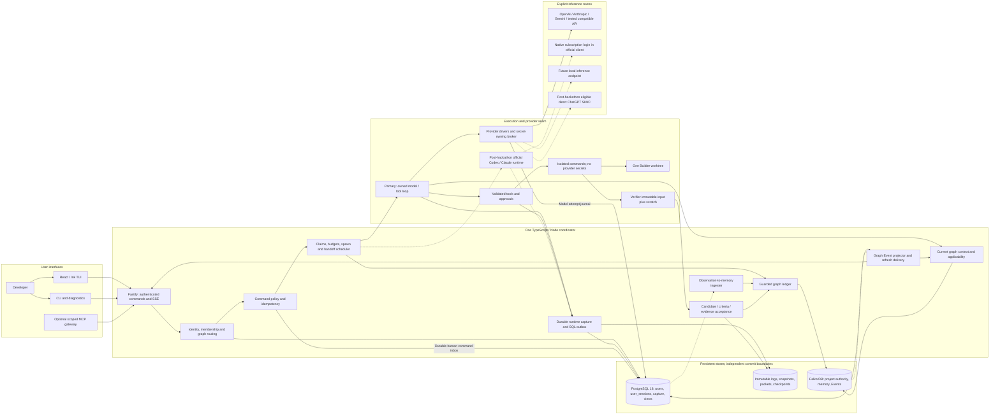

# Threadline: final end-to-end architecture for Track 2

**MVP authority — 15 October 2026:** [Development blueprint](track2-development-blueprint.md) controls release scope: two contributors, one logical Builder and fresh successor, a protected service checker, eleven tools and no automatic model summaries. This document retains broader target/reference contracts; model Verifier, polling, native adapters and fixed four-day schedules are not MVP commitments.

**Decision baseline: revised 14 October 2026 after adversarial review. Status: detailed proposed architecture; no Threadline runtime, native integration, database migration or performance result is claimed.** **User scope update:** Threadline owns a compact model/tool execution loop; Codex and Pi archives are inspiration, and native clients are compatibility runtimes. See [harness scope](track2-harness-scope.md). This document consolidates the 23 research/supporting notes indexed by [the repository README](../../README.md). It is the broader target reference; the [development blueprint](track2-development-blueprint.md) controls the current MVP. Historical notes remain evidence and alternatives; conflicts are resolved here.

## 1. Product, promise and delivered scope

Threadline is a local developer workspace for completing coding tasks across interrupted sessions, changing requirements and cooperating agents. A terminal UI drives one deterministic coordinator. Threadline’s own TypeScript runtime executes coding work through provider drivers and a scoped tool executor. Optional official Codex/Claude Code adapters retain their native authentication, tools and permissions when that compatibility route is selected. FalkorDB stores the connected memory and coordination authority that decide what a successor must know, who may advance a task, which evidence remains applicable, and whether completion is valid.

The complete delivery consists of an npm CLI/TUI, a local backend, its own execution loop and provider drivers, optional native runtime adapters, a typed memory-tool gateway, persistent FalkorDB, PostgreSQL for identity and session operations, immutable evidence storage, diagnostics, authored demonstration fixtures, and reproducible recovery/load/isolation checks. General child spawning and subscription adapters are post-hackathon milestones.

The principal user outcome is: **change a requirement, interrupt Builder, create a genuinely fresh successor, and finish with current source-linked verification without writing a manual recap.** Remembering an old transcript is necessary but insufficient. The graph determines applicable obligations and evidence; the selected runtime performs actual coding under its declared tool policy.

### 1.1 Deliverables and acceptance levels

| Release level | Included deliverable | Evidence required before calling it supported |
|---|---|---|
| Core, required | CLI + TUI + one coordinator + PostgreSQL + FalkorDB + local artifact store | Clean installation, persistence, restart, authenticated local access |
| Core, required | Threadline-owned runtime and one explicit API provider | Real model/tool loop, captured outcomes, policy refusal, cancellation and fresh restore |
| Core, required | MVP Builder + protected deterministic checker; future independent model review | Requirement revision, obsolete receipt rejection, current candidate completion |
| Core, required | Episodic, semantic, procedural memory and persistent history | Failed-attempt recall, accepted current constraint, held-out procedure reuse, original source inspection |
| Core, required | Per-tenant/project isolation and sharing | Cross-scope denial, bounded authorized retrieval, scoped artifact access |
| Core, required | Concurrent memory service | MVP stale/duplicate contention guards; separate declared load probes before capacity claims |
| Extension A | Native Codex/Claude subscription adapters and additional providers | Each route’s conformance run; native delegation is labelled separately from the owned loop |
| Extension B | Depth-1 read-only investigations | Globally bounded admission, crash/replacement, relevant finding delivery, matched-budget value |
| Extension C | Additional API drivers, remote memory, MySQL driver | Separate conformance/security/restore suites; no implicit compatibility claim |

The architecture records these target capabilities. The hackathon implements only core; future entries have no active menus or migration dependency. A release manifest lists which gates actually pass.

### 1.2 Track 2 mapping

| Track focus | Mechanism | Observable demonstration |
|---|---|---|
| Episodic memory | Captured messages, attempts, tool observations and outcomes linked to exact artifacts | Successor avoids an applicable failed approach and can open its source |
| Semantic memory | Versioned goals, constraints, decisions and sourced findings | Requirement change supersedes earlier authority; agent uses the current version |
| Procedural memory | Versioned steps, prerequisites and successful verification receipts | Held-out compatible task reuses procedure; incompatible environment forces revalidation |
| Persistent conversation | SQL message content + graph source anchors + immutable large payloads | Restart and inspect original visible messages in order |
| Shared state/handoffs | Graph claims, fences, state revisions, handoff contracts and durable Events | Old worker cannot complete; fresh successor claims current work |
| Concurrency | Indexed bounded reads, guarded single-query writes, backpressure and replay | Load report plus zero forbidden state transitions in declared cases |
| User/tenant separation | Trusted identity routing, memberships, separate project graphs and source visibility | Colliding identifiers in two tenants never disclose each other's content |

These are product acceptance criteria. Track wording and submission requirements come from the [official challenge](https://www.wemakedevs.org/hackathons/falkordb) and [rules](https://www.wemakedevs.org/hackathons/falkordb/rules). The latter allow preparatory notes, graph sketches and diagrams; the runtime implementation remains event-time work.

## 2. Decisions that replace ambiguous earlier guidance

| Question | Final decision | Consequence |
|---|---|---|
| Frontend | Terminal UI first | Browser hosting is optional; the same local service powers CLI and TUI |
| Harness | Compact Threadline-owned model/tool loop plus memory and coordination | Implement only the controlled tools and lifecycle needed; learn from archived Pi/Codex |
| First execution route | Own runtime with one explicit API profile | OpenAI Responses is the reference first driver; Anthropic API follows. Native subscriptions are separate routes |
| Graph authority | FalkorDB per `(tenant_id, project_id)` | Task state, accepted memory, claims, events and completion remain graph-governed |
| SQL engine | PostgreSQL reference implementation | MySQL 8.4 is an explicit future driver, not a second concurrent database |
| Why add SQL | User identity, human login sessions, durable runtime capture and operational projections | Deliberate change from earlier graph-only storage; no duplicate task authority |
| Conversation payload | SQL for bounded text and ordering; blobs for large output; graph for provenance and use | Two-store recovery is designed, not assumed transactional |
| Deployment unit | One TypeScript backend plus runtime workers, tool sandboxes and two data services | Internal modules are not individual microservices |
| Queue | SQL capture outbox + graph Events; bounded in-process notification queue | No Kafka, RabbitMQ or extra Redis queue in core |
| Retrieval | Task-seeded bounded graph closure first | Mandatory requirements never compete with embeddings for a place in context |
| Coding concurrency | One editable Builder, separate Verifier snapshot | Children investigate; they do not create a multi-writer merge system |
| Agent budget | MVP one live Builder and service checker; broader target two model roles | Stop/quarantine prior writer before fresh replacement; no autonomous children |
| Graphiti / vectors | Optional derived recall features | Neither controls acceptance, ownership or completion |

## 3. System overview and trust boundaries

The [complete Mermaid set](track2-diagram-atlas.md) includes the master architecture, backend, authentication, fresh recovery, data synchronization, schema, spawning and deployment views. Standalone sources live in [diagrams/](diagrams/).



Arrows from stores to processors mean polling by those backend modules; databases do not execute the application workflow. Authentication tokens for native clients never flow into the graph or SQL. The model receives typed tools, context and evidence locators, not database credentials. Model inference can remain remote even when Threadline's state and execution are local.

### 3.1 Trust boundaries

1. **Human to local service:** an OS-bound local bootstrap creates a user, tenant membership and expiring application session. Loopback is authenticated. A profile name is not identity.
2. **Service to databases:** only backend service identities have credentials. Graph keys derive from authorized project records, never model input. SQL memberships authorize access before queries.
3. **Service to runtime:** launch with explicit executable/version, workspace, provider profile, environment allowlist, policy and scoped gateway capability. Runtime output is untrusted observation.
4. **Runtime to repository/tools:** use actual host sandbox/permission capabilities and isolated worktrees. A graph fence alone cannot stop an already-running shell command.
5. **Service to evidence:** tenant/project-scoped content addressing and digest checks. Source access is checked on each read and citation resolution.
6. **Provider and publication boundary:** authorize the actual billing owner, and preserve the source readership of derived outputs. A project member cannot spend another member's account or publish their private context.

## 4. Technology and package structure

Use strict TypeScript on Node.js 24 LTS with a pinned maintained patch. Use React/Ink for the TUI and Fastify for the local JSON/SSE interface. See [technology decisions](track2-technology-decisions.md). PostgreSQL 18 is the SQL dialect baseline, with the actual maintained patch/image digest pinned during packaging. FalkorDB 6.0.2 is the previously audited candidate, not a promise that it is the release ultimately shipped. Select the engine/client pair after compatibility probes. Use the official FalkorDB Node client over RESP, a PostgreSQL driver, schema validation at all boundaries, and the MCP SDK version supported by the pinned native clients.

The following is a **proposed implementation layout**, not an existing codebase:

```text
packages/
  cli/                 command parsing, doctor, init, export, service discovery
  tui/                 views, user actions, event subscription
  contracts/           schemas, IDs, normalized events, adapter capability contract
  core/                policy, scheduler, task transitions, context selection
  storage-falkor/      reviewed Cypher templates, graph migrations, invariants
  storage-postgres/    identity, capture, projections, SQL migrations
  artifacts/           content addressing, manifests, snapshot validation
  adapters/codex/      app-server lifecycle and normalization
  adapters/claude/     official CLI lifecycle, stream/hooks normalization
  mcp-gateway/         scoped typed memory tools; no independent authority
  runtime-core/        required provider-neutral model/tool loop and event barriers
  tools/               scoped repository tools, approval and sandbox execution
  providers/           explicit API drivers and optional local/SIWC routes
  evaluation/         fixtures, protocol/load/fault cases, baselines
deploy/                pinned Compose profile, health checks, backup instructions
docs/                  installation, supported-version matrix, evidence reports
```

Publish one user-facing package initially; internal workspaces need not all be published. Package name is unreserved. Bundle compatible application code, templates and contracts. Require data-service connectivity and credentials for the selected provider route. Native clients and their login are prerequisites only for native compatibility modes. Do not bundle or modify native client credentials.

## 5. Backend module contracts

| Module | Input | Output / durable ownership | Important boundary |
|---|---|---|---|
| Identity and routing | Application token, opaque project ID | Principal, membership, graph key, visibility scope | Does not trust model tenant/user fields |
| Project/workspace registry | Canonical path, repository fingerprint, registration intent | SQL workspace registration and graph workspace references | Symlink resolution and authorized-root checks |
| Command admission | Typed operation, epoch/scope, request ID, expected revision | SQL command_inbox + source; graph receipt or typed rejection | Current grants and provider owner; durable full-envelope retry |
| Graph ledger | Validated domain command | Atomic state delta, revision, Event, RequestReceipt | Sole writer of domain authority |
| Context selector | Task, focus, role, budget | Versioned ContextPacket with reasons and sources | No silent omission of required constraints |
| Scheduler | Ready task/spawn request and budgets | Graph reservation, claim and LaunchIntent | No model inference in scheduler |
| Supervisor | Committed LaunchIntent | Owned runtime worker or native process, normalized lifecycle, cancellation proof | Process creation is outside graph transaction |
| Runtime capture | Observable event with stable source ID | SQL capture transaction, outbox, artifact references | Never fabricates unseen history |
| Capture ingester | Pending capture IDs | Idempotent graph Session/Message/Observation anchors | Durable SQL record can precede graph acknowledgement |
| Event projector | Graph Events after committed cursor | SQL event/status view and projection offset | Projection never authorizes task completion |
| Delivery manager | Affected tasks and ContextLoad edges | Scoped refresh, insertion ACK and replay cursor | ACK proves insertion, not understanding |
| Verification/integration | Candidate manifest and executable receipts | Accepted graph completion or stale/failing rejection | Requires exact candidate/environment/criteria |
| Artifact manager | Uploaded log, patch, manifest or packet | Immutable project-scoped object and digest | Missing bytes cannot be recreated from a hash |

All modules run inside one backend for core; execution workers and tool sandboxes are child processes/containers. Separate workers or additional replicas require leader ownership, partitioning and fault tests before deployment; adding replicas blindly duplicates process launches.

## 6. Storage authority and the two-store contract

### 6.1 One owner for each fact

| Fact | Authority | Secondary representation |
|---|---|---|
| User identity, membership, application session revocation | PostgreSQL | Minimal graph actor IDs for provenance |
| Registered project and derived graph key | PostgreSQL | ProjectRoot validates project ID/schema/epoch |
| Native provider authentication | Official native client | SQL stores route, account label and last diagnostic status only |
| API credential | OS keychain / explicit secret reference | SQL stores reference name; never secret bytes |
| Runtime process identity and observed messages/tool events | PostgreSQL capture ledger | Graph anchors link observations to tasks/evidence |
| Goal, constraints, task state, owner fence, run budget, launch authorization | FalkorDB | SQL status projections for browsing |
| Findings, decisions, procedures and applicability | FalkorDB | Export/search views only |
| Completion acceptance, handoff, context acceptance | FalkorDB | TUI event projection and audit view |
| Actual file/log/patch contents | Worktree or immutable object store | SQL and graph keep digests and authorized locators |

`agent_sessions.runtime_status` records what a process did. `TaskState.status` records whether domain work is ready/running/verified/completed. A process exiting successfully never writes a completed task directly.

### 6.2 SQL observations to graph memory

The capture transaction appends `capture_events`, any message/tool payload, and `capture_outbox` atomically in PostgreSQL. Each adapter supplies a stable source key and capture order. Large bytes are written to a temporary object, fsynced as configured, hashed and atomically published before the SQL reference is committed. Orphan objects are eligible for delayed garbage collection.

The ingester reads ready outbox rows, publishes graph anchors using a deterministic operation ID derived from the capture event, and records the returned graph receipt. If graph commit succeeds but SQL acknowledgement fails, retry reads the original graph receipt and updates SQL. A duplicate key with a different payload hash is an integrity error. Retry order preserves each runtime session's observed order; no ordering is invented between concurrent independent sessions.

Core actions that depend on new evidence wait for its graph receipt. The TUI can show **captured / memory pending / memory committed**. Capture lag is visible and cannot quietly masquerade as available shared memory.

### 6.3 Graph domain events to SQL views

Human goal/change admission first stores the original source and full immutable `command_inbox` envelope in one SQL transaction. Leased retries reconcile epoch-scoped graph receipts; pending intent is not accepted authority. Provider dispatch similarly journals each transport attempt in `model_requests`.

One guarded graph write atomically creates authoritative state, a new application event sequence and a RequestReceipt. The projector pulls Events strictly after its cursor and inserts them into `graph_event_projection`, updating the offset in the **same SQL transaction**. Lost notifications cause delay, not state loss. Consumers deduplicate on `(project, graph_epoch, event_seq)` and event ID.

`graph_epoch` changes only through a controlled restore/reset procedure. A projection cannot mix events from an older restored branch of history with the new authority. Ordinary service restarts preserve the epoch. A controlled new-epoch restore quarantines pending domain/effect commands from old epochs; historical observations can be re-imported by a separate provenance-preserving path, never by replaying old effects.

### 6.4 Availability policy

If either authority required by an action is unavailable, stop admitting new guarded work. Existing tool actions may still be running; request cancellation at a supported boundary and reconcile their effects. Capture uses a bounded fsynced local spool when SQL is briefly unavailable, with stable source IDs and visible gaps; exceeding the spool bound pauses/terminates execution rather than dropping history silently. The spool is a transport buffer, not a second task authority.

There is no distributed transaction across SQL, FalkorDB, filesystem and provider. The [protocol specification](track2-runtime-and-protocols.md) defines reconciliation windows and idempotency. Graph Events are retained until every required projection/consumer checkpoint permits compaction; expired cursors trigger snapshot restoration.

## 7. Identity, sessions and user_sessions

The word session is overloaded; these entities are deliberately different:

| Entity | Lifetime and purpose | Authentication meaning |
|---|---|---|
| `user_sessions` | Human application's local/TUI or future web login | Hash of a random bearer token; tenant/user membership; expiry/revocation |
| `runs` | One authorized goal execution with policy and budget | Owned by a tenant/project and initiating human; survives TUI disconnect |
| `agent_sessions` | One actual Builder or Verifier execution; future child roles are separately gated | Scoped runtime identity; no human bearer token |
| `native_bindings` | Native thread/session ID bound to adapter/version/account route | Native ID is correlation, not authorization |
| `context_deliveries` | One packet delivery to one agent at one turn/boundary | Records staged/submitted/acknowledged states |
| `worker_hosts` | Registered execution host and heartbeat | Short-lived scoped worker credential; local host first |

One user can have many application sessions, projects and runs. One run has multiple agent sessions. A fresh successor creates a new agent session and empty runtime context while retaining run/task IDs; native compatibility also creates a new native ID. Resume within the same native conversation is recorded as a resumed binding and never counted as fresh recovery. Human logout revokes interactive sessions; the user's selected run policy determines whether already-authorized local work pauses or completes its current boundary. Membership revocation and work admission serialize through one installation-wide coordinator gate covering all projects. After its SQL commit no new affected admission is allowed; already admitted effects are cancelled/reconciled and may have completed. On restart load current grants before dispatch. Multi-coordinator or out-of-band permission writes require another tested protocol.

For local mode, bootstrap from an OS-protected file/socket under the user's data directory; generate a high-entropy secret, enforce owner-only permissions, exchange it for an expiring app session and store only its hash in SQL. Define idle and absolute expiry; proposed defaults are 12-hour idle and 7-day absolute, configurable. Reauthentication creates a new token and revokes the old token; no plaintext token logging. Remote mode later uses an external identity provider, TLS, CSRF controls where cookies are used, and explicit device enrollment. It is not enabled by binding the local API to `0.0.0.0`.

## 8. Owned runtime, provider routes and subscriptions

See [provider evidence](track2-provider-evidence.md) for checked official routes, local version observations and limitations. This section is the product contract.

The [subscription and OAuth design](track2-authentication-and-oauth.md), checked 14 October, makes the setup decision explicit: bring-your-own API credentials establish the first owned-loop baseline; direct SIWC is the recommended subscription extension for an eligible local/open-source release. Native Claude subscription use remains in official Claude Code. These are distinct runtime/billing choices.

### 8.1 Threadline-owned runtime

The primary runtime executes `prepare context -> reserve model request -> stream -> persist completed request -> validate tool calls -> persist action intent -> execute -> persist result -> refresh/checkpoint -> continue or stop`. The [runtime specification](track2-runtime-and-protocols.md) defines every durability and policy barrier. Builder/Verifier are runtime configurations, not hard-coded agent products. Start with one OpenAI Responses API driver using explicit API credentials and a controlled toolset; add Anthropic/local drivers through the same interface after conformance tests.

Use the archived [Pi agent core](../pi-main/packages/agent/README.md) for event/context/tool-loop patterns and [Codex tool contracts](../codex/codex-rs/tools/README.md) for dispatch/approval separation. Keep both archives unchanged as inspiration. The selected design owns its behavior and state; it does not import either full application. A library can implement an internal seam later if it passes the same event, policy and recovery contract.

### 8.2 Codex compatibility route

For this selected compatibility route: install the official Codex client, authenticate in that client, then select **Codex — native login** in `threadline init`. Start app-server over stdio; negotiate the pinned schema, initialize, and create the actual thread and turn. Normalize observed items, approvals, interruption and turn completion. Prefer the native client's credential management for this compatibility route. Threadline does not parse its auth cache.

A current official local/open-source Sign in with ChatGPT route is documented, but implementing a separate OAuth client is additional work and has its own eligibility, preview and distribution conditions. Keep it as an explicit extension; do not implement it accidentally through credential extraction. Official references: [app-server](https://learn.chatgpt.com/docs/app-server), [local/open-source SIWC](https://developers.openai.com/siwc/token-sharing-open-source).

Native history, resume, goals and existing multi-agent features are baseline capabilities. Threadline must demonstrate additional revision-aware memory, evidence applicability and sharing; merely wrapping them is not the evaluation claim.

### 8.3 Claude compatibility route

For this selected compatibility route: install the official unmodified Claude Code binary, use its native authentication, then select **Claude Code — native login**. Drive the documented programmatic CLI and observe stream-json plus supported hooks/MCP events. Check actual active authentication route; environment API keys may change billing. Do not select a mode that disables native subscription authentication when subscription use is intended.

Using an unmodified native binary with direct user sign-in is distinct from offering Claude login through a third-party SDK runtime. The API-based Agent SDK fallback uses supported API/provider authentication unless separate approval permits otherwise. [Native authentication](https://code.claude.com/docs/en/authentication), [product conditions](https://code.claude.com/docs/en/legal-and-compliance), [programmatic CLI](https://code.claude.com/docs/en/headless).

### 8.4 Common runtime interface

The common runtime interface exposes `probe`, `start`, `send`, `events`, `cancel`, and `reconcile`. Native compatibility may additionally expose `resumeNative`, `resolveApproval`, and usage diagnostics through declared capabilities. A capability manifest declares supported event coverage, replay, safe injection boundaries, permission controls, native recursion controls and usage precision. Optional methods return explicit `UNSUPPORTED_CAPABILITY`; no terminal-screen scraping is the parity fallback.

Startup saves the executable version, protocol schema digest, config digest, tool/permission profile and auth-route label with the agent session. Strip secret environment values from diagnostics. Disable untracked native spawning and prove it in the adapter test. A native shell could still launch another CLI, so a hard worker cap additionally requires a tested process/tool sandbox that prevents bypass; otherwise the release labels the cap as applying to coordinator-managed workers only and does not claim a global hard bound. If it cannot be disabled/accounted for, advertise the native session without bounded-spawn guarantees and keep the spawning extension disabled.

Subscription quotas are provider/account limits, not a per-agent entitlement. The TUI shows account route, reported allowance if available, active workers, usage precision and quota pauses. An unavailable usage count is **unknown**, never zero. Token or monetary budgets that native APIs cannot enforce are labelled estimates; enforce hard local limits on process count, deadline and admitted turns. No automatic switch to paid API credentials when a subscription hits its limit.

### 8.5 Provider drivers

Define `ModelProvider` separately from `NativeRuntimeAdapter`. A raw OpenAI-compatible endpoint is a model transport, not a coding harness. Threadline supplies the required model/tool loop, sandboxed tools, approvals, streaming, cancellation, retries and checkpoint capture. Provider drivers translate OpenAI Responses, Anthropic Messages, Gemini, approved OpenAI-compatible endpoints, or Ollama/local inference into a normalized model contract.

Capability tests cover streaming framing, tool-call IDs/results, parallel calls, JSON/schema support, context/output limits, cancellation, usage and provider errors. Models/endpoints without required tool behavior remain analysis-only. Provider billing, region, retention and endpoint choice appear in the selected profile. Mixed-provider Builder/Verifier or fresh handoff shares graph state, not native conversation internals, reasoning tokens or credentials.

## 9. Memory design and retrieval

### 9.1 Memory creation

Automatic capture creates immutable episodic observations. The model can label a useful failure or propose a finding; it cannot alter the underlying tool result. Semantic acceptance is a separate operation governed by human authority or a declared scoped policy. Procedural memory consists of a named version, executable/readable steps, prerequisites, supporting receipts and later reuse outcomes. Broad automatic extraction is optional and asynchronous.

Visibility is one of `project`, `user`, or `session`. A user-private item records its owner; session-private material records its originating session. Publication creates a new authorized shared record with explicit source policy. It does not flip an entire private transcript to public. Citations must resolve to readable redacted/shared sources; even the existence or title of private evidence may be sensitive.

### 9.2 Context selection algorithm

1. Authenticate user/worker and load current project epoch, task revision and owner fence.
2. Rebase stale task requirements under the project revision barrier. Resolve task/ancestor/project/goal/artifact scope to stable constraints and exactly one current version each; missing/ambiguous/inaccessible mandatory authority fails closed.
3. Collect accepted applicable decisions, latest checkpoint, candidate manifest and unresolved tool outcomes.
4. Traverse allowlisted source/artifact relationships for relevant attempts, findings and procedures.
5. Apply visibility and artifact/environment/requirement applicability before ranking optional recall.
6. Deduplicate, attach inclusion paths and order mandatory authority before optional evidence.
7. Build a packet within the declared token budget; return `REQUIRED_CONTEXT_OVERFLOW` if required content cannot fit.
8. Store immutable packet bytes/digest and graph ContextPacket references. Submit to the selected runtime at its supported boundary; record actual insertion acknowledgement.

Proposed core packet budget is 6,000 tokens, with an 8,000-token maximum chosen per supported model. These are starting settings, not measured optima. Count the complete serialized memory packet including metadata and excerpts. Separately cap the full provider request, including instructions, tool schemas, user input and recent history, with output and safety headroom reserved. If exact tokenizer support is absent, use a conservative estimate and show its precision. Narrowing the task or explicitly raising the budget is preferable to silently truncating mandatory requirements.

Use one coherent graph read where feasible. A multi-query packet records project generation before and after assembly and retries on change; it is not called a snapshot transaction. Immediately before a guarded action, check the current relevant revisions again. Unrelated graph changes may require recomputation but need not invalidate unaffected evidence.

Optional lexical/vector seeds run inside the authorized project and undergo the same applicability checks. Embeddings are a derived cache with model/dimension/version; failed embedding jobs never prevent acceptance of a checkpoint or requirement.

### 9.3 Priority, compression and retention

Use four task-relative bands: P0 exact mandatory authority and safe continuation; P1 current blocker/checkpoint/checklist, relevant changes and active evidence; P2 compatible earlier attempts/validated procedures; P3 verbose or repeated trace. Source access and applicability are checked first. A current error excerpt can be high priority even when its surrounding log is P3. A tool request/result and affected candidate form one sourced episode; file-touched lists alone do not establish changed bytes.

Keep accepted requirements, critical execution status and source/candidate bindings exact. Compress optional explanatory history into structured problem/attempt/outcome/next-action records with original source references. Store captured permitted originals separately from what enters a packet; retention is an independent policy. Hidden reasoning is excluded; concise visible decision rationale may be retained. Deterministic extraction is first, model summaries optional, and summary chains/automatic promotion to truth are disallowed.

The owned-runtime composer maintains one current memory block, deduplicates source versions, bounds retrieval and recent history, and checks the complete provider request before inference. Repeated refresh must not append copies. See [the detailed priority and summarization contract](track2-runtime-and-protocols.md#20-memory-priority-representation-and-retention) for representation rules, provenance, budget gates and retention.

### 9.4 Save frequently, summarize selectively

Core captures human inputs, model-request intents, complete visible turns/tool batches and actual tool outcomes at their durability boundaries. Authority changes commit before dependent work; streaming logs use bounded ordered chunks. Meaningful approach/candidate/blocker changes update the working checkpoint. A crash recovers the last checkpoint plus subsequent captured evidence, without depending on a final recap.

No separate summarization API or service is required. Core uses deterministic extraction and the main agent's normal checkpoint tool. Optional model condensation is disabled by default; any later job uses the existing broker/account/run budget and is triggered by changed relevant sources plus a useful milestone or optional-history pressure, not every turn. Reuse matching source/version summaries, coalesce updates, limit jobs, and preserve non-model recovery fallback. See [the capture/checkpoint/summarization cadence](track2-runtime-and-protocols.md#21-capture-checkpoint-and-summarization-cadence).

## 10. Coding, verification and completion

The target model-visible registry has 14 tools; MVP advertises eleven tools under the blueprint, defined in [harness scope](track2-harness-scope.md#3-initial-tools-and-role-presets). Codex-inspired additions are `task.update_plan` for a source-backed tactical checklist, `interaction.ask_user` for durable TUI clarification and `workspace.poll` for captured output/status of a running approved command. These reuse existing persistence and preserve task/evidence authority; [the runtime contracts](track2-runtime-and-protocols.md#19-checklists-clarification-and-command-polling) define staleness, cancellation and restart behavior.

Builder has one registered writable worktree. It inspects current files, chooses tactics, edits through the guarded patch tool and checkpoints actual results. Native compatibility uses its host tools and reports any weaker guarantees separately. A trusted snapshot service creates a candidate manifest containing base commit, tracked and approved untracked file digests, patch digest, dependency/lockfile digests and relevant environment identity. Dirty files are included deliberately or rejected; commit SHA alone is insufficient.

Verifier receives a role-specific immutable assignment binding task/epoch/revision/candidate/criteria/environment/reservation; it does not take Builder's exclusive claim. It runs against that exact candidate in a separate snapshot/worktree with a tested restrictive tool policy. Tests may require scratch files/build outputs; permit those in an isolated writable sandbox while keeping the candidate input immutable. Disabling an edit tool alone does not make a general shell read-only. Network and commands follow the declared verification profile. Tests execute project code, so their process isolation must be real.

VerificationReceipt binds `candidate_digest`, `environment_digest`, `criteria_digest`, `requirement_revision`, command/argument digest, tool execution IDs, exit status, log references, verifier identity and timestamps. Criterion and receipt also bind a protected acceptance-bundle and trusted-launcher digest. Assertions, transitive helpers/config/dependencies and invocation are outside Builder's write control. Candidate-defined `npm test` scripts cannot redefine success. Trusted assertions and receipt writing execute outside the candidate-controlled process/isolate; candidate output is untrusted data, and a missing/forged/early-exit result fails. Acceptance changes require a new approved criteria version and re-verification. Human/agent review findings supplement executable evidence. An agent saying “tests passed” is not a receipt.

Completion checks current task state/revision/fence, no unresolved blocking tool outcomes, current governing requirement digest, successful mandatory checks, current candidate identity, dependencies and authorized review. The graph commits accepted completion and its Event atomically. Any subsequent relevant file/requirement change creates a new state requiring verification; it never rewrites the old receipt.

Integration is a separate authorized action: verify target base, expected patch and absence of unexpected changes; apply/merge using a stable operation ID; inspect resulting tree; run required checks for the integrated candidate when its bytes differ. A graph commit cannot atomically perform Git/file changes. Ambiguous integration outcome enters reconciliation, never blind retry. Core produces a reviewable patch; external push/deployment is not an implicit completion side effect.

## 11. Requirement change, refresh and fresh recovery

A requirement edit creates a new immutable constraint/goal version with its source message and supersession links. The coordinator checks the proposed change with the human's authority, increments requirement revision, finds affected tasks and invalidates applicable completion eligibility. Keep historical state and receipts inspectable.

Affected-worker discovery uses task dependencies plus `ContextPacket -> INCLUDES -> memory` and `AgentSession -> LOADED -> ContextPacket`. Notify those workers and mark pending refresh. Because dependencies can be incomplete, all guarded actions recheck current authority; impact traversal is an optimization and explanation, not the only correctness defense.

Fresh recovery performs these ordered operations:

1. Record handoff/stop intent and revoke future admission under the old fence.
2. Request runtime cancellation; drain capture; confirm process/session termination or quarantine the old worktree.
3. Mark unfinished external effects unknown and inspect actual repository/tool state.
4. Select current graph context and reconcile candidate/requirement mismatches.
5. Create a new agent session with empty conversation state; for native compatibility create a genuinely fresh native conversation. Pass only the approved packet plus declared ordinary repository/tool context.
6. Stage locally, atomically accept the successor claim/new fence after reconciliation, then rebuild current context, journal/reserve/submit the first provider request and record its actual insertion ACK. Local staging never implies provider submission.
7. Resume work, refresh evidence and verify the exact current candidate.

If termination is unknown, do not grant a successor write access to the same worktree. A separate quarantine/snapshot branch can support investigation, but integration waits for reconciliation. Native resume is a separate user action useful for ordinary continuation; it is not substituted for this fresh-session test.

## 12. Agent spawning and the lightweight harness

Threadline owns the execution loop, tool policy, context preparation, admission and durable contracts. Native compatibility delegates only the inner loop to the selected official client and uses a tested adapter; it is a different runtime mode. Builder can request a child using `agents.propose_spawn` with objective, parent, expected output, permitted sources/tools, stop condition and desired budget. The coordinator validates usefulness-related prerequisites and hard policy; the model's judgment that parallel work helps remains a hypothesis.

Post-hackathon extension defaults are four live model workers per run, depth one, maximum four child launches over the run including replacements, child limit of 10 tool calls or 3 minutes, and no child editing. Builder and Verifier count toward the four slots, as do waiting parents. A run initially admits one Builder and one Verifier reservation, leaving at most two child slots. Lifetime and resource reservations are persisted in the same project graph as the run. Core allows one active run per local installation; multiple-run admission requires a separate tested installation-wide allocator.

Reject duplicate/cyclic objectives using stable parent/request IDs and a normalized task signature. A graph write reserves budget and creates a child `Task` linked through `SUBTASK_OF`, plus a `LaunchIntent`, before the supervisor starts a process. The process registers the launch token and validates its role assignment before tool execution; Builder claims and read-only assignments are distinct. SQL launch attempts record PID/process-start identity and outcome. If launch response is lost, reconcile the stable launch ID; do not assume exactly-once process creation.

Child results include compact claims, source versions, observation receipts, unresolved uncertainty and applicability. Published findings pass scope/evidence checks. Contradictory findings remain separate; no majority voting turns them into truth. Late stale results remain history but cannot complete current work. Cancellation cascades to descendants and releases reservations only after termination/reconciliation. Paused/waiting live workers still occupy slots.

## 13. TUI experience and accessibility

The default layout uses a left task/worker list, central activity pane and right context/evidence inspector. A compact bottom strip shows current project, run, requirement revision, selected provider/runtime route, active slots, graph/capture health and pending approvals. At narrow widths, switch to tabs; support plain-text/no-color output, keyboard-only navigation and resizable terminal layouts.

Views are **Overview**, **Tasks**, **History**, **Memory**, **Evidence**, **Providers**, and **Diagnostics**. The Memory view shows the relevant path and source excerpt, not a giant graph canvas. History differentiates human user sessions from agent runtime sessions, shows capture gaps, and supports source-ID navigation. Evidence shows candidate/criteria/environment digests and stale/current status.

Main actions: start goal, pause at supported boundary, change requirement, respond to tool approval, resume native conversation, continue fresh, stop children, inspect source, review patch, export run. Provider selection displays native subscription versus separately billed API route before execution. Existing authorized actions do not repeatedly prompt; expanded access or a billing-route change is explicit.

Every operation displays a meaningful pending state: launching, waiting for a clarification answer, running command with captured output, waiting for approval, captured but not committed to memory, context refresh pending, quota paused, reconciliation required. Do not show a green success check for a model final message when task verification is still pending.

## 14. CLI, portability and installation

These are **designed commands, not working repository entry points**:

```text
npx <threadline-package>@<release> doctor
npx <threadline-package>@<release> init --workspace /path/to/repository
npx <threadline-package>@<release> services up
npx <threadline-package>@<release> provider add openai --auth api-key
# Optional subscription compatibility route:
npx <threadline-package>@<release> provider add codex --auth native
npx <threadline-package>@<release> tui
npx <threadline-package>@<release> run --goal-file ./goal.md
npx <threadline-package>@<release> task continue-fresh <task-id>
npx <threadline-package>@<release> mcp --project <project-id>
npx <threadline-package>@<release> export --run <run-id> --redacted
npx <threadline-package>@<release> backup create
```

First-run wizard checks Node/npm, Docker or supplied endpoints, selected runtime/provider capability, optional native executable/version, workspace access, free disk, data directories and provider route. It explains the two persistent services and asks for setup choices once. Existing authenticated native clients should be reusable without asking the user to paste tokens. The usability target is 5–15 minutes after prerequisite downloads and selected provider authentication; this is a target, not measured setup time.

The hackathon declares one tested macOS/Docker reference machine and architecture. Expand to macOS/Linux only after checks on each claimed target. Treat Windows through WSL2 as a later separate target; native Windows process groups, path semantics, keychains and Unix-socket replacements require their own suite. Do not claim portability merely because Node runs on all three systems.

Default data belongs in the platform's user-data directory, not the repository: configuration, daemon discovery/lock, logs, spool, project-scoped blobs and backup manifests. The repository contains only reviewable non-secret project metadata if desired. Resolve worktrees by stable project ID; clones do not automatically become trusted members of a shared project. Export paths are relative and portable, while local absolute workspace paths remain host registrations.

## 15. Deployment, persistence and operations

Run the coordinator/model broker on the host; keep model credentials out of tool containers. The owned runtime executes approved commands in a restricted container with only the registered workspace and necessary scratch mounts. Native compatibility processes remain on the host with their tested native permissions to preserve their own authentication. Run PostgreSQL and FalkorDB in pinned local Compose services with independent named volumes, health checks, database auth and loopback-only exposure. Disable public database dashboards by default. A configured remote database is an advanced option using encrypted authenticated connections and tested latency/recovery behavior.

PostgreSQL persists operational/capture state. FalkorDB persists authority using explicitly selected AOF/RDB settings. Local artifact bytes need their own backup. A mounted Docker volume is not a proven recovery guarantee. Backup quiesces new admission, drains capture/projection, records graph epoch/event sequence and SQL/spool watermarks, captures both stores plus required blobs, then verifies the manifest. Restore initially targets a separate instance and runs integrity checks before switching service discovery.

Record graph/SQL versions, schema versions, adapter versions, migration checksums and object hashes in each backup. Never prune graph events or source artifacts still referenced by retained context/verification. Retention policies distinguish bulk token deltas, visible final messages, tool logs, accepted evidence and security audit records. Redaction creates a recorded tombstone and invalidates dependent source views; it does not invent a surviving citation.

Instrument run/session/task/request/capture/event IDs, capture lag, projection lag, missing source count, queue depth, graph read/write latency, context construction/insertion latency, runtime startup, approval time, quota errors, unknown actions and stale completion rejections. Redact secrets before logs or graph ingestion. Traces use correlation IDs; raw private prompts are opt-in and excluded from the public demonstration.

## 16. Security and authority rules

Project graphs separate projects; per-source visibility handles users within a shared project. Authorization occurs before retrieval, not after returning a full graph to an agent. Parameterized Cypher templates and SQL queries are allowlisted. An LLM never emits executable database query text through a general tool. Path traversal, symlinks, unsupported URI schemes, unregistered worktrees and cross-project artifact locators are rejected.

Retrieved files/messages may contain hostile instructions. Context packets distinguish human accepted authority from quoted observations. A source telling the agent to change tenant or grant tools has no authority. Agents can propose decisions and child tasks only through scoped operations. Runtime approval responses remain tied to one runtime request, command digest, workspace and expiry; a prior approval is not a wildcard for future commands.

Provider secrets stay in the native client or OS secret store. API profiles keep only secret references. Environment inheritance is filtered to avoid accidentally selecting a paid API route or passing parent credentials into untrusted test code. Same-user local compromise is outside a magic cryptographic boundary, but file permissions and scoped capabilities prevent routine accidental disclosure.

## 17. Failure behavior

| Failure | Required behavior |
|---|---|
| TUI closes | Backend/run follows declared detach policy; persisted state remains |
| Backend crashes | Restart scans launch intents, runtime processes, spool, outboxes and graph cursors before admitting work |
| Native process disappears | Session interrupted; tool effects unknown until inspected; fresh successor gets current context |
| Graph commit reply lost | Lookup/retry same request ID and payload hash; never create a second business transition |
| SQL capture succeeds, graph unavailable | Durable outbox pending; dependent guarded actions wait |
| Graph commit succeeds, SQL projection fails | Graph remains authority; replay projects it later |
| Requirement changes during verification | Receipt preserved for old revision; current completion rejected |
| Provider throttles | Bounded backoff, visible quota pause, no silent billing switch |
| Missing/invalid evidence blob | Mark evidence unavailable; fail verification; restore/reproduce explicitly |
| Source visibility changes | Block admission; retire affected live sessions/descendants, discard continuation, rebuild fresh sanitized contexts; sent bytes cannot be recalled |
| Child cancellation uncertain | Keep slot reserved and worktree quarantined; reconcile before replacement |
| Backup stores disagree | Fail restore validation; do not silently accept mixed epochs |

## 18. Implementation and acceptance plan

The [development blueprint](track2-development-blueprint.md) controls implementation: two owners and sequential integration gates. User owns Memory/Coordinator; teammate owns Harness/Delivery; both pair on containment and protocol contracts. The previous four-person/four-day allocation is withdrawn. No deadline or measured delivery estimate is available.

## 19. Final acceptance statement and linked specifications

A release is ready when a new user can install it, authenticate through an actually supported route, run the authored task, inspect committed memory, change a requirement, recover a fresh worker, and obtain passing receipts for the exact resulting candidate. The release must also pass declared restart, isolation, duplicate-request, stale-owner and concurrency cases. Model accuracy and latency remain measured outcomes with sample sizes, not architectural guarantees.

- [Harness scope and archive inspiration](track2-harness-scope.md)
- [Technology decisions](track2-technology-decisions.md)
- [Database model and ownership](track2-data-model.md)
- [Runtime, tools and protocol specification](track2-runtime-and-protocols.md)
- [Delivery, operations and validation plan](track2-delivery-and-validation.md)
- [Detailed Mermaid diagram atlas](track2-diagram-atlas.md)
- [PostgreSQL reference DDL](schema/postgresql-reference.sql)
- [FalkorDB schema and query sketches](schema/falkordb-reference.cypher)
- [Provider primary-source evidence](track2-provider-evidence.md)
- [Storage primary-source evidence](track2-storage-evidence.md)
- [Figma read-only diagnostic and local visual deliverables](figma/README.md)

## 20. Privacy and review corrections

Apply the [runtime privacy and admission protocols](track2-runtime-and-protocols.md) to every model/tool submission, context load and publication. A session's derived output keeps the intersection of all loaded source readership; a private paraphrase remains private. Graph TaskState contains only policy-safe shared summary/status, while private text remains in scoped observations. Event/receipt payloads, SQL projections, export and source metadata inherit this rule. Explicit Publication review is required to share authorized redacted derivatives.

Provider admission requires the run initiator, profile owner and provider-account owner to match by default. No implicit shared billing follows from project membership. Verifier authorization is a candidate-bound read/check assignment, separate from Builder ownership. The complete [review resolution register](review/track2-review-resolutions.md) records all 14 findings, accepted corrections and remaining execution gates.
