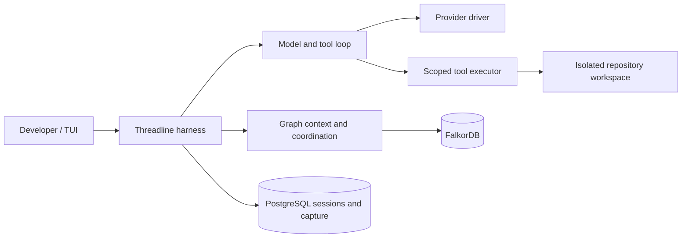

# Threadline harness scope and reference-code decisions

**MVP authority — 15 October 2026:** [Development blueprint](track2-development-blueprint.md) controls release scope: two contributors, one logical Builder and fresh successor, a protected service checker, eleven tools and no automatic model summaries. This document retains broader target/reference contracts; model Verifier, polling, native adapters and fixed four-day schedules are not MVP commitments.

**Scope revised with the user on 13 October 2026.** Build a compact **Threadline-owned agent harness**, using the archived Codex and Pi projects as inspiration. This supersedes the native-wrapper-first recommendation in the earlier notes and the first draft of the plan. The local npm/TUI product, FalkorDB memory and evidence-based recovery remain the objective.

## 1. The scope in one sentence

Threadline is a TypeScript harness that runs a model/tool loop, controls a small toolset, persists sessions, restores current graph memory, and coordinates Builder replacement with verifiable outcomes; model review remains a target extension.

**15 October release decision:** the hackathon ships eleven tools, one Builder and a protected deterministic service checker. Prime Agent remains an unchanged research reference. Native adapters, direct subscription OAuth and read-only child spawning are post-hackathon candidates with separate gates. [First vertical slice and release boundary](track2-first-vertical-slice.md).

An **agent** is a configured participant: a model, role, instructions, tool permissions and assigned task. The **harness** is the reusable machinery that runs that participant and enforces the contract. Builder is the MVP model preset. Verifier and Investigator are possible later model presets.

## 2. What the first harness must own

| Module | Small interface | Behavior hidden inside |
|---|---|---|
| Runtime | `start`, `send`, `cancel`, `events` | Turn loop, streaming, lifecycle, stop reasons, cancellation and error normalization |
| Provider driver | `capabilities`, `stream` | Provider request/response translation, tool-call framing, usage, supported limits |
| Tool executor | `describe`, `execute` | Schema checks, role policy, scope, approval, sandbox, timeout, bounded output, evidence |
| Session store | `append`, `read`, `checkpoint` | Durable ordered observations, deduplication, gaps and source references |
| Memory service | `context`, `commit`, `updates` | Graph authority, applicability, request receipts, closure and replay |
| Scheduler | `admit`, `cancel`, `reconcile` | Bounded Builder/Verifier reservations, role authorization, launch intents and crash handling |
| TUI | User actions and event subscription | Presentation and user input; never task authority |

These are design interfaces, not implemented TypeScript APIs. Internal methods can be more detailed; callers should not implement retries or state transitions independently.

The execution sequence is: load authorized current context, reserve one model turn, stream response, persist the completed visible assistant/tool request, validate each tool request, persist action intent, execute allowed actions, persist outcome, update graph memory as needed, then decide whether another model turn is permitted. Completion still requires current verification. This action-observation loop can be described as ReAct-style control, but we do not claim to reproduce the paper or expose hidden reasoning. A general CodeAct-style interpreter is not required; tools may execute approved commands without making code the universal action representation.

## 3. Initial tools and role presets

The catalog below is the 14-tool target. MVP advertises eleven: omit `workspace.poll`, `memory.propose_decision`, and `review.submit`. Registered commands are synchronous with streamed TUI capture; a protected service checker replaces model review. See the blueprint for exact MVP ownership and limits.

**Codex archive inspection, 14 October 2026:** identify three additions to the target contract: `task.update_plan`, `interaction.ask_user` and `workspace.poll`. The resulting target registry has 14 tools; polling is deferred from the eleven-tool MVP. These are TypeScript implementation proposals inspired by inspected Codex contracts; no Rust handler is copied and no tool is implemented in this repository.

| Tool | Builder | Verifier | Important condition |
|---|---|---|---|
| `workspace.read` | Yes | Yes | Bounded permitted path/range |
| `workspace.search` | Yes | Yes | Bounded source set/output |
| `workspace.inspect` | Yes | Yes | Current candidate, dirty files and digests |
| `workspace.apply_patch` | Yes | No | Expected file digest and active write ownership |
| `workspace.run` | Approved commands | Trusted verification commands | Isolated execution profile, timeout, no secret inheritance; terminal outcome or scoped running handle |
| `workspace.poll` | Own command | Own verification command | Status and bounded output for an existing handle; never arbitrary stdin |
| `task.update_plan` | Yes | No | Versioned tactical checklist through guarded checkpoint; checklist completion grants no task completion |
| `interaction.ask_user` | Yes | No direct question | One durable blocking clarification at a time; human answers through authenticated TUI |
| `memory.retrieve` / `memory.refresh` | Yes | Yes | Scope and applicability filters |
| `memory.checkpoint` | Owner checkpoint | No owner-state mutation | Current write claim and permitted output visibility |
| `memory.propose_decision` | Scoped proposal | Scoped observation/proposal | Cannot rewrite human requirements or task ownership |
| `review.submit` | No | Yes | Separate evidence authorization, exact candidate and trusted check evidence |
| `task.request_completion` | Yes | No | Service decides acceptance |

Verifier does not acquire Builder's exclusive write claim. It receives evidence-only authorization for the exact candidate and criteria. Child spawning is absent from the core tool registry.

Start with sequential effectful tool execution. Polling an already running command creates no second process; conflicting patches/commands remain blocked until termination or reconciliation. The TUI can stream its captured output without additional model requests.

 Add bounded parallel reads only when tool dependency/conflict semantics and cancellation tests pass. Do not run patch operations in parallel or trust the model to declare two arbitrary commands independent.

An approved command ID resolves to a reviewed executable, argument schema, working directory and execution profile. It is not an arbitrary shell string. Running project tests can execute arbitrary project code, so command allowlisting still requires a sandbox for filesystem/network/credential isolation.

## 4. What to learn from Pi

The inspected Pi source snapshot identifies Pi as a minimal extensible harness and separates its model-provider library, agent core, durable state and terminal UI. Its package manifests identify that snapshot as `1.2.0`; this is a local observation, not a checked published release. The source snapshot was used for this inspection but is not included in this repository export.

Useful patterns in the inspected documentation/source:

- Separate provider-facing message conversion from internal events and stored session state.
- Prepare canonical context immediately before each provider request.
- Run tool preflight after arguments are validated and before effects occur.
- Distinguish an event saying the loop ended from the final durable listener work settling.
- Preserve model-request tool order even when observations finish in a different order.
- Support cancellation and steering explicitly rather than treating them as another ordinary prompt.

Pi's `Agent` class awaits subscribers; its low-level loop's event stream is observational and does not itself wait for consumer persistence. Threadline must implement a real durability barrier before side effects. A fire-and-forget listener attached to an event emitter is insufficient. These observations came from the inspected local snapshot, which is not included in this repository export.

The archive README also states that Pi does not supply a built-in permission system restricting filesystem, process, network or credential access. Threadline must provide its own policy plus isolation; adopting Pi would not remove that responsibility. Pi context-transform callbacks also have their own failure contracts, so a mandatory graph outage cannot be handled by blindly returning stale context.

**Selected reuse approach:** study the small-loop and event patterns; implement the Threadline runtime interface directly. Use official provider SDKs behind a narrow driver for the first route. `pi-ai` or `pi-agent-core` can be evaluated as an internal implementation if their pinned contracts reduce work without weakening persistence and policy. They are not a launch dependency, and we do not fork the entire Pi CLI or adopt its durability store as a second task authority.

## 5. What to learn from Codex

Codex is useful for tool dispatch, approvals, execution isolation, interruption and the separation between core logic and presentation. The inspected core describes platform-specific sandbox behavior; it is substantial infrastructure, not something obtained merely by using Rust. The tools crate explicitly separates tool contracts/adaptation from session/turn/approval orchestration. These observations came from the inspected local snapshot, which is not included in this repository export.

Borrow the separation of concerns and failure semantics. Consider official Codex app-server compatibility after the hackathon baseline passes. Do not port Codex's entire Rust workspace, sandbox helpers, TUI and protocol machinery to produce the first Threadline build. Its tool/code-mode mechanisms do not establish that the whole product is a pure implementation of either ReAct or CodeAct.

The reference folders remain unchanged. Their presence is not a runtime dependency. Before copying substantial implementation, record the snapshot/source and retain applicable licenses/notices: the Pi archive contains MIT and the Codex archive Apache-2.0 plus NOTICE. This plan does not copy either implementation.

## 6. Provider access and subscriptions

| Route | Who runs the inner loop? | Credential route | Scope |
|---|---|---|---|
| Threadline + OpenAI API model | Threadline | Explicit user-provided API key | Hackathon baseline |
| Threadline + local model | Threadline | Local model endpoint | Post-hackathon capability gate |
| Threadline + eligible direct ChatGPT sign-in | Threadline | Official local/open-source SIWC implementation | Post-hackathon authentication/preview gate |
| Threadline + Codex native | Codex | Official native authentication | Post-hackathon compatibility gate |
| Threadline + Claude native | Official unmodified Claude Code | Official native authentication | Post-hackathon subscription compatibility gate |
| Threadline + Anthropic API | Threadline | Supported API credentials | Post-hackathon driver; no borrowed subscription tokens |

The first implementation should prove one explicit API route so the harness's own loop/tools are actually exercised. Native subscription adapters remain useful, but a native-only demo must be labelled as delegated execution, not proof of our own runtime. Authentication features observed in a reference project's source do not independently authorize the same route in Threadline. [Current provider evidence](track2-provider-evidence.md)

## 7. What can wait

The first release does not need a plugin marketplace, IDE integrations, browser automation, remote code hosting, a custom terminal renderer, every provider, multi-writer patch merging, arbitrary recursive swarms or a new operating-system sandbox implementation.

Bounded read-only spawning is a post-hackathon candidate after the fresh-Builder recovery proof, with its own admission, budget, cancellation and value tests. Native compatibility follows its own lifecycle/authentication gate. Neither is an alternate core implementation during the deadline.

Build an extension interface only for a demonstrated second implementation. For example, OpenAI and Anthropic provider drivers make provider variation concrete; an empty future driver per possible vendor does not.

## 8. Definition of the minimum complete harness

The harness is complete enough when it can run a real scoped task using its own model/tool loop, capture and inspect history, refuse an unauthorized tool action, cancel safely, restart with current graph context, run a protected service checker, and accept only receipts for the current requirement and candidate. Package that workflow as npm + TUI. The [first vertical slice](track2-first-vertical-slice.md) freezes the actual release inventory and acceptance gates.

Do not use a target line count as the scope contract. The right size is the smallest implementation passing these behaviors. Memory correctness and recovery are the differentiator; the harness makes those guarantees observable and enforceable.

## 9. Codex tool inventory and selected additions

**Evidence: local source inspection on 14 October 2026, not a build or runtime probe.** The registry is assembled in Codex's `spec_plan.rs`. Available tools depend on feature flags, model/provider capabilities, tool mode, environment, permission policy and loaded extensions. A handler's presence in the inspected source snapshot does not mean it is enabled in every Codex session. That snapshot is not included in this repository export.

The inspected tool families are:

- **Command execution:** `exec_command`, plus `write_stdin` for resumed command input/polling when unified execution is enabled. One-shot execution remains a separate configured mode.
- **File editing and inspection:** `apply_patch` and `view_image`. The inspected core registry does not register dedicated `read_file`, `list_directory` or `grep` handlers; command execution can perform those operations. Threadline retains its narrower `workspace.read/search/inspect` tools.
- **Planning and user interaction:** `update_plan`, `request_user_input`, `request_user_input_async`, `send_message_to_user_async`, and `request_permissions`, subject to configuration/root-thread/mode restrictions.
- **Context, time and environment:** `get_context_remaining`, `new_context`, `clock.curr_time`, `clock.sleep`, and `wait_for_environment`. Context estimates can be unavailable; Codex's new-context operation is not proof of Threadline's fresh-worker recovery.
- **Collaboration, alternate versions:** `spawn_agent`, `send_input`, `resume_agent`, `wait_agent`, `close_agent`, or the newer `send_message`, `followup_task`, `interrupt_agent`, `list_agents` alongside spawn/wait. These versions have different lifecycle semantics and are selected by configuration.
- **Discovery, plugins and external sources:** `tool_search`, `list_mcp_resources`, `list_mcp_resource_templates`, `read_mcp_resource`, `list_available_plugins_to_install`, `request_plugin_install`, plus dynamically loaded MCP/extension tools. Hosted web search is assembled separately from local executable handlers.
- **Code mode:** `exec` and `wait` compose configured tools through JavaScript, using separate execution infrastructure. This is distinct from `exec_command`; it is not a requirement for our typed-tool loop.
- **Testing support:** `test_sync_tool` is conditionally exposed to supported test/model configurations. It is not a Threadline product capability.

### 9.1 MVP additions: `task.update_plan` and `interaction.ask_user`; `workspace.poll` deferred

**`task.update_plan`**, inspired by `update_plan`, records a bounded tactical checklist for the current Builder task. Each step has a stable ID, text and `pending/in_progress/completed` status; at most one step is in progress. Its command binds epoch, requirement revision, expected TaskState revision and owner fence. Persist exact checklist bytes through the existing capture/artifact ledger, then update the checklist section of the guarded checkpoint while preserving existing progress/evidence. A checklist is the Builder's tactic; it cannot edit accepted goals/constraints, create authority-bearing subtasks, alter criteria, or satisfy the deterministic completion gate. Current applicable checklist/source references belong in fresh recovery context. Private-source-derived plans retain private scope.

**`interaction.ask_user`**, inspired by `request_user_input`, requests one explicit clarification through the TUI. Use a stable question ID and invocation digest, at most three questions with bounded options/free text, and one pending request per run. The tool suspends dependent work until an actual answer or cancellation; elapsed time never counts as an answer. Persist the question as a scoped tool-intent event/artifact and the answer as an authenticated `project_messages` source plus `command_inbox` input binding that question/session/revision. The coordinator rejects duplicate/conflicting or stale answers and returns the supported result under the original tool-call ID. If the answer changes requirements, it passes ordinary human requirement admission before another model/effect boundary. It grants no tool permission; approvals stay in `tool_approvals`. Verifier routes uncertainty through its review finding; Builder owns this interactive channel. Closing the TUI leaves the question pending, with new provider admission paused. Fresh replacement may retire the old question and reissue a current one explicitly; it cannot invent a response.

**`workspace.poll`**, inspired by empty-input `write_stdin`, observes an admitted command's existing handle. `workspace.run` may return `running` after a bounded yield instead of holding the model call until the process exits. Poll input is `execution_id`, `after_output_seq`, bounded `wait_ms` and output limit; result is bounded ordered captured chunks, next cursor, observed process status and exit code when actually known. The handle is tied to tenant/project/session, original command, workspace, epoch and role authorization; it is not a transferable PID. Persist output before disclosing it. Repeated polls do not launch a process, repeat effects, or settle an unknown result as success. The supervisor enforces the original timeout, cancellation, process containment and cumulative output quota. Restart reconciles original process identity; missing proof yields `unknown`. There is no arbitrary stdin or interactive terminal in the first release. A returned handle is not a passing test receipt, and Verifier still needs its trusted terminal assertion result.

These additions reuse `tool_executions`, `capture_events`, scoped artifacts, `project_messages`, `command_inbox` and existing checkpoint/source records. Typed event payloads must define question IDs, checklist data and command-output sequences. No new SQL table, graph label or second task authority is introduced. See [runtime protocol details](track2-runtime-and-protocols.md#19-checklists-clarification-and-command-polling).

### 9.2 Candidates after the release

`view_image` is a useful later addition when the fixture includes screenshots or visual artifacts and the selected model supports image input. Context/budget diagnostics should first appear in the TUI and be enforced by the runtime; a model-facing status tool can follow if it affects agent decisions. MCP discovery, web search and agent management each require another supported integration or workload. General JavaScript code mode, arbitrary terminal stdin and automatic plugin installation are outside the selected deadline scope. Existing provider streams already carry progress text; a separate model-facing user-message tool has no demonstrated necessity for this release.

The selected approach reimplements small contracts in TypeScript. Reusing actual Codex source later requires compatible interfaces and retaining Apache-2.0/NOTICE obligations. The archive remains read-only reference material.
