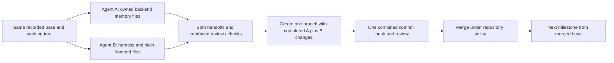

# Threadline code-first implementation checklist

**15 October 2026. Proposed work, not implementation results. Two full-time contributors.** This is the execution checklist for the complete `archive/plans/` collection. It changes build order following the user's instruction: **start with working backend/frontend code, then persistence and the model/tool flow, then containment, protected verification, recovery evidence and packaging.** The [development blueprint](track2-development-blueprint.md) still controls product scope and trust contracts; this checklist supersedes its preflight-first sequencing only.

Implementation boxes start unchecked and are updated only from verified evidence. A plan, stub, diagram or passing documentation check does not finish a runtime task. Use actual code/output/evidence before checking a box. No Git branch, commit, push, merge, package publication or implementation is performed by creating this document.

## 1. What the two variants mean

**Variant A / Agent A: Memory and Coordinator.** Own authority, identity, durable capture, SQL/graph operations, checkpoints, context selection, procedure lifecycle and evidence acceptance. Start from [Agent A checklist](track2-agent-a-checklist.md).

**Variant B / Agent B: Harness and Frontend.** Own model loop, provider driver, workspace tools, isolated execution, checker supervisor, CLI/TUI and packaging. Start from [Agent B checklist](track2-agent-b-checklist.md).

These are two lanes of the same product, not two competing architectures. Work in the same integration checkout from the same recorded base. Every milestone includes A tasks, B tasks and joint integration/commit tasks. Complete and review both lanes before creating the milestone branch. One combined commit/branch contains both lanes. Repeat this cycle per milestone; there is no separate branch/PR per agent. If several milestones are intentionally batched into one commit, finish the same checks for every included milestone first.

The master file owns overall completion; lane files are detailed handoff views with the same task IDs. Agent reports cite IDs and changed files. The integration owner updates master status from verified reports; do not infer completion from a lane's claim or let duplicate checkboxes drift without reconciliation.

## 2. Keep the initial backend and frontend clean

Use one TypeScript codebase, three npm workspaces and one local backend process. The frontend is the terminal CLI/Ink TUI; a browser SPA is not part of this plan. Create modules when their first real function is implemented. A proposed layout is:

```text
packages/
  shared/src/           public types, schemas and event/error envelopes
  backend/src/
    index.ts             startup/shutdown
    api/                 thin authenticated local transport
    coordinator/         authority, sessions, claims, human commands
    capture/             journals, artifact Sources, outbox and projection
    memory/              checkpoint, retrieval, procedure operations
    harness/             provider loop and validated dispatch
    execution/           candidate snapshots, patches, command supervisor
    checker/             protected assertions and service receipt production
    storage/             explicit SQL/graph/artifact adapters
  cli/src/               commands, transport client, simple Ink views
fixtures/                synthetic authored task and protected check bundle
scripts/                 only actual setup/integration helpers when needed
archive/plans/           active architecture and checklist documents
```

Do not create empty directories/subsystems merely to match this tree. Keep repository-specific protected fixture code outside Builder-writable candidate paths. Names are proposed local module paths, not published npm package names.

- [ ] **S01:** Start M00 by writing the small service, public types and terminal entry point. No checker, fixture hash, container digest, lockfile ceremony or CI setup blocks that first runnable code.
- [ ] **S02:** Install only necessary dependencies through normal package management; commit its generated lockfile with working scaffold when ready. There is no separate backend/frontend lockfile project or reason to hand-author a lockfile.
- [ ] **S03:** Use strict TypeScript, a basic build and direct run commands. Add focused tests when a consequential state/IO boundary is implemented; no bespoke validation framework, formatting initiative or coverage threshold first.
- [ ] **S04:** Keep SQL/graph/provider secrets in backend modules. TUI sends commands and renders backend results; it never owns task truth or inference billing.
- [ ] **S05:** Keep one OpenAI BYOK route, one Builder at a time, fresh successor, eleven final tools, PostgreSQL/FalkorDB and immutable Sources. No RLM or automatic model summarization.
- [ ] **S06:** Temporary development fixtures/fake providers may unblock local coding, but label and isolate them. Production startup cannot silently use them when a required store/provider is down.
- [ ] **S07:** Implement patch/executor/checker code when its milestone arrives. Before exposing real effectful code, prove its containment; before accepting completion, prove protected receipts. Moving them later does not waive their release gates.
- [ ] **S08:** Keep the initial UI plain: input, task/checklist, activity and Source/context/receipt inspection. No graph editor, theme system, animations, admin dashboard or remote deployment.

## 3. File ownership and parallel-work rules

Agent A owns `backend/{coordinator,capture,memory,storage}`, SQL/graph migration/query behavior and shared contract definitions. Agent B owns `backend/{harness,execution,checker}`, `cli`, fixtures, Compose/package/build configuration and dependency edits. Backend startup/API composition is reviewed jointly; appoint one editor per file for each milestone before concurrent work.

- [ ] **P01:** Record the base branch/commit, current dirty files and milestone before either agent edits. Existing README/plans changes belong to this planning work; do not discard or accidentally bundle them with unrelated code.
- [ ] **P02:** Agree the small public operation signatures/error/event shapes needed for the milestone. A publishes shared contracts first; B can implement provider/UI behavior behind those seams while storage progresses.
- [ ] **P03:** One agent edits shared types at a time; the other proposes changes by message/patch request rather than overwriting the file.
- [ ] **P04:** Agent B alone owns root manifests/dependency installs; do not run two `npm install` processes or race lockfile changes. Agent A requests required dependencies.
- [ ] **P05:** One designated owner edits startup composition/routes for the current integration pass. Both modules remain independent behind imports until that pass.
- [ ] **P06:** Agents edit disjoint files and report additions/deletions. Neither runs `git switch`, stash, reset, add, commit, push or merge during parallel coding.
- [ ] **P07:** Separate test data directories/ports/project IDs where independent live tests would collide; serialize shared migration/fixture reset and packaged-flow runs.
- [ ] **P08:** No duplicate production implementations, second authority store, independent provider loop or fake UI business rules. Resolve interface disagreements in the shared contracts.
- [ ] **P09:** Integration owner performs final cross-lane review and meaningful tests on the combined tree. A and B individual green builds are insufficient if the assembled flow fails.
- [ ] **P10:** On new user scope changes, update master/lane views and relevant plan references before continuing dependent work. Scope never expands merely because a target diagram shows a box.

## 4. One branch and commit after both agents finish

This checkout now has Git metadata and existing modified/untracked planning files. The commands below describe the future workflow; they are not executed here. Use the actual configured base/remote/branch policy. Do not assume the base is `main`, a remote exists, or direct merging bypasses required review. If the team starts from an export without Git, configure Git/remote separately when collaboration needs it, rather than making Git setup the first application-code deliverable.

One integration cycle:



For each milestone, the integration owner completes:

- [ ] **G01:** Receive both agent handoffs with completed IDs, owned paths, actual tests/results, open issues and any shared-contract changes.
- [ ] **G02:** Inspect `git status`/diffs and separate unrelated pre-existing work. Explicitly select the milestone's files; do not use `git add .` blindly.
- [ ] **G03:** Verify both agents used the recorded base. If the base moved, resolve integration against the new base and rerun relevant checks before calling the batch ready.
- [ ] **G04:** Run the milestone's joint integration checks on the combined tree. Future unimplemented milestones do not block an honest scaffold commit; unfinished behavior is not exposed as working.
- [ ] **G05:** Verify no secret, OS file, generated local data, archive copy or developer-only path is staged; inspect deletions and generated package/schema changes deliberately.
- [ ] **G06:** Once ready, create one branch such as `threadline/m00-scaffold` from the recorded base, carrying the completed uncommitted A+B changes. If checkout/branch creation refuses, stop and resolve the cause; never force/reset away work.
- [ ] **G07:** Stage explicit owned paths and review `git diff --cached`/`git diff --cached --check`. Include generated lockfile when dependencies changed and include relevant docs/evidence changes intentionally.
- [ ] **G08:** Create one combined commit with the milestone's proposed subject; record observed validation and limitations in its review/PR description.
- [ ] **G09:** Push that one feature branch to the configured remote and open one combined review/PR where applicable. Neither agent pushes an independent branch.
- [ ] **G10:** Resolve review/CI findings against the combined result; use the repository's permitted merge method when ready. Branch creation and code readiness do not override required review policy.
- [ ] **G11:** Confirm the merged base contains both agents' changes, update local base and master completion status, then begin the next A+B batch from that merged commit.
- [ ] **G12:** Keep merge/push outcome separate from npm publication, hosted deployment or remote Figma updates. This workflow alone does not perform those other actions.

Illustrative commands, with values chosen by the integration owner:

```sh
git status --short
git diff
# After both lanes and combined validation are ready:
git switch -c threadline/m00-scaffold
# Stage only explicit milestone files, then:
git diff --cached
git diff --cached --check
git commit -m "feat: scaffold local backend and terminal interface"
# Push to the actual configured remote; review and merge under its policy.
```

Before a merge or branch switch later, ensure any remaining unrelated work is preserved. Never make destructive reset/clean/stash-discard part of the routine workflow.

## 5. Milestone sequence

Milestones M00–M13 form the MVP path. Work inside a milestone is parallel where file ownership and inputs allow. The joint block finishes the batch and triggers the section 4 workflow. Later milestones may be developed behind disabled interfaces, but their acceptance depends on the stated earlier features.

The first checkpoint is intentionally a working service/TUI, not a checker/lockfile/preflight project. M02 starts with real read-only model tools. Actual command exposure is M06; protected completion is M08. No calendar estimate is imposed without a deadline.


### M00 — Small running scaffold

**Depends on:** None; start here. **Combined result:** A running TypeScript backend and plain terminal frontend with an actual command/event exchange. No database or checker prerequisite.

**Proposed combined commit:** `feat: scaffold local backend and terminal interface`.

#### Variant A — Memory/Coordinator

- [x] **M00A01** Create `packages/shared/src` for public IDs, command/result envelopes, event types and typed errors. Keep database clients and secrets out of this package.
- [x] **M00A02** Create `packages/backend/src/index.ts` and one `createBackend(deps)` composition entry point; separate startup/shutdown from import-time effects.
- [x] **M00A03** Implement a small Fastify local health endpoint and a real backend-owned development status event. Health reports which components exist; it does not pretend storage/model readiness.
- [x] **M00A04** Add configuration parsing for bind address, data directory and declared limits, with actionable errors and no credential values in output.
- [x] **M00A05** Implement a backend event publisher with bounded listeners and clean shutdown. Start with process-local development events; do not advertise replay or durability yet.
- [x] **M00A06** Define the first versioned command/result/event TypeScript shapes and give Agent B a compiling import/example. Do not design every future API before coding.
- [x] **M00A07** Keep API handlers thin and domain operations independent of HTTP. Create only directories needed by working code, rather than empty repositories for every table.

#### Variant B — Harness/Frontend

- [x] **M00B01** Own root `package.json`, workspace configuration, `tsconfig` and dependency edits. Use three packages only: shared, backend and cli; no browser app or microservice fleet.
- [x] **M00B02** Create `packages/cli/src` with a plain command entry point using `util.parseArgs`, then a minimal React/Ink view that connects to the backend.
- [x] **M00B03** Display service connection state, a text activity stream and a simple input/action. Avoid graph widgets, themes, animations and settings screens at scaffold time.
- [x] **M00B04** Wire one real development command through the backend and show its actual acknowledgement/event; label this mode as development-only and non-durable.
- [x] **M00B05** Add only scripts needed to run/build the current code. Install actual dependencies normally; retain the automatically generated dependency lockfile without turning it into a separate preparatory project.
- [x] **M00B06** Add standard ignores for dependencies, generated build output, OS files, local data and credential files; preserve existing plans and archives.
- [x] **M00B07** Keep TUI input/render state local, while task status comes from the backend. No frontend direct SQL/FalkorDB access or provider calls.

#### Joint integration and branch readiness

- [x] **M00J01** Run the backend and terminal view from the documented commands and observe the actual round trip; no paid model or database required.
- [x] **M00J02** Check the TypeScript build/import boundaries and shutdown once; do not require a custom linter, checker framework, CI pipeline or coverage target for this increment.
- [x] **M00J03** Inspect changed files for generated data/secrets and unrelated modifications; preserve the pre-existing dirty documentation work.
- [x] **M00J04** Review shared types together, resolve compile mismatches, then use the single-branch procedure in section 4.


**Independent M00 integration verification — 15 October 2026:** all fourteen A/B tasks verified in the combined tree; M00J01–M00J03 passed. Root `npm test` passed 49 backend + 5 CLI tests, including 25 real CLI exchanges and event-subscription cleanup. Real PTY echo/Esc, disconnect, terminal restoration and backend SIGTERM passed. Fragmented SSE, subscription readiness and capacity rejection defects were fixed with regression evidence. M00J04 was pending at that verification snapshot; the user subsequently merged PR #1 with resolutions into `main` (`ed18168`), completing the Git integration step. [Full evidence and limitations](review/m00-integration-verification.md).

### M01 — Real stores, local identity and one accepted task

**Launch prompts:** [Agent A — persistence/authority](prompts/track2-m01-agent-a.md) and [Agent B — services/CLI](prompts/track2-m01-agent-b.md). Both start from the same merged base and implement M01 only; preserve the merged review resolutions and verify the actual new baseline.

**Depends on:** M00. **Combined result:** A human goal becomes durable SQL source/inbox and guarded graph authority, inspectable from the CLI.

**Proposed combined commit:** `feat: persist local identity and accepted task authority`.

#### Variant A — Memory/Coordinator

- [x] **M01A01** Implement small `pg` and FalkorDB adapters with explicit connection lifecycle, parameterized operations and trusted project-to-graph routing.
- [x] **M01A02** Prepare the 31-table FK-closed core bootstrap from the reference DDL; validate real SQL syntax/constraints. Keep the two native/auth extension tables out of startup requirements.
- [x] **M01A03** Create only operations used by this trace: local tenant/user membership, project, human session, project message, command inbox, graph project/task and accepted criteria (execution Run starts at M02). Unused bootstrap tables need no services or screens.
- [x] **M01A04** Implement owner-only local bootstrap, random token hashing, session lookup, idle/absolute expiry and revocation. Do not add registration/login pages or remote enrollment.
- [x] **M01A05** Persist original human goal plus complete command envelope in one SQL transaction before graph admission; pending, accepted, rejected and unknown are distinct outcomes.
- [x] **M01A06** Implement graph readiness, reviewed unique constraints/indexes, epoch identity, request digest and idempotent state/event/receipt mutation. A query sketch is not a production mutation.
- [x] **M01A07** Create stable goal/constraint identities and immutable current versions. Missing/duplicate required current versions block authority resolution.
- [x] **M01A08** Guard same-request/same-payload retry versus same-request/different-payload conflict. Return exact committed receipt rather than an optimistic UI success.

#### Variant B — Harness/Frontend

- [x] **M01B01** Add minimal Docker Compose PostgreSQL/FalkorDB services with explicit persistent volumes and host-local connectivity; do not begin with a deployment platform.
- [x] **M01B02** Select compatible development runtime/client/image versions while using them; record observations. Immutable release digests and a polished doctor are later packaging work.
- [x] **M01B03** Wire CLI `init` and task admission to the real backend; show pending versus accepted criteria and source IDs.
- [x] **M01B04** Load the existing authored fixture manifest as data; let the user explicitly accept its bounded goal/criteria. Do not translate arbitrary prose into hidden tests.
- [x] **M01B05** Keep model API credentials unset for this stage. Model and command containers must not receive database credentials later.
- [x] **M01B06** Implement a simple backend connection/start/stop view with real errors, retry action and cancellation of UI connection; closing the TUI does not delete persisted work.
- [x] **M01B07** Make configured endpoint versus local Compose behavior explicit; refuse an unreachable/misconfigured store instead of falling back to pretend memory.

#### Joint integration and branch readiness

- [x] **M01J01** From clean local volumes, admit one fixture goal and inspect its SQL source/inbox, graph current versions and exact receipt.
- [x] **M01J02** Restart the backend and confirm the same project/task is read, rather than recreated from frontend state.
- [x] **M01J03** Retry admission with the same request ID and then a conflicting payload; observe one mutation and a typed mismatch respectively.
- [x] **M01J04** Run one synthetic unauthorized project/source request. Database port binding or an opaque ID alone must not grant access.
- [x] **M01J05** Document the actual setup commands and encountered version limitations; merge only the functioning increment, without requiring future checker/recovery features.

**Combined M01 verification — 15 October 2026:** A01–A08, B01–B07 and J01–J04 verified against real stores and actual CLI/TUI. [Full evidence, resolved defects and limitations](review/m01-integration-verification.md). J05 is complete: the user merged PR #2 and local main was fast-forwarded to `067f842`. M01 accepts a goal/task without an execution Run or fabricated provider profile; real Run creation starts in M02.

### M02 — One owned provider turn with read-only tools

**Implemented workflow:** use [M02 development](../../docs/m02-development.md), [live acceptance evidence](../../docs/m02-live-acceptance.md) and [provider setup](../../docs/provider-setup.md). The original lane launch instructions are superseded.

**Depends on:** M01; shared types from M00. **Combined result:** One real API-backed model/tool round trip, with guarded admission and persisted request/result identity.

**Proposed combined commit:** `feat: run journaled provider turns with read-only tools`.

#### Variant A — Memory/Coordinator

- [x] **M02A01** Implement Run/AgentSession admission with one active run, one live logical Builder, graph claim/fence, claim lease and budget reservation.
- [x] **M02A02** Implement provider-profile owner checks: run initiator, profile owner and account owner must match. Source/project grants are rechecked before release of inference.
- [x] **M02A03** Implement SQL model-request journal with logical request versus attempt IDs, prepared/dispatched/streaming/completed/unknown/failed states and observed usage; add the smallest immutable input/response artifact writer now, extending it into general Source/capture handling in M03.
- [x] **M02A04** Journal attempt intent and reserve budget before network dispatch. Persist read-tool invocation/results with stable IDs before the next turn; M03 extends them into general sourced capture/admission. Unknown sends retain reservation and possible-charge status; never automatically replay them.
- [x] **M02A05** Persist exact supported submitted input and complete visible assistant/tool-request batch. Do not persist hidden reasoning or execute partial streamed tool arguments.
- [x] **M02A06** Implement initial human-command versus worker-admission serialization gate and graph revision checks; one coordinator is the active installation authority.
- [x] **M02A07** Return typed errors for authorization, storage, context, budget and provider outcomes, with correlation IDs suitable for CLI display.

#### Variant B — Harness/Frontend

- [x] **M02B01** Implement narrow owned provider transports and verify the user-selected account/model. User-approved scope: OpenAI Responses implementation plus OpenCode Go Chat Completions; Space Bunny is the live acceptance model. This does not claim live OpenAI account or subscription compatibility.
- [x] **M02B02** Implement caller-owned conversation reconstruction, streaming frame/tool-call correlation, terminal response handling, usage reporting and cancellation/unknown behavior.
- [x] **M02B03** Read `THREADLINE_OPENAI_API_KEY` only in coordinator/provider code; redact it and avoid forwarding its environment to any execution helper.
- [x] **M02B04** Implement the bounded sequential model → validated tool → result → next-turn loop, with an abort path and maximum attempts/tools/wall time.
- [x] **M02B05** Create the actual small authored imperfect inventory-export candidate workspace from the manifest now, retaining its original seed template outside the mutable candidate and disclosing the UTC defect; protected assertions/receipt infrastructure come in M08. Implement `workspace.read`, `workspace.search` and `workspace.inspect` against those existing files with range/result limits, digests and explicit truncation.
- [x] **M02B06** Validate path traversal, symlink escape and unsupported encodings; use argument arrays for any search helper, never an interpolated shell command.
- [x] **M02B07** Display streamed visible text/tool activity in the plain TUI while retaining only allowed durable completed records. Mark partial/gapped outcomes honestly.
- [x] **M02B08** Expose only the three implemented read-only tools initially; the final eleven-tool registry is added as real implementations become available.

#### Joint integration and branch readiness

- [x] **M02J01** Run deterministic protocol fixtures/fake provider responses locally for malformed/partial calls and disconnects; no paid calls in ordinary tests.
- [x] **M02J02** Explicitly start one real small model/read-tool turn, record selected model/runtime versions and actual terminal outcome/usage; configuration checks incur no silent inference.
- [x] **M02J03** Confirm no edit, shell, completion or subscription capability is advertised yet.
- [x] **M02J04** Check a mismatched provider owner is denied before dispatch and a cancelled/unknown request does not fabricate successful usage or tool execution.
- [x] **M02J05** Confirm paid runs stop when required storage or authority is unavailable. A development fixture adapter must not become a production fallback.

**Independent M02 local integration — 16 October 2026:** A01–A07, B02–B08, J01 and J03–J05 verified through the assembled real-store/runtime/CLI/PTY flow. Ordinary suite: 212 passed, 0 failed; live suite: 33 passed, 0 failed. **Historical local-only snapshot:** B01/J02 were deferred then; the subsequent user-authorized Space Bunny acceptance closes both gates, as recorded below. The transport is implemented and locally tested, with no paid inference or production fixture fallback. No Git integration step was performed. [Full evidence, commands, repaired defects and limitations](review/m02-integration-verification.md).

**Provider extension authorized after local M02 integration:** OpenCode Go and custom compatible API-key providers are now selectable. A single real Space Bunny text test returned HTTP 200; synthetic-provider/store conformance passes 222 ordinary tests and 34 live-store cases. This does not close the full live model/read-tool gate or establish OpenAI model access. [Configuration and evidence](../../docs/provider-configuration.md).

**M02 closed — 16 October 2026:** all A/B/joint checkpoints verified within the user-approved API-key provider scope. Real Space Bunny run `a5272d65-cbf2-4526-a334-35d159cf23a0`: 3 completed model turns, 2 successful tools including exact exporter bytes, 8,045 reported tokens, zero unresolved attempts/reservations, released claim. Final regressions: 224 ordinary tests and 34 isolated real-store tests pass. OpenAI live-account access remains unclaimed. No branch/commit/push performed. [Live acceptance and repaired defects](../../docs/m02-live-acceptance.md).

### M03 — Durable capture, artifact Sources and graph admission

**Depends on:** M01; integrate with M02. **Combined result:** Tool/model evidence has available original bytes and idempotent graph provenance.

**Proposed combined commit:** `feat: capture sourced runtime evidence and reconcile graph admission`.

#### Variant A — Memory/Coordinator

- [ ] **M03A01** Implement immutable content-addressed artifact storage with safe project-relative locators, digest/size validation, atomic publication and availability states.
- [ ] **M03A02** Implement capture append with stable per-session sequence positions and typed event versions; persist critical intent/result boundaries before dependent success.
- [ ] **M03A03** Write capture/outbox rows transactionally and lease/replay them with the profile's polling, batch, timeout and retry limits.
- [ ] **M03A04** Admit Source, Message, Observation and task-bound Attempt episodes deterministically; retain invocation/outcome/candidate/environment/revision identity.
- [ ] **M03A05** Map registered-command failures, diagnostic nonzero exits and unknown effects into useful observed episodes without depending on model checkpoint text or inventing root cause.
- [ ] **M03A06** Implement SQL-to-graph idempotency and ambiguous graph-write receipt reconciliation. Only known replay-safe operations get automatic retries.
- [ ] **M03A07** Implement ordered graph Event projection into SQL views with cursor advancement in the same SQL projection transaction; notifications are wakeups, not delivery truth.
- [ ] **M03A08** Record gaps, missing artifact bytes, ingestion lag and pending admission explicitly. Stop admission on SQL outage; do not promise an offline spool.

#### Variant B — Harness/Frontend

- [ ] **M03B01** Wire provider and read-tool lifecycle events into the capture service: complete invocation, result and final visible response keep their original correlation IDs.
- [ ] **M03B02** Implement bounded stdout/message chunk capture plumbing for future commands, with declared ordering, 16 KiB chunks/250 ms flush and partial/gap behavior.
- [ ] **M03B03** Add backend history/source range transport and CLI inspection that rechecks source permission on every read; raw arbitrary artifact paths are unavailable.
- [ ] **M03B04** Implement `memory.retrieve(mode=source)` with source ID, byte offset and at most 32 KiB, returning digest/size/range/truncation/status.
- [ ] **M03B05** Implement SSE cursor reconnect using persisted projections once available; use bounded frontend event buffers and show gaps requiring refresh.
- [ ] **M03B06** Display capture pending/available/missing status separately from task truth and successful tool status.
- [ ] **M03B07** Do not add graph rendering, full transcript injection or token-by-token SQL/graph writes to this stage.

#### Joint integration and branch readiness

- [ ] **M03J01** Deliver the same capture/outbox event twice and observe one Source/Observation/Attempt and consistent sequence/cursor state.
- [ ] **M03J02** Interrupt after SQL capture commit and after graph commit before acknowledgement; reconcile without lost or duplicate authority.
- [ ] **M03J03** Remove a synthetic artifact and verify unavailable Source behavior; a digest alone does not restore the bytes.
- [ ] **M03J04** Reconnect the TUI from an earlier event cursor, observe ordered events or an explicit gap, and bound client/server queues.
- [ ] **M03J05** Inspect real stored call/result fields and compare them with the original permitted bytes. No private reasoning or credentials appear in the capture/export path.

### M04 — Structured checkpoints and tactical state

**Depends on:** M03. **Combined result:** Current progress/checklist is source-backed, with exact per-session coverage and automatic failure-safe persistence.

**Proposed combined commit:** `feat: persist structured checkpoints with capture coverage`.

#### Variant A — Memory/Coordinator

- [ ] **M04A01** Implement runtime validation for `memory-checkpoint.schema.json` and `memory-episode.schema.json`; TypeScript declarations alone are insufficient at the boundary.
- [ ] **M04A02** Build checkpoint manifests from trusted authority, candidate/environment identity, meaningful captured outcomes, unresolved effects and pending questions.
- [ ] **M04A03** Maintain exact immutable checkpoint Source, TaskState pointer and CHECKPOINT_SOURCE edge atomically with state/event/receipt updates.
- [ ] **M04A04** Track unique `(session_id, covered_capture_seq)` entries separately from graph-admission cursors; validate covered position never exceeds admitted/available evidence.
- [ ] **M04A05** Implement automatic checkpoints for admission, accepted changes, mutating/registered-command terminal outcomes, failure, unknown effects and safe handoff; fallback after five meaningful uncheckpointed events.
- [ ] **M04A06** Exclude checkpoint-publication events from their own checkpoint trigger; coalesce routine read/search activity without dropping its captured records.
- [ ] **M04A07** Implement versioned plan/checkpoint patch merge that preserves unrelated progress, Sources and unresolved effects, and rejects conflicting stale updates.
- [ ] **M04A08** Reconstruct structured state deterministically when the model provides no narrative recap. Model prose remains an attributed proposal, never accepted proof.

#### Variant B — Harness/Frontend

- [ ] **M04B01** Implement `memory.checkpoint` with bounded progress/next-action/plan patches; server-owned coverage/authority fields cannot be overridden by model input.
- [ ] **M04B02** Implement `task.update_plan`: at most eight steps, one in progress, stable step IDs and allowed transitions; all-completed checklist does not imply verified task completion.
- [ ] **M04B03** Implement `memory.refresh` to return a current binding/packet status and distinguish ready, stale, blocked and capture-pending.
- [ ] **M04B04** Add plain TUI current checklist, next action, blocker and checkpoint/source inspection; avoid duplicated frontend task-state mutation logic.
- [ ] **M04B05** Provide a durable source link for each accepted checklist update and display conflict/retry guidance without hiding stale revisions.
- [ ] **M04B06** Give Agent A actual tool result fields needed by deterministic episode/checkpoint generation; do not use hand-crafted success strings as observations.

#### Joint integration and branch readiness

- [ ] **M04J01** Inject a protocol fault immediately after durable failure capture and before a voluntary checkpoint; deterministic recovery preserves the failure and progress. The actual isolated-command/session kill trace follows in M07/M11.
- [ ] **M04J02** Interleave plan and progress patches under the same revision; no unrelated field is lost and stale writes are rejected.
- [ ] **M04J03** Check the four-stream bound equals initial session plus three permitted replacements, without comparing sequences from different sessions.
- [ ] **M04J04** Verify a checkpoint does not trigger infinite checkpoint capture or any extra summarization model request.
- [ ] **M04J05** Inspect exact manifest bytes and task pointer together, with all listed Sources resolvable and authorized.

### M05 — Bounded graph retrieval and context construction

**Depends on:** M03 and M04; real model loop M02. **Combined result:** The next request contains exact current authority plus relevant bounded sourced memory, without replaying the old transcript.

**Proposed combined commit:** `feat: assemble bounded task context from graph memory`.

#### Variant A — Memory/Coordinator

- [ ] **M05A01** Implement indexed current-task closure from stable goals/constraints/criteria, TaskState, candidate and required Sources; do not rank mandatory authority by similarity.
- [ ] **M05A02** Resolve current governing versions, graph epoch/generation/revision and membership/source scope before selection; recheck version guards before admission.
- [ ] **M05A03** Implement P0 exact authority/unresolved effects, P1 current blockers/checklist/diagnostics, P2 compatible advice and P3 bulk references, with reasons and source/version bindings.
- [ ] **M05A04** Implement at most three hops/64 optional candidates, four advisory failures and two procedures, using declared compatibility rather than global recency.
- [ ] **M05A05** Differentiate exact proof from advice: proof requires current candidate/criteria/environment/revision; advice requires relevant paths/signature/task family/preconditions and never completes work.
- [ ] **M05A06** Implement immutable packet manifest with selected items, exact/excerpt/reference representations, template/policy version, token count precision, inclusion reasons and omission counts.
- [ ] **M05A07** Enforce 6,000 default/8,000 maximum packet and whole-request limits, preserving output/headroom. Exact mandatory overflow blocks or requires accepted narrower scope/compatible budget.
- [ ] **M05A08** Implement source deduplication by scope/version/digest; do not merge unrelated candidates/failures or treat repeat messages as corroboration.
- [ ] **M05A09** Implement task-relevant `memory.retrieve(mode=search)` with bounded output and cumulative next-request allocation; no unrestricted Cypher, vector database or classifier API.

#### Variant B — Harness/Frontend

- [ ] **M05B01** Replace the single current memory block on request reconstruction instead of appending another copy per refresh.
- [ ] **M05B02** Keep valid tool-call/result pairs in bounded recent working history; prune an entire obsolete episode or replace it with an attributed record, not an orphaned tool response.
- [ ] **M05B03** Include instructions, tool schemas, current input, history and memory in whole-request budget accounting; use a compatible tokenizer or conservative labelled estimate.
- [ ] **M05B04** Wire search/refresh/source retrieval to the dispatcher with exact returned Sources and policy limits.
- [ ] **M05B05** Record context submission occurrence IDs tied to each model attempt; same packet in two turns has two delivery records, persistence retry of one occurrence deduplicates.
- [ ] **M05B06** Implement plain context-inspector text: current requirement/revision, included failure/advice reasons, Source ranges and omitted counts.
- [ ] **M05B07** Test request rendering with many individually small retrieval calls so cumulative growth cannot bypass the next input limit.

#### Joint integration and branch readiness

- [ ] **M05J01** Inspect an actual submitted provider input artifact and verify exact current accepted criteria, one current memory block and no full inherited transcript.
- [ ] **M05J02** Use synthetic relevant error plus noisy successful logs: include the diagnostic/invocation/candidate, omit bulk with visible counts and retain source access.
- [ ] **M05J03** Force mandatory overflow, stale current-version pointers and unauthorized Source references; no provider request proceeds.
- [ ] **M05J04** Run repeated refresh/search and observe bounded packet/input usage with no extra summarizer call.
- [ ] **M05J05** Compare compatible advice versus stale proof on a changed candidate/requirement; only exact current evidence can be accepted later.

### M06 — Guarded patches, snapshots and contained registered commands

**Depends on:** M02–M05; containment proof before effectful tool exposure. **Combined result:** Actual bounded edits and command outcomes, with no credential/network/path escape and honest cancellation.

**Proposed combined commit:** `feat: execute guarded patches and isolated registered commands`.

#### Variant A — Memory/Coordinator

- [ ] **M06A01** Implement registered workspace identity, canonical paths, current candidate manifest and scope/fence/revision guards at each edit/command boundary.
- [ ] **M06A02** Persist stable tool intent/canonical arguments and admission before effects, then terminal or unknown result before returning success.
- [ ] **M06A03** Implement candidate manifest from tracked/approved untracked bytes, patch/base/dependency identities and relevant environment; a commit SHA alone is insufficient.
- [ ] **M06A04** Invalidate candidate-bound evidence when bytes change; register environment identity and preserve immutable before/after artifacts.
- [ ] **M06A05** Prevent conflicting edits/commands while an effect remains running or unknown; cancellation status alone does not release the writer.
- [ ] **M06A06** Implement budget reservations for tool count, command timeout/log/disk/snapshot limits and visible exhaustion outcomes from the development profile.
- [ ] **M06A07** Reconcile lost terminal persistence against actual command/workspace state before retry; never rerun an unknown command blindly.

#### Variant B — Harness/Frontend

- [ ] **M06B01** Implement `workspace.apply_patch`: expected candidate digest, 64 KiB/eight-path bounds, validate all paths before mutation and reject traversal/symlink escapes.
- [ ] **M06B02** Implement actual command executor with explicit argument arrays, noninteractive IO, deadlines and process/container identity; no model-selected shell interpolation.
- [ ] **M06B03** Implement Docker restriction profile: one CPU, 512 MiB RAM, 64 PIDs, non-root 10001, read-only root/candidate, bounded scratch, network none, capabilities dropped and no-new-privileges.
- [ ] **M06B04** Exclude provider/DB credentials, host sockets and protected assertion directories from execution mounts/environment.
- [ ] **M06B05** Implement synchronous `workspace.run(diagnose)` using published case input/current accepted parameters and `build` using fixed node syntax argv; `verify` remains unavailable until M08.
- [ ] **M06B06** Keep candidate snapshot read-only in commands; code edits occur only through the guarded patch path. Scratch is separate and bounded.
- [ ] **M06B07** Implement real log capture with 1 MiB total bound/32 KiB model-visible result and explicit truncation; TUI streams captured chunks without model polling.
- [ ] **M06B08** Implement two-second termination grace, child/container reap, stopped-state proof and quarantine on uncertain termination.
- [ ] **M06B09** Add TUI stop/pause controls with stopped versus cancellation-requested versus unknown status; no fake success when a command outlives the UI.

#### Joint integration and branch readiness

- [ ] **M06J01** Attempt path/symlink escape, credential read, prohibited network, background child survival and resource exhaustion using synthetic candidates; record actual containment outcomes.
- [ ] **M06J02** Verify a patch against a stale digest/fence never executes and a late old-session result cannot become current authority.
- [ ] **M06J03** Terminate or disconnect during a real command; inspect outcome and actual bytes before accepting replacement access.
- [ ] **M06J04** Hit timeout/log/scratch/snapshot limits and observe bounded stopped/unknown outcomes rather than unbounded buffers.
- [ ] **M06J05** Expose effectful tools only after these boundaries work on the declared target. Implementing their code is allowed earlier; unsafe exposure is not a completion criterion.

### M07 — Human changes, clarification and fresh successor

**Depends on:** M04–M06; provider/capture/request identities already integrated. **Combined result:** Current human intent survives interruption and a fresh empty-conversation session resumes under new authority.

**Proposed combined commit:** `feat: recover fresh sessions under current requirements`.

#### Variant A — Memory/Coordinator

- [ ] **M07A01** Implement normalized human freshness change with explicit acceptance, original source/inbox, superseding requirement version and project revision barrier.
- [ ] **M07A02** Use stable task-to-constraint links to resolve new current rules without rewriting history; rebase affected task before further guarded admission.
- [ ] **M07A03** Implement durable human clarification/answer binding to question, session and requirement revision; late/conflicting/duplicate answers have explicit results.
- [ ] **M07A04** Implement retirement/handoff intent and revoke old admissions; drain required capture, reconcile unknown effects and retire/quarantine before replacing the writer.
- [ ] **M07A05** Scan ordered uncovered capture in batches of 100/max 1,000, admitting relevant episodes and publishing deterministic checkpoint when safe. Critical overflow/gaps block inference; never silently last-N the tail.
- [ ] **M07A06** Stage the successor packet locally, atomically grant new claim/fence, rebuild post-claim current context, then journal/reserve/submit first request and record actual ACK.
- [ ] **M07A07** Recover staged-but-unclaimed and claimed-but-unsent states distinctly from unknown provider dispatch; no circular ACK-before-claim dependency.
- [ ] **M07A08** Enforce initial-plus-three-replacements lifetime budget and one live model slot; logical Builder sessions receive new IDs but no fabricated operating-system PID.

#### Variant B — Harness/Frontend

- [ ] **M07B01** Implement `interaction.ask_user` with at most three questions/one pending request, stable invocation ID, bounded choices and durable question Sources.
- [ ] **M07B02** Pause dependent work until an actual required answer/cancellation; elapsed time is not an answer or tool permission.
- [ ] **M07B03** Wire user requirement edit, question answer and continue-fresh to authenticated backend commands; TUI preview shows normalized accepted value/version.
- [ ] **M07B04** Create successor with empty caller-owned model history, new session identity and only current packet/ordinary repository context; never resume an old hidden provider thread.
- [ ] **M07B05** Show the old session retirement, unknown-effect reconciliation, new claim and exact submitted packet/source link as text events.
- [ ] **M07B06** Handle TUI disconnect and backend restart without losing pending questions or turning a requested cancellation into confirmed termination.
- [ ] **M07B07** Avoid forcing a new edit after freshness changes if the candidate already handles current parameters; stale proof still requires a new current check.

#### Joint integration and branch readiness

- [ ] **M07J01** Inject failure before claim, after claim before send, during dispatch and after tool completion before capture ACK; verify only authorized requests/effects occur.
- [ ] **M07J02** Actually kill after durable failed-tool capture before voluntary checkpoint, then recover with summarization disabled and no manual recap.
- [ ] **M07J03** Verify late old-writer admissions fail even when task numbers happen to resemble earlier values; epoch and fence are checked.
- [ ] **M07J04** Answer a stale/duplicated question and test a pending question survives frontend/service restart; no invented human acceptance.
- [ ] **M07J05** Show changed freshness in the fresh submitted input and historical failure provenance, while excluding the old transcript and unauthorized context.

### M08 — Protected checker and current-evidence completion

**Depends on:** M06–M07; deliberately after working application code. **Combined result:** Only actual protected evidence for the current candidate/criteria/environment can complete the task.

**Proposed combined commit:** `feat: accept completion from protected current verification`.

#### Variant A — Memory/Coordinator

- [ ] **M08A01** Implement immutable Criterion/check-bundle/launcher/environment identities and guarded receipt admission under current epoch/requirements/candidate.
- [ ] **M08A02** Bind VerificationReceipt to check_run_id and a trusted service actor through CHECKED_BY; optional model verifier session remains absent in MVP.
- [ ] **M08A03** Implement `task.request_completion`: invoke check or reuse an exact-current eligible receipt, then guard task transition against current evidence and unresolved effects.
- [ ] **M08A04** Reject stale candidate, changed requirement/environment/checker bundle, unavailable evidence and untrusted model success text.
- [ ] **M08A05** Link receipt observations, checked candidate/artifacts, criteria and exact available Sources; preserve failed/stale receipts as history rather than overwriting them.
- [ ] **M08A06** Validate permission to change accepted criteria/check bundle separately from candidate edits. A Builder cannot approve its own modified acceptance definition.

#### Variant B — Harness/Frontend

- [ ] **M08B01** Use the actual authored seed created in M02 and implement protected assertion code from the manifest now; retain defect disclosure and verify fixed expected outputs independently.
- [ ] **M08B02** Implement trusted supervisor/assertions/receipt writer outside candidate-controlled execution. Candidate stdout/status are untrusted data consumed by this supervisor.
- [ ] **M08B03** Run candidate exporter in restricted read-only snapshot with service-selected args/inputs; never use editable candidate npm scripts as success authority.
- [ ] **M08B04** Implement registered `workspace.run(verify)` dispatch to this supervisor, returning real receipt/rejection/blocked/unknown, not candidate-generated pass JSON.
- [ ] **M08B05** Cover UTC offset normalization, age boundaries/future timestamps, sorted CSV/escaping/header, empty input and invalid/duplicate data. Fix executable RFC3339 grammar/error behavior before expanding inputs.
- [ ] **M08B06** Display actual per-criterion results, stale-receipt reason and accepted completion in a plain terminal view; show proposal versus proof explicitly.
- [ ] **M08B07** Keep check run process/log identity separate from logical Builder identity and do not create a fictitious second model session.

#### Joint integration and branch readiness

- [ ] **M08J01** Run disclosed seed and observe its real failure; repair through the working harness and verify real initial-criteria pass.
- [ ] **M08J02** Attempt assertion/helper/config tampering, forged output, zero-exit-without-valid-result and monkey-patching; trusted controller must still reject incorrect output.
- [ ] **M08J03** Change freshness 600 → 60 and demonstrate old proof is stale and current checking works, whether or not a code diff is needed.
- [ ] **M08J04** Run completion race with candidate/requirement change during check; matching current bindings are required at acceptance.
- [ ] **M08J05** Confirm unknown termination/missing source/failed criteria cannot become completed task, even with all checklist steps done or a confident model response.

### M09 — Sourced procedural memory and semantic reuse

**Depends on:** M05 and M08. **Combined result:** A procedure is created from real success, tried under explicit policy and validated from a distinct compatible run.

**Proposed combined commit:** `feat: validate sourced procedures through compatible reuse`.

#### Variant A — Memory/Coordinator

- [ ] **M09A01** Implement project-scoped HAS_PROCEDURE discovery with fixture/input/output/runtime/tool-policy/precondition filters for new tasks.
- [ ] **M09A02** Instantiate exactly one declared authored procedure template from actual successful execution Sources and matching trusted receipt; initial state is candidate, not universal learned truth.
- [ ] **M09A03** Record originating task/run/receipt, observed steps, Source IDs, template version, current-parameter references and applicability limitations.
- [ ] **M09A04** Permit labelled candidate advice only under the human-accepted bounded trial policy; accepted goals/constraints remain semantic authority.
- [ ] **M09A05** Validate that version only with a distinct compatible held-out task/run's exact successful receipt; repeated same receipt does not increment validation counts.
- [ ] **M09A06** Record failed reuse, narrow or invalidate applicability and preserve original evidence. Incompatible output schema/environment/private scope cannot auto-apply.
- [ ] **M09A07** Keep agent decision/rationale as proposal/checkpoint notes. Do not implement automatic lesson/decision promotion or an inference-based curator.

#### Variant B — Harness/Frontend

- [ ] **M09B01** Add a simple new held-out fixture task entry path reusing the same implementation harness and policy; no new screen or agent role required.
- [ ] **M09B02** Implement published held-out examples and incompatible inventory-json-v2 case without sending protected held-out inputs to the authoring model's initial run.
- [ ] **M09B03** Show procedure candidate/validated status, prerequisites, evidence and why it was selected in the context inspector.
- [ ] **M09B04** Parameterize freshness from current accepted criteria instead of storing literal 600/60 as a universal procedure rule.
- [ ] **M09B05** Run reuse with normal allowed tools, capture actual choice/result and avoid manually pre-seeding a fake learned success in the graph.
- [ ] **M09B06** Disclose that template and fixture family were authored and held-out specification is published, so this is not a statistically independent benchmark.

#### Joint integration and branch readiness

- [ ] **M09J01** Begin with no procedures, finish initial task, observe one sourced candidate and one authorized distinct held-out validation.
- [ ] **M09J02** Repeat the same reuse receipt and confirm idempotent status/count; supply a stale or fabricated receipt and observe denial.
- [ ] **M09J03** Reject wrong output contract, incompatible environment and inaccessible Source discovery; conditional advice never qualifies as completion proof.
- [ ] **M09J04** Record a reuse failure and show it changes applicable advice without deleting the original observation.

### M10 — Simple complete TUI and local API behavior

**Depends on:** Incremental frontend work starts M00; final integration after M07–M09. **Combined result:** A complete plain local user journey backed by authoritative persisted data.

**Proposed combined commit:** `feat: complete terminal task and evidence workflow`.

#### Variant A — Memory/Coordinator

- [ ] **M10A01** Finish typed local API commands used by init/admit/run/change/answer/stop/fresh/complete/history/source/context; expose only implemented operations.
- [ ] **M10A02** Authenticate loopback/socket commands, resolve trusted principal/project and validate size/schema on every boundary. No remote hosting, CORS workaround or direct DB query endpoint.
- [ ] **M10A03** Provide small pageable history/context/evidence views from projections with explicit current/pending/stale/gap states; event streams remain read-only views.
- [ ] **M10A04** Implement clean backend lifecycle, active-instance discovery/lock with PID/start identity and safe attach/conflict behavior; stale PID file alone proves nothing.
- [ ] **M10A05** Keep source grants, provider ownership and authorization-changing operations under the same coordinator ordering gate across projects.
- [ ] **M10A06** Implement backend backpressure, replay cursor/overload responses and bounded request/event payloads. No unbounded subscription/listener growth.

#### Variant B — Harness/Frontend

- [ ] **M10B01** Consolidate the plain TUI into input/current task/checklist, live activity, and Source/context/receipt inspector views; keep business decisions out of render components.
- [ ] **M10B02** Support keyboard-only navigation, clear focus, Ctrl-C behavior, narrow terminals, non-color status and screen-reader-friendly text where feasible.
- [ ] **M10B03** Show billing route/model/run limits, current requirements, active session/fence, pending question, selected evidence and final accepted result in plain language.
- [ ] **M10B04** Support stop versus pause/fresh semantics with actual backend states; closing the view preserves backend/task/data and reconnect works.
- [ ] **M10B05** Display typed failures with useful next action, bounded logs and Source drill-down; no credential/private metadata in errors.
- [ ] **M10B06** Remove development fake adapters/actions from packaged normal paths; unavailable deferred features have no working-looking menu buttons.
- [ ] **M10B07** Ensure UI memory use stays bounded with long streams, invalid events and repeated reconnection; no need for an elaborate graph visualization.

#### Joint integration and branch readiness

- [ ] **M10J01** Run the entire human journey from CLI/TUI and reconnect midway, while comparing displayed state with authoritative backend records.
- [ ] **M10J02** Attempt unauthenticated local commands and cross-project Source reads; local address alone is not an access grant.
- [ ] **M10J03** Use a small terminal and keyboard-only controls, verify pending question/source view and a visible error can be handled without a mouse or color cue.
- [ ] **M10J04** Check frontend imports contain no SQL/graph clients, API credential handling or task authority implementation.

### M11 — Recovery, scope and resource acceptance suite

**Depends on:** Features under test must exist; execute individual cases earlier as they become available. **Combined result:** Executed evidence for the MVP claims, with exact versions and failures retained.

**Proposed combined commit:** `test: verify continuity isolation and bounded execution`.

#### Variant A — Memory/Coordinator

- [ ] **M11A01** Implement focused protocol/fault tests for duplicate/conflicting requests, claim competition, stale fence, changed requirements/candidates and missing current authority.
- [ ] **M11A02** Exercise SQL capture/inbox crash boundaries, graph ambiguous commit, duplicate outbox delivery, projection cursor and checkpoint merge/coverage invariants.
- [ ] **M11A03** Exercise private/source canaries across retrieval, checkpoint/Event/Receipt/SSE/history/export and sanitized fresh continuation. Unsupported private ingestion is rejected rather than pretending publication exists.
- [ ] **M11A04** Exercise tenant/project/source membership and provider-account revocation orderings before/after admission and across restart; already admitted effects are reconciled, not retroactively undone.
- [ ] **M11A05** Exercise restored graph epoch against delayed commands with coincidentally matching revision/fence; distinguish observation repair from authorizing old work.
- [ ] **M11A06** Exercise retained-source deletion/tombstone and evidence unavailability, cumulative packet/request limits, mandatory overflow and incompatible advice predicates.
- [ ] **M11A07** Verify one run/one live model session, replacement/lease/budget reservation bounds, unknown usage and no summarizer calls in the complete trace.

#### Variant B — Harness/Frontend

- [ ] **M11B01** Implement focused provider protocol tests for streaming completion, malformed/partial tools, disconnects, rate limits, cancellation and distinct occurrence IDs.
- [ ] **M11B02** Execute containment/checker tampering and child-stop tests on the actual reference Docker/OS target, including timeout/stdout/scratch pressure.
- [ ] **M11B03** Use deterministic provider/clock fixtures for ordinary tests, with explicit paid integration runs separated from default commands.
- [ ] **M11B04** Execute CLI/TUI reconnect, pending questions, source-range truncation, log gaps, service conflict and shutdown cases using packaged or near-packaged code.
- [ ] **M11B05** Record actual selected model capability and input/output compatibility; do not infer support from a catalog entry or key presence.
- [ ] **M11B06** Collect structured per-case results with run/source/check IDs, versions, setup, expected versus actual outcome, known capture limitations and relevant redacted logs.
- [ ] **M11B07** Keep tests tied to consequential behavior; avoid coverage-percentage targets, implementation-mirroring tests and a bespoke general-purpose test framework.

#### Joint integration and branch readiness

- [ ] **M11J01** Map all delivery C01–C24 and RV01–RV14 cases using section 8; mark required cases passed/failed and extensions deferred with explanation.
- [ ] **M11J02** Reproduce the core kill-after-failure/no-summary/fresh-claim/current-check trace from a fresh project without hand-entering a recap.
- [ ] **M11J03** Resolve consequential failures before advertising the affected behavior; record unsupported routes/platforms rather than waiving guards.
- [ ] **M11J04** Check logs/export/test fixtures contain no real secrets or private transcripts and that failure outcomes are visible, not silently retried away.

### M12 — Honest memory comparison and minimal operational evidence

**Depends on:** M08–M11. **Combined result:** Measured authored-workload continuity outcomes, not assumed graph or multi-agent superiority.

**Proposed combined commit:** `feat: export reproducible continuity comparison evidence`.

#### Variant A — Memory/Coordinator

- [ ] **M12A01** Implement the equally informed structured-checkpoint baseline using the same accepted requirements, source facts, tools, checks and budget as graph retrieval.
- [ ] **M12A02** Define fixed authored/held-out interruption points and outcome measures before recording runs; do not remove relation facts from the baseline to manufacture graph advantage.
- [ ] **M12A03** Capture correctness/current-evidence outcomes, repeated invalid attempts, included/omitted sources, packet/input tokens, tool/model calls, usage/cost where known and recovery effort.
- [ ] **M12A04** Collect capture/outbox/projection lag and conflict/overload observations for the declared actual trace. Do not infer high concurrency from one model slot.
- [ ] **M12A05** Provide immutable redacted evidence manifest with schema/epoch/capture positions and versions, sufficient to understand what was actually observed.
- [ ] **M12A06** Keep runtime persistence/restart evidence separate from full backup/restore or high-concurrency claims; add those claims only after their explicit tests.

#### Variant B — Harness/Frontend

- [ ] **M12B01** Build a small comparison runner using existing CLI/runtime paths, not a separate benchmark application or new agent architecture.
- [ ] **M12B02** Run both routes with the same model/profile and authored workload; report denominator, each failure, latency and aggregate budget, including unknown usage.
- [ ] **M12B03** Keep source permissions/redaction when exporting packets/log excerpts; no provider tokens, local credential caches or private conversation dump.
- [ ] **M12B04** Record a simple terminal demo showing accepted rule, real failure Source, interruption, fresh submitted context and current protected receipt.
- [ ] **M12B05** Write limitations: one authored family, one held-out compatible task, one declared platform/provider, small sample and published fixture template.
- [ ] **M12B06** Report equally good baseline performance honestly; describe graph coordination/query behavior only where actually demonstrated.

#### Joint integration and branch readiness

- [ ] **M12J01** Inspect comparison inputs for information/budget asymmetry and check outcomes against the same independent criteria.
- [ ] **M12J02** Check every claim in the demonstration/export resolves to actual records, rather than the planning HTML's illustrative prose.
- [ ] **M12J03** Publish no measured superiority, setup time, zero-loss capture or capacity claim without its captured evidence and stated setup.

### M13 — Package, doctor and release readiness

**Depends on:** M00–M12 core path; packaging code can be developed earlier. **Combined result:** One tested npm/tarball entry point usable without developer/archive dependencies.

**Proposed combined commit:** `feat: package local harness with setup diagnostics`.

#### Variant A — Memory/Coordinator

- [ ] **M13A01** Finish versioned migration/readiness operations and startup refusal for schema mismatch, unavailable required Sources and incompatible graph epoch/state.
- [ ] **M13A02** Configure and test database persistence volumes/options on the selected target, including graceful restart and abrupt-failure limitations.
- [ ] **M13A03** Make data/artifact paths configurable and project-scoped; preserve accepted evidence while allowing bounded bulk-retention policy.
- [ ] **M13A04** If full backup is advertised, implement coordinated SQL/graph/artifact watermark manifest and isolated restore validation now; otherwise mark full backup/restore deferred and document basic persistence limits.
- [ ] **M13A05** Update source/schema/operation documentation to actual implementation and fix drift in backend invariants/graph field dictionaries.
- [ ] **M13A06** Keep secrets outside exported backups/evidence and fail restore/startup with unavailable evidence rather than fabricating repair.

#### Variant B — Harness/Frontend

- [ ] **M13B01** Build the one user-facing npm package or tested tarball with CLI entry, backend/TUI/shared runtime dependencies; inspect `npm pack` contents and install from it in a clean directory.
- [ ] **M13B02** Implement practical `doctor`: Node/Docker/store/storage/model-profile/config checks with actionable errors and no automatic paid inference.
- [ ] **M13B03** Provide minimal init/run/tui/service/setup instructions and troubleshooting, plus explicit local-Compose versus configured-endpoint guidance.
- [ ] **M13B04** Freeze the actual generated lockfile and selected patches/container digests/profile/schema versions for the tested release; this happens after running code exists.
- [ ] **M13B05** Verify package contains no archive checkout, local absolute developer path, secrets, test-only fake runtime or unused extension dependencies.
- [ ] **M13B06** Measure warm-prerequisite and clean-install setup separately if reporting time; one macOS/Docker target is supported only after actual installation checks.
- [ ] **M13B07** Provide uninstall/cleanup guidance that preserves user data by default and makes destructive volume deletion explicit.
- [ ] **M13B08** Recheck current official submission requirements at submission time; include actual repository/setup/video/evidence and assistance disclosure where required, without relying solely on historical notes.

#### Joint integration and branch readiness

- [ ] **M13J01** Install and execute the entire core workflow through the packed entry point, including one explicit real provider route, interruption, fresh recovery and protected completion.
- [ ] **M13J02** Verify normal startup requires neither OAuth/native tables nor polling/review/spawn modules; unsupported features remain disabled and described as deferred.
- [ ] **M13J03** Attach required-case evidence and actual supported versions/platforms. Merge/push preparation follows section 4; package publication is a separate action.
- [ ] **M13J04** Keep root/plans indexes, reading view, Mermaid and local SVG exports aligned with implemented scope; remote Figma mutation requires the applicable instruction, not this checklist alone.

## 6. Final eleven-tool completeness audit

Use this after the tool-bearing milestones. Partial earlier registries are permitted; the release advertises only real enabled tools. All tools receive server-owned scope/role/fence/epoch fields, runtime input/output validation, limits, stable call/execution/source identity and typed denied/unknown outcomes.

- [ ] **T01** `workspace.read` (M02): implement and exercise bounded authorized file range, digest/encoding/truncation and traversal/symlink denial.
- [ ] **T02** `workspace.search` (M02): implement and exercise bounded query/allowed paths, 30-result limit, source locations and explicit truncation.
- [ ] **T03** `workspace.inspect` (M02/M06): implement and exercise authorized paths, metadata/changed paths and exact current candidate digest.
- [ ] **T04** `workspace.apply_patch` (M06): implement and exercise expected digest/fence, all-path validation, eight paths/64 KiB, durable intent/result and evidence invalidation.
- [ ] **T05** `workspace.run` (M06/M08): implement and exercise registered diagnose/build/verify arguments, isolated real execution, synchronous bounded result, captured TUI output and unknown/stop reconciliation.
- [ ] **T06** `memory.retrieve` (M03/M05): implement and exercise bounded search advice plus authorized source byte range up to 32 KiB; no raw Cypher/path escape.
- [ ] **T07** `memory.refresh` (M04/M05): implement and exercise current authority/checkpoint packet with stale/pending/blocked state and whole-request budget.
- [ ] **T08** `memory.checkpoint` (M04): implement and exercise bounded narrative/plan patch, service-owned coverage and exact manifest Source; never truth promotion.
- [ ] **T09** `task.update_plan` (M04): implement and exercise eight steps/one in progress, safe field merge and source/revision binding; completed plan is not proof.
- [ ] **T10** `interaction.ask_user` (M07): implement and exercise three questions/one pending request, durable answer binding and no inferred answer/permission.
- [ ] **T11** `task.request_completion` (M08): implement and exercise exact candidate/criteria/environment/epoch proof, service receipt and guarded accepted/rejected/unknown outcome.
- [ ] **T12** Final model tool advertisement is exactly these eleven; `workspace.poll`, `memory.propose_decision` and `review.submit` remain disabled target tools.
- [ ] **T13** No model-selected arbitrary shell, hidden thinking storage, general interpreter or custom RLM/summary executor is introduced under another tool name.

## 7. Full plan and schema coverage

“Cover everything” means assign every artifact a build, validation or deferred disposition. It does not mean turn the complete target schema into MVP features. References below remain architectural inputs until compared with executed code.

- [ ] **DOC01** [track2-development-blueprint.md](track2-development-blueprint.md): M00–M13; execution order here overrides preflight-first sequence, while product/authority rules stay intact.
- [ ] **DOC02** [track2-first-vertical-slice.md](track2-first-vertical-slice.md): M00–M09 core flow, with code-first scaffold preceding runtime preflight.
- [ ] **DOC03** [track2-harness-scope.md](track2-harness-scope.md): M02–M08 and T01–T13; archive inspiration retained, eleven-tool release versus fourteen-tool target.
- [ ] **DOC04** [track2-technology-decisions.md](track2-technology-decisions.md): M00 package boundaries, M01 stores, M02 provider, M06 containment and M13 release versions.
- [ ] **DOC05** [track2-final-architecture.md](track2-final-architecture.md): M01–M13 current topology, memory, identity, TUI, recovery, security and failures; optional target branches deferred.
- [ ] **DOC06** [track2-runtime-and-protocols.md](track2-runtime-and-protocols.md): M02–M11 envelopes, journals, effects, context, synchronization, API/errors, privacy and capture/cadence.
- [ ] **DOC07** [track2-data-model.md](track2-data-model.md): M01 migrations, M03 Sources/outbox/views, M04 checkpoint, M08 receipt, M09 procedures and M13 retention/persistence.
- [ ] **DOC08** [track2-delivery-and-validation.md](track2-delivery-and-validation.md): M10–M13 delivery/acceptance/evidence; broader load/backup/research deferred unless claimed.
- [ ] **DOC09** [track2-authentication-and-oauth.md](track2-authentication-and-oauth.md): M01 local user_sessions and M02 BYOK; all app OAuth/native subscription sections deferred.
- [ ] **DOC10** [track2-provider-evidence.md](track2-provider-evidence.md): M02 real model capability route; future native/API provider work reverified at its own milestone.
- [ ] **DOC11** [track2-storage-evidence.md](track2-storage-evidence.md): M01/M03 actual SQL/Cypher/concurrency assumptions, M11 ambiguous writes and M13 persistence; MySQL deferred.
- [ ] **DOC12** [track2-diagram-atlas.md](track2-diagram-atlas.md): Compare current execution with diagrams after M05/M07/M08/M13; optional diagrams do not silently expand scope.
- [ ] **DOC13** [threadline-plan.html](threadline-plan.html): M13 update illustrative target view to actual scope/results; do not promote historical demo prose to execution evidence.
- [ ] **DOC14** [validation.md](validation.md): Record only performed document/runtime checks with versions; current static validation is not product validation.
- [ ] **DOC15** [README.md](README.md): Keep plans index pointing to controlling blueprint, master checklist, A/B lanes and current status.
- [ ] **DOC16** [review/track2-critic-report.md](review/track2-critic-report.md): Historical baseline C01–C14; retain unchanged and implement relevant RV obligations under M11.
- [ ] **DOC17** [review/track2-critic-evaluation.md](review/track2-critic-evaluation.md): Historical independent baseline/remediation; retain and avoid claiming its design reread is runtime proof.
- [ ] **DOC18** [review/track2-review-resolutions.md](review/track2-review-resolutions.md): Map old fixes to current MVP/review-case dispositions in section 8, retaining historical scope snapshot.
- [ ] **DOC19** [review/track2-development-readiness-critic.md](review/track2-development-readiness-critic.md): D01–D10 map to fixture/checkpoint/procedure/handoff/scope/ownership/checker/limits/retrieval/single-model tasks.
- [ ] **DOC20** [review/track2-development-readiness-evaluation.md](review/track2-development-readiness-evaluation.md): Use approved design constraints; real tests still required under M11/M12.
- [ ] **DOC21** [review/track2-development-readiness-resolutions.md](review/track2-development-readiness-resolutions.md): Update later with actual test links/results, preserving design versus implementation distinction.
- [ ] **DOC22** [figma/README.md](figma/README.md): M13 maintain local architecture/schema SVGs and read-only remote status; remote publication separate.
- [ ] **DOC23** Keep [root domain glossary](../../CONTEXT.md) and [root index](../../README.md) consistent with actual implementation; preserve research notes and reference archives.

### Contract files

- [ ] **K01** [Fixture manifest](contracts/fixture-manifest.json): M01 human acceptance; M06 diagnostics; M08 real seed/protected outputs; M09 held-out/incompatible reuse.
- [ ] **K02** [Development profile](contracts/development-profile.json): implement every enabled default in M02/M04–M07/M11; record adjusted policy version/digest and explicit exhaustion outcomes.
- [ ] **K03** [Checkpoint schema](contracts/memory-checkpoint.schema.json): validate structure in M04 plus unique streams/coverage/admission/visibility and merge invariants in code.
- [ ] **K04** [Episode schema](contracts/memory-episode.schema.json): deterministic M03 normalization and M05 applicability; no fabricated cause or missing invocation/result pairing.

### SQL and graph inventory

Bootstrap/reference existence does not imply a working per-entity feature. Keep one reviewed core migration, then implement explicit workflow operations. If the actual migration narrows the bootstrap, document the FK-closed change and regenerate references rather than silently drifting.

- [ ] **SQL-IDENTITY** Account for `users`, `auth_identities`, `tenants`, `tenant_memberships`, `projects`, `project_memberships`, `user_sessions`, `audit_events`. Implement only current workflow operations; reconcile columns, composite scope FKs, nullability, uniqueness, indexes and actual migration order.
- [ ] **SQL-EXECUTION** Account for `worker_hosts`, `workspace_registrations`, `runs`, `agent_sessions`, `native_bindings` (deferred extension), `launch_attempts`. Implement only current workflow operations; reconcile columns, composite scope FKs, nullability, uniqueness, indexes and actual migration order.
- [ ] **SQL-PROVIDERS** Account for `provider_accounts`, `provider_profiles`, `usage_ledger`, `provider_oauth_registrations` (deferred extension). Implement only current workflow operations; reconcile columns, composite scope FKs, nullability, uniqueness, indexes and actual migration order.
- [ ] **SQL-EVIDENCE** Account for `artifacts`, `context_packets`, `context_deliveries`. Implement only current workflow operations; reconcile columns, composite scope FKs, nullability, uniqueness, indexes and actual migration order.
- [ ] **SQL-HISTORY** Account for `capture_events`, `session_messages`, `tool_executions`, `tool_approvals`, `capture_gaps`, `project_messages`, `model_requests`. Implement only current workflow operations; reconcile columns, composite scope FKs, nullability, uniqueness, indexes and actual migration order.
- [ ] **SQL-SYNCHRONIZATION** Account for `capture_outbox`, `graph_event_projection`, `projection_offsets`, `command_inbox`. Implement only current workflow operations; reconcile columns, composite scope FKs, nullability, uniqueness, indexes and actual migration order.
- [ ] **SQL-OPERATIONS** Account for `schema_migrations`. Implement only current workflow operations; reconcile columns, composite scope FKs, nullability, uniqueness, indexes and actual migration order.
- [ ] **SQL-REFERENCE** Compare [core DDL](schema/postgresql-core-reference.sql), [full DDL](schema/postgresql-reference.sql), [SQL dictionary](schema/relational-field-dictionary.md) and [SQL JSON](schema/relational-model.json). Target remains 33 tables/371 columns, with 31 core tables; native/OAuth extensions are not mandatory behaviors.
- [ ] **SQL-AUTHORITY** Never use SQL projection/history status as independent task authority or claim an SQL foreign key validates graph candidate/epoch/source permission.

- [ ] **GRAPH-AUTHORITY** Account for `ProjectRoot`, `ActorRef`, `Run`, `Goal`, `GoalVersion`, `Constraint`, `ConstraintVersion`, `Criterion`, `Task`, `TaskState`. Implement current guarded operations, exact Source/receipt references and scope/cardinality invariants; leave future-only launch/publication behaviors disabled.
- [ ] **GRAPH-EXECUTION** Account for `Workspace`, `AgentSession`, `Handoff`, `BudgetReservation`, `LaunchIntent`. Implement current guarded operations, exact Source/receipt references and scope/cardinality invariants; leave future-only launch/publication behaviors disabled.
- [ ] **GRAPH-MEMORY** Account for `Source`, `Message`, `Observation`, `Attempt`, `Decision`, `Finding`, `Procedure`, `Publication`. Implement current guarded operations, exact Source/receipt references and scope/cardinality invariants; leave future-only launch/publication behaviors disabled.
- [ ] **GRAPH-EVIDENCE** Account for `ArtifactVersion`, `VerificationReceipt`, `ContextPacket`, `ContextLoad`, `IntegrationIntent`. Implement current guarded operations, exact Source/receipt references and scope/cardinality invariants; leave future-only launch/publication behaviors disabled.
- [ ] **GRAPH-SYNCHRONIZATION** Account for `Event`, `RequestReceipt`, `DeliveryCursor`. Implement current guarded operations, exact Source/receipt references and scope/cardinality invariants; leave future-only launch/publication behaviors disabled.
- [ ] **GRAPH-REFERENCE** Compare [graph JSON](schema/graph-model.json), [dictionary](schema/graph-field-dictionary.md), [Cypher sketches](schema/falkordb-reference.cypher) and [constraints](schema/falkordb-constraints.txt); target is 31 labels/433 properties/82 typed relationships. Validate queries on the chosen server, not only Mermaid syntax.
- [ ] **GRAPH-CHECKPOINT** Verify TaskState source pointer/producer/covered position, CHECKPOINT_SOURCE, per-stream manifest and actual Source availability agree.
- [ ] **GRAPH-CHECKER** Verify check_run_id, service verified_by_actor_id and CHECKED_BY; no fake mandatory model Verifier session.
- [ ] **GRAPH-PROCEDURE** Verify project HAS_PROCEDURE discovery, real success Sources and guarded candidate/trial/validated transitions.

### Diagram and local visual coverage

Read and reconcile each source with the actual implemented feature at its milestone. Complete schema panels are target references; future OAuth/spawn/model-review diagrams remain explicitly deferred.

- [ ] **DGM01** [backend-modules.mmd](diagrams/backend-modules.mmd): verify node/edge/order/role labels against current scope and actual code; mark future branches as target.
- [ ] **DGM02** [bounded-spawning.mmd](diagrams/bounded-spawning.mmd): deferred feature reference; no MVP implementation required.
- [ ] **DGM03** [chatgpt-oauth.mmd](diagrams/chatgpt-oauth.mmd): deferred feature reference; no MVP implementation required.
- [ ] **DGM04** [checkpoint-recovery.mmd](diagrams/checkpoint-recovery.mmd): verify node/edge/order/role labels against current scope and actual code; mark future branches as target.
- [ ] **DGM05** [command-recovery.mmd](diagrams/command-recovery.mmd): verify node/edge/order/role labels against current scope and actual code; mark future branches as target.
- [ ] **DGM06** [completion-and-integration.mmd](diagrams/completion-and-integration.mmd): verify node/edge/order/role labels against current scope and actual code; mark future branches as target.
- [ ] **DGM07** [deployment.mmd](diagrams/deployment.mmd): verify node/edge/order/role labels against current scope and actual code; mark future branches as target.
- [ ] **DGM08** [development-mvp.mmd](diagrams/development-mvp.mmd): verify node/edge/order/role labels against current scope and actual code; mark future branches as target.
- [ ] **DGM09** [fresh-session-recovery.mmd](diagrams/fresh-session-recovery.mmd): verify node/edge/order/role labels against current scope and actual code; mark future branches as target.
- [ ] **DGM10** [graph-authority.mmd](diagrams/graph-authority.mmd): verify node/edge/order/role labels against current scope and actual code; mark future branches as target.
- [ ] **DGM11** [graph-evidence.mmd](diagrams/graph-evidence.mmd): verify node/edge/order/role labels against current scope and actual code; mark future branches as target.
- [ ] **DGM12** [graph-execution.mmd](diagrams/graph-execution.mmd): verify node/edge/order/role labels against current scope and actual code; mark future branches as target.
- [ ] **DGM13** [graph-memory.mmd](diagrams/graph-memory.mmd): verify node/edge/order/role labels against current scope and actual code; mark future branches as target.
- [ ] **DGM14** [graph-synchronization.mmd](diagrams/graph-synchronization.mmd): verify node/edge/order/role labels against current scope and actual code; mark future branches as target.
- [ ] **DGM15** [harness-tool-surface.mmd](diagrams/harness-tool-surface.mmd): verify node/edge/order/role labels against current scope and actual code; mark future branches as target.
- [ ] **DGM16** [identity-and-sessions.mmd](diagrams/identity-and-sessions.mmd): verify node/edge/order/role labels against current scope and actual code; mark future branches as target.
- [ ] **DGM17** [master-architecture.mmd](diagrams/master-architecture.mmd): verify node/edge/order/role labels against current scope and actual code; mark future branches as target.
- [ ] **DGM18** [owned-runtime-loop.mmd](diagrams/owned-runtime-loop.mmd): verify node/edge/order/role labels against current scope and actual code; mark future branches as target.
- [ ] **DGM19** [privacy-revocation.mmd](diagrams/privacy-revocation.mmd): verify node/edge/order/role labels against current scope and actual code; mark future branches as target.
- [ ] **DGM20** [provider-routes.mmd](diagrams/provider-routes.mmd): verify node/edge/order/role labels against current scope and actual code; mark future branches as target.
- [ ] **DGM21** [requirement-invalidation.mmd](diagrams/requirement-invalidation.mmd): verify node/edge/order/role labels against current scope and actual code; mark future branches as target.
- [ ] **DGM22** [sql-evidence.mmd](diagrams/sql-evidence.mmd): verify node/edge/order/role labels against current scope and actual code; mark future branches as target.
- [ ] **DGM23** [sql-execution.mmd](diagrams/sql-execution.mmd): verify node/edge/order/role labels against current scope and actual code; mark future branches as target.
- [ ] **DGM24** [sql-graph-reconciliation.mmd](diagrams/sql-graph-reconciliation.mmd): verify node/edge/order/role labels against current scope and actual code; mark future branches as target.
- [ ] **DGM25** [sql-history.mmd](diagrams/sql-history.mmd): verify node/edge/order/role labels against current scope and actual code; mark future branches as target.
- [ ] **DGM26** [sql-identity.mmd](diagrams/sql-identity.mmd): verify node/edge/order/role labels against current scope and actual code; mark future branches as target.
- [ ] **DGM27** [sql-operations.mmd](diagrams/sql-operations.mmd): verify node/edge/order/role labels against current scope and actual code; mark future branches as target.
- [ ] **DGM28** [sql-providers.mmd](diagrams/sql-providers.mmd): verify node/edge/order/role labels against current scope and actual code; mark future branches as target.
- [ ] **DGM29** [sql-synchronization.mmd](diagrams/sql-synchronization.mmd): verify node/edge/order/role labels against current scope and actual code; mark future branches as target.
- [ ] **DGM30** [state-machines.mmd](diagrams/state-machines.mmd): verify node/edge/order/role labels against current scope and actual code; mark future branches as target.
- [ ] **DGM31** [tool-surface.mmd](diagrams/tool-surface.mmd): verify node/edge/order/role labels against current scope and actual code; mark future branches as target.
- [ ] **VIS01** [threadline-architecture.svg](figma/threadline-architecture.svg): refresh from the matching reviewed architecture/schema when code changes its contract; local export does not imply remote Figma publication.
- [ ] **VIS02** [threadline-falkordb-schema.svg](figma/threadline-falkordb-schema.svg): refresh from the matching reviewed architecture/schema when code changes its contract; local export does not imply remote Figma publication.
- [ ] **VIS03** [threadline-graph-relationships.svg](figma/threadline-graph-relationships.svg): refresh from the matching reviewed architecture/schema when code changes its contract; local export does not imply remote Figma publication.
- [ ] **VIS04** [threadline-postgresql-schema.svg](figma/threadline-postgresql-schema.svg): refresh from the matching reviewed architecture/schema when code changes its contract; local export does not imply remote Figma publication.

## 8. Acceptance-case disposition

C identifiers here refer to the delivery case table, not critic finding IDs. Execute relevant tests as features appear, then consolidate results in M11. “Deferred” is an explicit scope statement, not a checked/pass result.

- [ ] **AC-C01** M01/M03: identical command produces one graph transition and exact repeated receipt.
- [ ] **AC-C02** M01: same operation ID/different payload fails without mutation.
- [ ] **AC-C03** M02/M11: synthetic concurrent claim contenders yield one current owner/fence.
- [ ] **AC-C04** M06/M07: old worker after handoff is rejected before an effect.
- [ ] **AC-C05** M07/M08: requirement changed during checking cannot accept old receipt.
- [ ] **AC-C06** M06/M08: changed candidate bytes invalidate prior proof.
- [ ] **AC-C07** M08: model/native “done” cannot complete without protected evidence; native route itself deferred.
- [ ] **AC-C08** M05: mandatory context overflow blocks request.
- [ ] **AC-C09** M03/M05/M11: inaccessible private/source data excluded from packet/citation/export.
- [ ] **AC-C10** M01/M07: human input survives failed/delayed worker admission.
- [ ] **AC-C11** M02/M06: denied path/command never executes.
- [ ] **AC-C12** M02: partial streamed tool JSON cannot dispatch.
- [ ] **AC-C13** M03/M06: event persistence fails before tool preflight, so no external effect occurs.
- [ ] **AC-C14** M03/M06: ended command/lost capture stays unknown until actual reconciliation.
- [ ] **AC-C15** M02/M11: unavailable provider usage is displayed unknown, never invented zero or exact cost.
- [ ] **AC-C16** M02/M11: incompatible provider tool semantics reject profile before work; no silent downgrade.
- [ ] **AC-C17** M04/M08: completed checklist is not completion and checkpoint survives fresh recovery.
- [ ] **AC-C18** M07: pending/stale/conflicting clarification is durable, grants no tool permission.
- [ ] **AC-C19** deferred polling: workspace.poll-specific observations denied handles/duplicate process tests remain deferred; synchronous command cancellation/capture tested in M06.
- [ ] **AC-C20** M05: memory priority/current exact authority and sourced diagnostic behavior.
- [ ] **AC-C21** M05/M11: packet/request limits and source/version/privacy bindings.
- [ ] **AC-C22** M05/M11: retained evidence availability and no unsupported truth promotion.
- [ ] **AC-C23** M03/M04/M07: boundary capture and no-summary interruption/fresh recovery.
- [ ] **AC-C24** deferred model condensation: per-source cache/coalescing/quota/privacy tests only if optional model summaries are ever implemented; deterministic bounds already tested.
- [ ] **AC-RV01** M01/M03/M07: human SQL/graph command journal crash boundaries.
- [ ] **AC-RV02** M07/M11: private-canary denial and retirement/sanitized continuation where supported; no recalled-bytes claim.
- [ ] **AC-RV03** M01/M05/M07: stable superseding constraints and missing/duplicate current rule denial.
- [ ] **AC-RV04** M02/M11: prepared/dispatched/streaming model journal and unknown charges.
- [ ] **AC-RV05** M06/M08/M11: protected assertions cannot be defeated by candidate scripts/helpers/forged output.
- [ ] **AC-RV06** M02/M11: another member cannot spend the provider owner allowance.
- [ ] **AC-RV07** M02/M10/M11: installation-wide permission/admission race orderings and restart.
- [ ] **AC-RV08** M08/M11: service checker immutable candidate and stale-evidence rejection; model Verifier assignment tests deferred.
- [ ] **AC-RV09** M05/M11: one packet in two provider attempts keeps distinct delivery occurrences.
- [ ] **AC-RV10** M00/M13: actual release one model slot/service checker/eleven tools/one provider/platform, not historical two-model scope.
- [ ] **AC-RV11** M07/M11: restored epoch rejects stale matching fence/revision commands.
- [ ] **AC-RV12** M11/M13: canonical INCLUDES/cancellation/provider ownership across implementation and views.
- [ ] **AC-RV13** M03/M05/M11: private derived output/metadata absent from shared Sources/views/export; general Publication flow deferred.
- [ ] **AC-RV14** M13: packaged entry matches actual tools, schemas and recovery; no RLM/module remnants.
- [ ] **AC-F01** M03: after SQL capture before graph admission: replay pending outbox once.
- [ ] **AC-F02** M03: after graph commit before SQL ACK: reconcile original receipt.
- [ ] **AC-F03** M03: projection rows and cursor roll back/replay together.
- [ ] **AC-F04** M03/M10: missed wakeup/SSE disconnect recovers from authorized durable cursor.
- [ ] **AC-F05** M05/M10: expired replay retention yields current authorized snapshot/packet, not silent event gaps.
- [ ] **AC-F06** M06/M07: actual command launch/process identity reconciliation; child-agent LaunchIntent spawning deferred.
- [ ] **AC-F07** M06/M07: refused cancellation/persistent child retains reservation/quarantine and blocks overlap.
- [ ] **AC-F08** M03/M11: SQL unavailable: stop admission and mark uncertain/gapped outcomes; legacy offline fsynced-spool promise is deferred.
- [ ] **AC-F09** M01/M03: graph timeout/lost reply reconciles request receipt instead of assuming rollback.
- [ ] **AC-F10** M03/M08: missing object bytes deny current proof.
- [ ] **AC-F11** M11; full restore tooling deferred unless shipped: mismatched restored epoch/projection is detected and cannot authorize old work.
- [ ] **AC-F12** M07/M11/M13: whole-stack restart reconciles task/Sources/history/claim under measured persistence limits.
- [ ] **AC-F13** deferred spawning: full child slots/waiting-parent budget behavior needs extension tests.
- [ ] **AC-D01-D10** Map fresh critique fixes to M01 fixture admission, M04 checkpoint, M09 procedures, M07 claim-before-send, M00 two-lane scope, M06/M08 checker, profile limits and M05 advisory discovery. Keep actual evidence separate from historical design closure.

## 9. Deferred work covering the broader target

None of these boxes is required to finish the selected MVP. Start only after an explicit product scope decision and the core path works. Each extension still uses A+B shared-branch batching. RLM is removed, not a latent milestone.

- [ ] **EXT01 — Additional API providers:** A extends journal/profile ownership/capability/budget invariants without changing authority; B adds one Anthropic/Gemini/tested-compatible/local driver and its streaming/tool/error/usage/cancellation conformance. Verify current primary docs when implementing, allow explicit billing selection, and never silent fallback.
- [ ] **EXT02 — Native Codex subscription adapter:** A maps host account/thread/turn/item identity, capture gaps, current graph packet and conservative admission guarantees; B implements the documented official client seam, native login/permissions, explicit fresh versus resume, interruptions and version schema probes. Users keep native credentials; do not copy caches into Threadline. Reverify current support and test a real eligible account before advertising.
- [ ] **EXT03 — Native Claude subscription adapter:** A validates separate native ownership/capture/restore source contracts; B uses the official unmodified client/native authentication with tested CLI/hooks/MCP/worktree surfaces. Reverify current route policy and credential precedence; no borrowed subscription token in the owned API driver. SDK/app login permission is a separate question.
- [ ] **EXT04 — Direct ChatGPT OAuth/SIWC:** A owns account-bound registration/session/credential references, scope revocation and policy separation from app user_sessions; B owns documented PKCE/state/nonce/loopback callback/token verification/refresh/logout/provider transport. Implement only a currently eligible supported route; no invented file/team key/certificate equivalence or generic token proxy.
- [ ] **EXT05 — Deferred three tools:** A implements explicit human acceptance for proposed decisions, role-bound evidence assignments and receipt/source guards; B implements polling against the same existing captured execution and review-submit behavior only if a model reviewer is justified. Add conformance/stale-handle tests before raising advertised tool count from eleven.
- [ ] **EXT06 — Model Verifier:** A defines evidence-only candidate/criteria/environment/epoch assignment and budget without taking Builder claim; B creates a second model role with restricted tools and an actual useful review workload. Compare added value/cost with protected checks; retain deterministic proof rather than accepting model opinion.
- [ ] **EXT07 — Bounded spawning/investigators:** A implements global run slots/lifetime budget, depth-one no-edit child Tasks/LaunchIntent/reservations, stable request dedup and sourced publication; B launches/observes/stops real children and reconciles lost launch/termination. Count waiting parents/replacements and no hidden paid workers. Prove distinct value versus sequential work before shipping.
- [ ] **EXT08 — MCP and other tool transports:** A retains same principal/source/revision/budget authority; B adds tested scoped transport and lifecycle capture/context reinsertion. Registering an MCP tool does not itself deliver automatic memory or fresh recovery.
- [ ] **EXT09 — MySQL portability:** A writes actual MySQL-compatible migrations/scope/uniqueness/transaction/lease/reconciliation tests; B adds explicit configuration/driver/setup and package conformance. Choose one SQL store per installation, not deploy both by default.
- [ ] **EXT10 — Remote/multi-user/private-source product:** A adds real identity enrollment/membership/source grants, conservative derived-output policy/publication and cross-project revocation/race ordering; B adds appropriate remote transport/auth/network/TUI workflow and tested operational deployment. This is not enabled merely by binding Fastify publicly.
- [ ] **EXT11 — Broader portability/distribution:** A validates store/artifact/path semantics and migrations on each supported target; B tests Linux/Windows-WSL2 paths/process/sandbox, installation/signing needs and release packaging. Report supported versus untested. Rust helpers require an actual isolated measured need.
- [ ] **EXT12 — Full coordinated backup/restore and retention:** A implements consistent SQL/graph/artifact watermarks, hashes, epoch/cursor checks, deletion/tombstone behavior and safe restore; B adds offline/operator tooling and declared process/worktree reconciliation. Test isolated restore and actual RPO/RTO before claiming backup correctness.
- [ ] **EXT13 — Wider load and evaluation:** A runs declared 4/8/16 protocol-client workloads/conflicts/queue/backpressure/latency and broader graph-closure baselines; B runs repeatable authored/repository campaigns and bounded real model comparisons. Report inputs/hardware/versions/denominators; protocol clients are not autonomous agents and sample comparisons do not prove general superiority.
- [ ] **EXT14 — Optional model condensation or vector recall:** A preserves exact authority/source scopes/template versions/applicability, source-based caches and quotas; B reuses the existing journaled provider broker and explicit model budget or tested recall driver. No separate mandatory API or per-turn summarizer. Only optional material can be condensed; failures fall back to sourced structured state.
- [ ] **EXT15 — Remote Figma publication or richer product UI:** A reviews accurate schema/flow/version status; B creates only requested views/visuals and verifies actual exports. Keep current remote file unchanged unless authorized; exact connection metadata is independent of file/team keys. The local SVGs already exist and are not a prerequisite to coding.

## 10. Handoff and milestone completion

Each agent supplies this concise handoff after working code is ready. The integration owner reconciles IDs/status in master and runs the joint block before branching.

```text
Milestone / lane: Mxx / A or B
Recorded base branch / commit:
Completed task IDs:
Changed owned files:
Shared contracts changed (owner and agreement):
Actual run/build/test commands and observed results:
Evidence/source/check IDs when applicable:
Unfinished or blocked items and affected release claim:
Files that must be included in the single combined commit:
Pre-existing/unrelated files that must be preserved separately:
Ready for joint integration: yes / no
```

- [ ] **DONE01** Both lanes and milestone joint checks completed with actual evidence; no unresolved core mismatch hidden by a stub.
- [ ] **DONE02** Master/lane checkbox status reconciled, docs reflect actual enabled behavior and deferred items stay deferred.
- [ ] **DONE03** One reviewed combined branch/commit pushed and merged under the actual repository workflow; local base contains both lanes.
- [ ] **DONE04** Next milestone begins from that merged base. A working M00 is a valid first result even while the remaining product checklist is unchecked.
