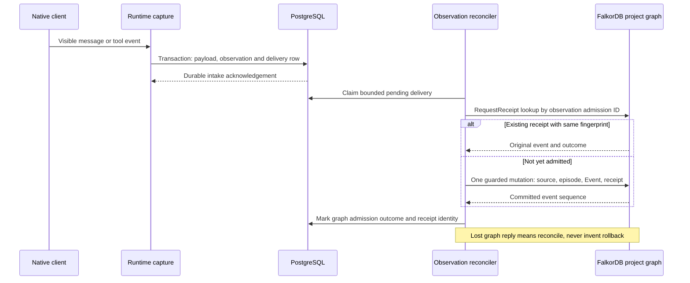
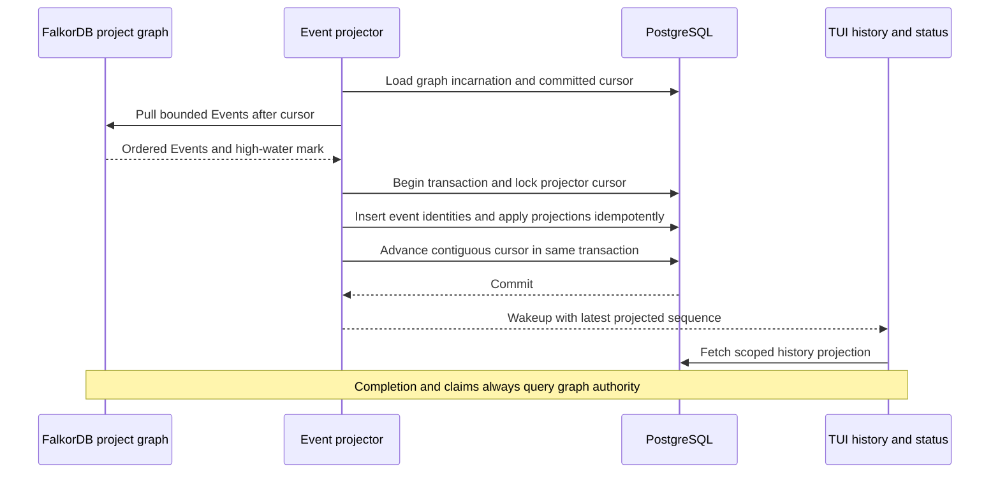

# Threadline storage and reconciliation evidence

**MVP authority — 15 October 2026:** [Development blueprint](track2-development-blueprint.md) controls release scope: two contributors, one logical Builder and fresh successor, a protected service checker, eleven tools and no automatic model summaries. This document retains broader target/reference contracts; model Verifier, polling, native adapters and fixed four-day schedules are not MVP commitments.

> **Scope update:** The user subsequently selected a compact Threadline-owned harness. Recommendations below about starting with native execution describe the earlier research baseline; [the final harness scope](track2-harness-scope.md) takes precedence. The cited authentication, storage and protocol evidence remains applicable.

**Evidence checked: 13 October 2026. Status: architecture research and proposed contracts; no database, migration, adapter or recovery experiment was executed.** This note supports the final architecture. It follows the current local npm/TUI recommendation after reading README's four starting documents and all remaining notes. Earlier browser/SDK delivery descriptions remain historical context.

## 1. Decision and authority boundary

Choose **PostgreSQL 18 for the relational implementation** and **one FalkorDB graph per `(tenant, project)` for domain authority**. MySQL 8.4 is an explicitly specified future persistence adapter, requiring its own migrations and tests. Do not ship PostgreSQL and MySQL simultaneously or claim that a connection-string change makes the two interchangeable.

Adding SQL is a new design decision requested by the final architecture brief. Earlier notes say that FalkorDB and immutable files suffice. The addition is justified by identity, authenticated user sessions, runtime capture, provider configuration metadata and efficiently pageable history. It must not introduce another authoritative task state machine.

| Record class | Authoritative home | Other-store representation |
| --- | --- | --- |
| Users, identities, tenants, membership, authenticated `user_sessions`, device registration | PostgreSQL | Opaque actor references on graph events; no copied authentication credentials |
| Project/workspace registration and trusted graph routing | PostgreSQL | Project control node includes matching opaque project identity and graph incarnation |
| Goals, criteria, constraints, accepted decisions, tasks, revisions, claims/fences, handoffs, spawn/budget admission, applicability, receipts | FalkorDB | Optional query projection with explicit source event/sequence; never write task authority from a SQL view |
| Runtime sessions, native session handles, capture offsets, provider route metadata, observed process status | PostgreSQL | Graph `Session` anchor and links to the corresponding task, context, messages and attempts |
| Captured visible message/tool payloads | PostgreSQL or immutable artifact payload | Graph `Message`/`Source` anchor with immutable digest, sequence, visibility and evidence relationships |
| Findings, episodes, procedures and verification evidence relationships | FalkorDB | SQL history projection may display the committed result |
| Ordered domain Events and idempotent RequestReceipts | FalkorDB | Replayable SQL projections, each pinned to graph incarnation and sequence |
| Raw observation intake awaiting graph admission | PostgreSQL | Accepted observations become graph evidence through an idempotent bridge |
| Files, candidate snapshots, patches, large logs | Registered filesystem/artifact store | SQL metadata and graph provenance references; neither a digest nor a path contains the file |
| Native-client subscription credentials | Official native client's credential store | Only route/capability/connection metadata; no extracted tokens |
| API-key credentials for an explicit provider route | OS secret storage or a deliberately configured secret reference | Reference and nonsecret metadata only |

The graph's `Session` describes participation in the memory and coordination model. SQL `runtime_sessions` describes observable execution and capture. SQL `user_sessions` describes access to Threadline. A task lease, user login session, native conversation and provider credential are four different lifecycles.

The graph remains essential because current task closure, applicability, selective invalidation, claim ownership, child admission and evidence-backed completion all consult it. An SQL cache may render previously captured history during an outage with its freshness label. It cannot authorize new work or claim completion.

## 2. Verified FalkorDB capabilities and design consequences

### 2.1 Atomicity and concurrency

Current official documentation specifies atomic individual modifying queries, consistent committed snapshots for reads, and serialized writers within a graph. Parallel clients therefore do not imply parallel same-graph mutations. A single statement may update state and create associated records atomically. [FalkorDB concurrency](https://docs.falkordb.com/design/concurrency)

The audited `v6.0.2` implementation uses an MVCC committed graph and a copy-on-write writer version. Its dispatcher maintains a write queue; writer-slot contention can be retryable. Source inspection establishes the implementation path, not correctness under our eventual workload. [Tagged MVCC source](https://github.com/FalkorDB/FalkorDB/blob/v6.0.2/graph/src/graph/mvcc_graph.rs), [tagged execution source](https://github.com/FalkorDB/FalkorDB/blob/v6.0.2/src/graph_core.rs)

**Proposed invariant:** one guarded graph statement checks expected revision, current owner/fence, project/run scope and applicable evidence, then commits the new immutable state, current-state pointer, Event, project sequence and RequestReceipt. A zero-row conditional update is a conflict. Guard checks performed only before the mutation in application code are insufficient against concurrent requests.

Do not use `MULTI/EXEC` as rollback across independent graph queries. Redis explicitly retains successful commands when another queued command fails during execution. This contradicts the overly broad multi-query all-or-fail wording in FalkorDB's concurrency page. [Redis transaction error semantics](https://redis.io/docs/latest/develop/using-commands/transactions/)

The `GRAPH.QUERY version` argument concerns client schema mapping consistency. It is not the business revision of a task. Use explicit application revisions and monotonically increasing ownership fences. [GRAPH.QUERY reference](https://docs.falkordb.com/commands/graph.query/)

### 2.2 Timeouts and unknown outcomes

In the inspected `v6.0.2` `compute_effective_timeout` implementation, per-query timeouts are applied to reads and ignored for writes; default/global timeout handling is separate. Writer-slot acquisition can also return a retryable contention error. A disconnected client cannot infer that its write was rolled back. [Pinned implementation](https://github.com/FalkorDB/FalkorDB/blob/v6.0.2/src/graph_core.rs)

**Proposed response:** classify lost acknowledgements as `OUTCOME_UNKNOWN`. Read the original RequestReceipt using the same request identity and payload digest before resubmission. Retry transient admission/connection failures boundedly; reconcile stale revisions rather than repeatedly submitting them. A timeout must not cause another shell command, model turn or worker launch automatically.

### 2.3 Identity, properties and indexes

Mandatory and unique graph constraints are documented. Uniqueness needs a supporting index and is enforced only where all indexed properties exist; array properties are excluded. Constraint creation is asynchronous and can fail. Readiness must wait for `OPERATIONAL`, not just successful submission. [Constraint reference](https://docs.falkordb.com/commands/graph.constraint-create)

**Proposed minimum identity rules:** every persistent domain node gets an opaque application ID and schema version; Event has a unique project sequence; RequestReceipt has a unique application request ID and immutable request fingerprint; session messages have unique `(session_id, source_event_id)` where the adapter provides a stable source identity. Do not expose engine-generated node IDs as the public API identity. Canonicalize and bound every identifier before graph routing.

FalkorDB supports scalar and permitted list properties; arbitrary maps are not stored as property values. Relationship-rich fields should become explicit nodes/edges. A serialized payload string is suitable only for bounded opaque data that is not used for traversal. [Data types](https://docs.falkordb.com/datatypes)

Use indexed IDs and bounded relationship traversal for required context. Lexical/vector recall is optional and must pass scope/applicability checks after seeding. Do not make mandatory constraints depend on approximate similarity. `RETURN ... LIMIT` is not a mutation limit: the documented eager-write behavior can apply writes before limiting returned rows. [Known limitations](https://docs.falkordb.com/cypher/known-limitations)

### 2.4 Access and durability

FalkorDB ACLs can restrict commands and graph key patterns. They do not express per-message or per-node visibility inside a shared project graph. Derive graph keys from trusted SQL identity and project registration, then apply source authorization before traversal results, quotations or artifact fetches reach an agent. [ACL reference](https://docs.falkordb.com/commands/acl)

Persistence options include RDB and AOF. RDB loses changes after its latest saved snapshot; AOF loss/performance depends on fsync policy. A volume preserves files across container replacement, while configuration controls when writes reach those files. Explicitly choose and inspect the actual data directory. [Durability guide](https://docs.falkordb.com/operations/durability/), [persistence configuration](https://docs.falkordb.com/operations/durability/persistence)

**Proposed default:** AOF enabled, `appendfsync always` evaluated first for the small correctness-focused demonstration, no cache eviction policy for authoritative graphs, explicit persistent volume and backup policy. Measure the throughput cost. Neither this setting nor a graceful restart proves zero loss for every power/storage failure.

## 3. PostgreSQL design constraints

### 3.1 Schema discipline

Use relational constraints for identity and scope: every tenant-owned record has `tenant_id`; project-owned records also have `project_id`; references use composite scope-aware keys. For example, a message referencing `(tenant_id, project_id, runtime_session_id)` must reference a session under the same scope. UUIDs alone do not document that invariant. PostgreSQL supports multicolumn foreign keys; row-local `CHECK` constraints cannot guarantee facts about other rows. [PostgreSQL 18 constraints](https://www.postgresql.org/docs/18/ddl-constraints.html)

Recommended schema conventions are application choices:

- Generate opaque IDs in the coordinator so they are stable across SQL, graph and retry records.
- Store UTC `timestamptz` instants and separate observed time from ingestion time.
- Store 64-bit sequences as decimal strings at JavaScript/JSON boundaries unless a verified codec preserves them; JavaScript number precision must not silently reorder long histories.
- Keep status vocabulary in checked strings for portable migrations; state transitions remain service logic.
- Keep raw adapter-specific metadata in bounded `jsonb`; frequently queried identity, scope, status, ordering and digest fields are typed columns.
- Preserve an immutable digest for accepted observation payloads; duplicate identity with different bytes is an integrity error.
- Represent graph references as explicit external IDs, not imaginary SQL foreign keys into FalkorDB.
- Avoid automatic destructive cascades across long-lived evidence. Use tombstones and a deliberate deletion workflow where needed.

PostgreSQL `jsonb` permits efficient processing and indexing but does not preserve the original textual formatting or key order of JSON input. Keep original bytes separately when their precise representation is part of evidence; hash the declared canonical or original representation consistently. [PostgreSQL JSON types](https://www.postgresql.org/docs/18/datatype-json.html)

### 3.2 Authentication sessions and RLS

`user_sessions` should contain a session ID, user/tenant context, a **hash of the bearer token**, creation/expiry/revocation timestamps and metadata needed for session management. The opaque secret is shown only when issued and kept outside transcript/graph records. Authentication session renewal must not implicitly renew a task lease or native provider authorization. A local development profile is still a principal; switching a display name is not authentication.

PostgreSQL row security is default-deny when enabled without applicable policies. Superusers and `BYPASSRLS` roles bypass it; table owners normally do too unless forced. `USING` and `WITH CHECK` apply to distinct read/write cases, and referential-integrity checks are not constrained in the same way as ordinary row access. [PostgreSQL row security](https://www.postgresql.org/docs/18/ddl-rowsecurity.html)

**Proposed implementation rules:**

1. Migrations run as a schema-owner role. Normal requests run as a non-owner, non-superuser role without `BYPASSRLS`.
2. Tenant-owned tables enable and force RLS. Define both row visibility and permitted new-row scope.
3. Begin a transaction, set trusted tenant and user settings locally, perform scoped queries, and release only after commit/rollback. Never keep a tenant setting on a reusable connection outside its transaction.
4. Treat those settings as application-supplied security context; an arbitrary SQL interface would let a caller supply its own context. Agents receive typed tools, never SQL access.
5. Project membership and per-source visibility checks remain application policy. A tenant filter alone gives all tenant members too much access to private sources.
6. Session-token lookup before identity is known uses a narrow authentication repository/function and grants; do not solve bootstrap by making every business query privileged.
7. The background projector uses its own narrowly granted role or iterates explicit trusted project scopes. It must not become the ordinary request role.

This is defense in depth, not a claim that RLS alone replaces authenticated membership and source policy. Test direct row access, joins, update/insert, session revocation, pooled connection reuse and colliding cross-tenant identifiers.

### 3.3 Transactions, replay and wakeups

PostgreSQL defaults to Read Committed, with a fresh snapshot for each statement. Serializable transactions can raise serialization failures and must be retried as whole transactions. Do not assume that a sequence of reads at the default isolation level is one fixed snapshot. [Transaction isolation](https://www.postgresql.org/docs/18/transaction-iso.html)

`INSERT ... ON CONFLICT` supports unique-key conflict handling. For immutable capture, an idempotency conflict must still compare the existing payload digest; silently keeping the first row without checking different retry content hides corruption. [INSERT reference](https://www.postgresql.org/docs/18/sql-insert.html)

`NOTIFY` is transactional signaling with bounded payloads; delivery is deferred until commit and repeated equal notifications in a transaction may be folded. Use it only to wake a poller. Recovery comes from durable rows and cursors, not a listener connection or notification count. [NOTIFY reference](https://www.postgresql.org/docs/18/sql-notify.html)

Keep `fsync`, `full_page_writes` and synchronous commit configured deliberately. PostgreSQL documents weaker acknowledgement guarantees for asynchronous commit and significant durability consequences when fsync is disabled. Record effective values in readiness diagnostics; a Docker volume does not override them. [WAL settings](https://www.postgresql.org/docs/18/runtime-config-wal.html)

## 4. Two durable bridges, no distributed transaction

The following protocols are proposed Threadline behavior. Neither database supplies a transaction spanning SQL, FalkorDB, filesystem artifacts and a native process. Each bridge has an immutable source, a stable replay key, a receipt and a restart strategy. Do not run both directions as uncontrolled replication of the same state.

### 4.1 Runtime observation to graph memory

1. The adapter normalizes an observed native event, retaining raw source IDs and capture capability/version. Capture does not wait for a model-generated summary.
2. Store large payloads in the artifact store using write-to-temporary, durability checks and final atomic rename before recording their immutable digest/locator. A failed SQL insert leaves an orphan eligible for later garbage collection, not a dangling committed reference.
3. In one SQL transaction, insert the observation and its pending admission record. Assign a stable capture identity before acknowledgement. If the provider event has no stable identity, use a persisted adapter sequence and visibly record that replay reconciliation cannot guarantee full source deduplication.
4. Intake acknowledges **captured**, never **accepted memory** or **task completed**. Preserve provider event order separately from local receipt order; missing ranges remain capture gaps.
5. The reconciler submits an immutable normalized envelope through the domain API. Its stable admission request ID and fingerprint identify retries. It may append historical observations without granting current ownership to their producing worker.
6. One graph mutation commits admitted source/episode links, Event and receipt. Turning an agent's interpretation into an accepted decision is a separate policy-checked operation. Late obsolete work can remain history while being ineligible for current completion.
7. Update SQL with the graph receipt only after confirming the result. A crash between graph commit and SQL update is recovered by receipt lookup. A duplicate request with a different fingerprint is rejected and investigated.
8. A durable rejection records a typed reason. Dependency-not-yet-present is retryable; unauthorized or invalid immutable payloads are quarantined. Do not advance an ordered watermark past unresolved earlier observations unless the protocol explicitly records a terminal gap/rejection.

The source row must remain available until admission is terminal and retention policy allows deletion. A local transient in-memory queue is not sufficient. If SQL fails, stop new guarded work; a bounded fsynced emergency spool may preserve already-arriving native events, but it is not another domain authority. If no durable capture path remains, stop/reconcile the native session and expose the gap.

### 4.2 Graph Events to SQL query projections

1. The graph Event stream is the domain outbox. A projection is derived; it never republishes an equivalent domain transition back into the graph.
2. Scope event identity by `(tenant_id, project_id, graph_incarnation, event_id)` and sequence by `(project_id, graph_incarnation, event_seq)`. A restored/recreated graph must not collide silently with an older timeline.
3. Use a bounded ordered fetch and one SQL transaction to apply the batch and advance its cursor. Unique event identities make redelivery harmless. Store the source digest/version to detect incompatible duplicate content.
4. Use the highest **contiguous successfully applied** sequence, not the largest received number. On an unknown event schema, stop that projector and expose the blocked version; do not skip it silently.
5. If the graph commit succeeds while SQL is down, domain truth remains committed. The command returns its graph receipt where available; the TUI labels history lag until replay catches up. Restarting the projector must not rerun the original command.
6. A SQL projection may render task status with `projected_through_seq` and lag. All task mutation preconditions re-read authoritative graph state.
7. If events are pruned, preserve a supported snapshot/export and its exact sequence. Rebuild from that snapshot plus later events; do not assert that current graph nodes alone recreate deleted history.
8. Restoring only one database may move their timelines apart. Compare incarnation, graph high-water mark, projector cursor and backup manifest before workers resume. A cursor ahead of the restored graph is a recovery inconsistency, not evidence that the graph should be recreated from SQL UI rows.

### 4.3 Cursor meanings must stay separate

| Position | Meaning | Does not prove |
| --- | --- | --- |
| Native capture offset | Adapter has durably captured a source event range | Every native event was observable |
| Observation admission status | Captured observation has a graph receipt or terminal rejection | Its interpretation is accepted semantic truth |
| SQL projector cursor | Domain Events through this sequence are reflected in the SQL view | Any agent received the change |
| Worker delivery cursor | A worker has received a bounded update | Update was inserted into the active model turn |
| Context insertion acknowledgement | Adapter confirms packet/revision supplied at supported boundary | Correct model understanding or behavior |
| Verification receipt | Named checks ran on an exact artifact/environment/criterion version | Later artifacts still pass |

### 4.4 Failure outcomes

| Failure boundary | Persisted evidence | Required action |
| --- | --- | --- |
| Native process exits before final result | Partial observations, process exit and last capture position | Mark interrupted/unknown effects; inspect artifacts before retry |
| Artifact exists, SQL intake fails | Unreferenced immutable file | Retry stable intake or garbage collect after grace period |
| SQL intake commits, graph unavailable | Pending admission row | Pause graph-dependent work and retry admission boundedly |
| Graph commit succeeds, reply lost | Graph RequestReceipt/Event | Read receipt; do not create another domain event |
| Graph commits, SQL projector fails | Graph Event stream | Replay projections from committed SQL cursor |
| SQL projection commits, wakeup lost | Projection rows and cursor | TUI reconnect/poll; notification is expendable |
| Old worker submits after requirement change | Historical receipt/source remains inspectable | Retain observation but reject current completion |
| SQL is restored from older backup | Graph may contain later references | Restore matching payloads or mark missing evidence; rebuild derived projections |
| Graph is restored from older backup | SQL may have newer observations/projections | Fence workers, validate backup manifest, reset/rebuild projections explicitly and reconcile pending observation admission |

## 5. MySQL 8.4 portability contract

PostgreSQL is the implementation target. MySQL support is a future adapter over the same typed persistence interface, with dedicated migrations and integration tests. The graph/domain protocol stays the same.

| Concern | PostgreSQL target | MySQL 8.4 adaptation |
| --- | --- | --- |
| Storage engine | Normal PostgreSQL tables | InnoDB required for transactional capture and projection |
| ID representation | Native UUID | Canonical binary or string encoding chosen once and tested |
| Time | `timestamptz`, UTC at transport | UTC `DATETIME(6)` convention with explicit conversion |
| Structured metadata | `jsonb` | `JSON`; port indexed paths/query operators explicitly |
| Scope enforcement | Composite scoped FKs plus application policy and RLS | Composite scoped FKs plus mandatory application filtering and narrowly granted repositories/views |
| Immutable insert retry | `ON CONFLICT` with digest comparison | Duplicate-key handling followed by identical digest validation |
| Queue claiming | Bounded SQL transaction; optional `SKIP LOCKED` | InnoDB locking read in an explicit transaction; same lease/retry semantics |
| Status uniqueness | Partial indexes where chosen | Portable explicit active-slot rows or tested generated-column design |
| Event wakeups | Polling; optional `NOTIFY` hint | Polling or in-process hint; durable rows remain the source |
| Migration behavior | PostgreSQL migration implementation | MySQL-specific DDL, rollback/recovery and collation tests |
| Full-text history search | Optional PostgreSQL-specific implementation | Optional separate MySQL implementation; not part of domain correctness |

MySQL's native JSON type validates documents, stores them in an internal representation, and commonly indexes extracted scalar values through generated columns rather than indexing an entire JSON document directly. PostgreSQL `jsonb` indexes and operators are not portable SQL. [MySQL JSON](https://dev.mysql.com/doc/refman/8.4/en/json.html)

MySQL documents `FOR UPDATE`/`FOR SHARE` with `NOWAIT` and `SKIP LOCKED`. Skipped rows give an inconsistent overall view, suitable for queue-like work claiming rather than correctness-sensitive aggregate state. Keep task ownership in the graph regardless of SQL queue implementation. [InnoDB locking reads](https://dev.mysql.com/doc/refman/8.4/en/innodb-locking-reads.html)

MySQL's privilege model operates at scopes such as global, database, table and column. This plan does not claim PostgreSQL RLS policy equivalence. A MySQL adapter requires independently tested source/tenant authorization and cannot inherit the PostgreSQL RLS guarantee merely by sharing an ORM. [MySQL privileges](https://dev.mysql.com/doc/refman/8.4/en/privileges-provided.html)

MySQL 8.4 has enforced `CHECK` constraints and duplicate-key update syntax, but SQL modes and constraint handling must be deliberate. Do not use `INSERT IGNORE` to make evidence errors disappear, and do not overwrite an immutable payload in a duplicate-key update. Choose strict mode, explicit collations and stable string normalization. [CHECK constraints](https://dev.mysql.com/doc/refman/8.4/en/create-table-check-constraints.html), [duplicate-key updates](https://dev.mysql.com/doc/refman/8.4/en/insert-on-duplicate.html), [constraint behavior](https://dev.mysql.com/doc/refman/8.4/en/constraints.html)

Portability acceptance means the same capture, idempotency, projection replay, scope denial, session expiry/revocation and crash tests pass against both adapters. It does not mean identical query plans or throughput. MySQL need not be implemented during the four-day MVP to be covered by the final architecture.

## 6. Backup, retention and migration design

These are application proposals:

- Pin engine images, official client, SQL driver, schema versions and artifact format in a release manifest. Do not resolve `latest` during a reproducibility test.
- Store separate graph schema, SQL schema and event-envelope versions. Changes to projection code may require replay without changing graph semantics.
- Stop admitting guarded mutations during a maintenance backup, drain observation admission/projection, record per-project sequence/cursors, flush declared database persistence and include immutable artifact manifests. A coordinated backup procedure is simpler for the first local release than live cross-store snapshots.
- Retain opaque IDs and graph incarnations in the backup manifest. Restores run with worker execution disabled until consistency and missing-artifact checks pass.
- Preserve native credential stores independently; never add subscription tokens to a portable project export.
- Default retention must preserve demonstration evidence through judging. Production retention is a later configurable policy, applied coherently to payloads, graph references and SQL projections.
- Message deletion creates a source tombstone and invalidates or hides dependent references before physical removal. Deleting only the SQL payload leaves graph evidence unusable and may violate citation privacy.
- Artifact garbage collection must account for both graph and SQL references and pending intake. A grace period protects crash-created temporary/orphan files from premature deletion.
- Memory expiry is an application field/filter; a whole-graph Redis key expiry is not per-node retention.

## 7. Required storage and integration probes

All items below are **planned acceptance gates**, not completed checks.

1. Pin server/client versions, inspect effective data directories, AOF/WAL settings and schema readiness, then persist one complete observation-to-receipt chain.
2. Race two claims and two identical RequestReceipts; exactly one state transition should be accepted, with both identical retries resolving to its receipt. Reuse the request ID with different content and require an integrity rejection.
3. Inject a failure after each boundary of both bridge protocols. Verify no missing committed transition, duplicate accepted episode or cursor advancement past failed work.
4. Interrupt a write reply and confirm receipt reconciliation. Independently test server write timeout behavior; do not extrapolate read timeout handling.
5. Force capture gaps and out-of-order native events. Verify history displays gaps and freshness checks do not claim that all prior events were observed.
6. Restart SQL, graph, coordinator and runtime independently, then restore a matching backup set. Validate source digests and projection watermarks before enabling workers.
7. Test two tenants and two users inside one tenant with colliding IDs, private messages and inaccessible artifact citations. Exercise pooled connection reuse to catch retained RLS context.
8. Change a requirement and artifact after a passing receipt. The affected context is refreshed and old completion rejected; unrelated current evidence remains inspectable.
9. Run 4/8/16 protocol clients with read-heavy, balanced and burst mixes against one graph and separate projects. Record request mix, versions, persistence configuration, data size, queue delay, p50/p95, conflicts/retries and invariant failures. Label simulations separately from actual model workers.
10. Rebuild SQL domain projections from graph Events and verify equality of projected identities/status. This test does not assert that graph Events can reconstruct uncaptured messages or missing artifact bytes.
11. Exercise unknown event-schema handling and migration interruption. A failed migration/projector must fail readiness visibly rather than letting current workers operate with partial constraints.
12. Measure SQL/graph capture overhead separately from model inference and native tool execution. No latency guarantee follows from these design choices.

## 8. Historical conflicts resolved for the final plan

| Earlier position | Where it appears | Final integration resolution |
| --- | --- | --- |
| Browser or Railway is primary; avoid a TUI | Core contract, delivery feasibility, presentation, Railway and user-experience notes | Current local npm/TUI decision governs. Railway is an optional later read-only viewer or remote topology. |
| Independent SDK runtime first; native adapters secondary | Core contract, agent tools, browser delivery notes | Native runtime first; one tested adapter required, second gated. Retain custom repository-tool contracts only for an explicit future API runtime. |
| No relational database needed | Core contract and Railway topology | SQL is an explicit final-design addition for requested user/session/capture concerns; graph retains domain authority. |
| Full messages only in graph | Packaging/requirements notes | Preserve durable graph Session/Message anchors, provenance and relevance links; SQL/artifact payload storage carries bulk history with digests and authorization. This is a deliberate refinement. |
| Two native adapters and cross-provider takeover mandatory | Earlier packaging/portability notes | One dependable native adapter is the release gate; cross-provider claims require the second adapter's actual tests. |
| 32 concurrent clients required | Portable core and packaging review | Use consolidated 4/8/16 protocol probes; 32 is optional extra capacity evidence. |
| Private scratch needs a separate graph | Early continuity note | Private capture belongs under explicit SQL/source visibility or remains local. Publication to a project graph is a deliberate sourced operation; sharing never exposes the full scratch transcript automatically. |
| Curator agent builds continuity packet | Early social-signals proposal | Deterministic bounded context selector owns required authority. Agent interpretation may propose optional semantic records. |
| Generic MCP supplies lifecycle and spawning | Potential reading of early package sketches | MCP tools are one access surface. Capture, fresh-session insertion, interruption and process launch require tested native adapters. |
| Lease/fence prevents stale native edits | Potential overreading of graph claims | Fences protect guarded operations. Worktree isolation, confirmed termination and candidate digests handle external file effects. |
| Notification/ACK means useful shared memory | Potential overreading of delivery sketches | Track committed, delivered and inserted separately; observable behavior and current tests establish usefulness. |

## 9. Repository review coverage

The four README starting documents were read first: package/requirements decision, local TUI decision, Codex native-subscription adapter, and Claude native-subscription adapter. All remaining notes were reviewed: architecture core contract; continuity; swarm memory reliability; technical dossier; agentic RAG evaluation; investigation/product scope; capability map; tool/execution plan; portable core/team plan; portability adapters; bounded spawning; Railway; delivery feasibility; user experience; presentation/team decision; packaging review; harness alternatives; and context social signals.

The repeated consistent obligations are source-bound evidence, fresh rather than resumed continuation, no hidden-reasoning capture, recorded uncertainty, revision-checked completion, mandatory context before optional recall, one coding writer, graph-derived applicability and fair equal-information file/JSON baselines. The final plan should retain these even when adding SQL or expanding provider portability.
